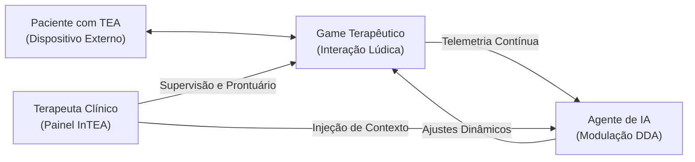

# Contextualização e Problemática Clínica — InTEA

> **Projeto:** InTEA — Interface do Terapeuta para Orquestração do Ecossistema de Games Terapêuticos  
> **Instituição:** Sistemas de Informação — Universidade Federal do Piauí (UFPI)  
> **Documento Mestre:** [Projeto_de_InTEA.pdf](file:///c:/Users/MWSS/OneDrive/Desktop/InTEA/docs/Projeto_de_InTEA.pdf)  
> **Hub de Navegação:** [Índice Geral](file:///c:/Users/MWSS/OneDrive/Desktop/InTEA/docs/README.md)

---

## 1. Contextualização: O Transtorno do Espectro Autista (TEA) e a Gamificação

O uso da tecnologia como ferramenta de apoio terapêutico para indivíduos com Transtorno do Espectro Autista (TEA) tem apresentado significativa expansão nos últimos anos. Destacam-se, nesse cenário, os **jogos digitais terapêuticos**, que integram o engajamento lúdico a objetivos clínicos específicos, tais como:
* O desenvolvimento e mediação da linguagem funcional;
* A autorregulação emocional e comportamental;
* O aprimoramento da tolerância a estímulos sensoriais;
* O treino de funções executivas (atenção sustentada, flexibilidade cognitiva e tempo de reação).

Quando adequadamente instrumentados e calibrados, esses jogos geram um volume contínuo e expressivo de dados comportamentais em tempo real, capazes de viabilizar o **Ajuste Dinâmico de Dificuldade (*Dynamic Difficulty Adjustment* — DDA)** do próprio jogo de forma contínua, responsiva e personalizada.

---

## 2. A Problemática Operacional e Clínica

Apesar dos benefícios comprovados da gamificação, a sua aplicação na rotina clínica de psicologia, fonoaudiologia e terapia ocupacional frequentemente esbarra em quatro desafios operacionais crônicos:

### 2.1. Sobrecarga Cognitiva Extrema do Terapeuta
Durante uma sessão de intervenção com uma criança no espectro, o terapeuta é submetido a uma sobrecarga cognitiva severa: precisa manter o acolhimento afetivo e a escuta terapêutica humana enquanto simultaneamente tenta anotar à mão ou tabular métricas comportamentais (tempo de resposta, taxa de erros, sinais de desregulação sensorial). Esse acúmulo de demandas compromete a atenção clínica direta e introduz imprecisões no registro dos dados.

### 2.2. Heterogeneidade e Fragmentação das Métricas
Cada jogo comercial ou terapêutico adota representações próprias para seus dados (valores contínuos em segundos, pontuações inteiras, estados categóricos ou booleanos). A ausência de um padrão unificado faz com que os dados fiquem isolados nos próprios dispositivos, impossibilitando a consolidação de gráficos evolutivos e a análise comparativa longitudinal entre diferentes jogos.

### 2.3. Inicialização a Frio (*Cold-Start*) sem Contexto Clínico Prévio
Para que motores de inteligência artificial modulem a dificuldade de forma segura desde o primeiro segundo de interação, é indispensável que o sistema conheça o estado basal da criança (nível de estresse no dia, gatilhos auditivos/visuais a evitar e objetivo terapêutico da sessão). Sem uma interface para envio desse contexto pré-sessão, o jogo inicia de forma cega ou aplica dificuldades genéricas que podem desregular a criança.

### 2.4. Gestão Multidisciplinar e Falta de Rastreabilidade
Em clínicas especializadas, o acompanhamento do paciente é multidisciplinar: um psicólogo, um terapeuta ocupacional e um fonoaudiólogo compartilham o mesmo caso. Sistemas tradicionais ou jogos isolados não fornecem rastreabilidade de autoria por sessão nem mecanismos de controle institucional, ferindo normas éticas de saúde e privacidade.

---

## 3. A Proposta de Solução: O InTEA

Diante do cenário exposto, este projeto delimita o escopo ao desenvolvimento do **InTEA (Interface do Terapeuta)**, um módulo web e API centralizados concebidos para governar, orquestrar e conectar todo o ecossistema terapêutico:

1. **Gestão de Perfil e Autenticação Segura:** Controle de acesso hierarquizado baseado em tokens JWT e isolamento multi-tenant por clínica (**RF01 a RF05**, **RN04**).
2. **Biblioteca de Jogos e Leitura de Manifestos:** Catálogo padronizado de jogos terapêuticos integrados, com validação estrita de metadados clínicos e tipagem de métricas (**RF09**, **RN02**).
3. **Orquestração de Sessões e Pareamento Remoto:** Geração de `session_token` temporário (PIN de 15 minutos) que conecta o tablet externo do paciente sem exigir que a criança faça login (**RF10**, **RF12**, **RF13**).
4. **Modo Livre com Trava de Segurança:** Suporte à execução recreativa sem gravação em prontuário, preservando o histórico clínico oficial (**RF11**, **RN01**).
5. **Injeção de Contexto Pré-Sessão para DDA:** Formulário clínico para informar nível de estresse, gatilhos a suprimir e objetivos antes do início dos estímulos (**RF17**, **RN03**).
6. **Cockpit em Tempo Real e Recepção de Resultados:** Visualização em streaming da sessão e consolidação automática de relatórios analíticos gerados pela IA (**RF14**, **Contrato 4**).
7. **Prontuário Longitudinal e Anotações Clínicas:** Histórico evolutivo com normalização relacional em 3ª Forma Normal (3FN), autoria médica obrigatória e bloqueio de exclusão física (**RF15**, **RF16**, **RF21**, **RN05**).

---

## 4. Evidências Visuais e Interfaces de Referência

O ecossistema InTEA foi projetado com base em interfaces clínicas focadas em usabilidade, ergonomia visual e clareza de dados:

* `[Imagem 8: Tela Principal / Dashboard]` — Visão consolidada da rotina clínica, contadores de sessões realizadas e atalhos operacionais rápidos.
* `[Imagem 11: Tela de Configuração de Sessão]` — Modal parametrizável para seleção de objetivos clínicos, injeção de gatilhos pré-sessão e emissão do PIN de pareamento remoto.
* `[Imagem 12: Tela de Emissão do Relatório de Sessão]` — Apresentação consolidada de indicadores de desempenho, métricas de engajamento e parecer automatizado do Agente de IA.
