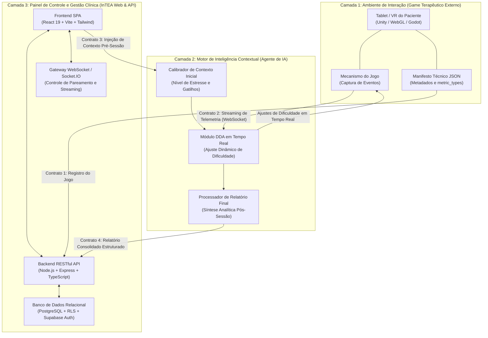

# Arquitetura Macro do Ecossistema InTEA

> **Projeto:** InTEA — Interface do Terapeuta para Orquestração do Ecossistema de Games Terapêuticos  
> **Instituição:** Sistemas de Informação — Universidade Federal do Piauí (UFPI)  
> **Documento Mestre:** [Projeto_de_InTEA.pdf](file:///c:/Users/MWSS/OneDrive/Desktop/InTEA/docs/Projeto_de_InTEA.pdf)  
> **Hub de Navegação:** [Índice Geral](file:///c:/Users/MWSS/OneDrive/Desktop/InTEA/docs/README.md)

---

## 1. Visão Geral das Três Camadas do Ecossistema

O ecossistema tecnológico do InTEA foi concebido sob o princípio de **desacoplamento estrito em três camadas interdependentes**, garantindo escalabilidade, interoperabilidade entre diferentes jogos e isolamento entre as regras clínicas, a execução lúdica e a inteligência analítica:

---

## 2. Detalhamento e Responsabilidades por Camada

### 2.1. Camada 1: Ambiente de Interação (Game Terapêutico Externo)
* **Dispositivos:** Tablets (iOS/Android), telas sensíveis ao toque ou dispositivos de Realidade Virtual (VR) manuseados exclusivamente pelo paciente.
* **Características Operacionais:**
  * Não exige login, autenticação nem armazenamento de credenciais do paciente. A vinculação à sessão é realizada exclusivamente via `session_token` efêmero (**RF10**).
  * Possui um **Manifesto Técnico em JSON** (**Contrato 1**) declarando suas métricas (`metric_type`), objetivos clínicos e versões compatíveis.
  * Captura eventos de interação (toques, tempo de resposta, acertos, erros, pausas) e transmite pacotes de telemetria contínua via WebSocket (**RNF01**).
  * Executa os ajustes dinâmicos enviados pelo Agente de IA (alteração de velocidade, simplificação visual, supressão de estímulos sonoros).

### 2.2. Camada 2: Motor de Inteligência Contextual (Agente de IA)
* **Função Principal:** Processamento inteligente em tempo real e análise longitudinal do comportamento do paciente.
* **Componentes Centrais:**
  * **Calibrador Pré-Sessão:** Recebe o contexto fornecido pelo terapeuta no InTEA antes do primeiro estímulo (**RN03**, **Contrato 3**), estabelecendo o limiar basal de tolerância sensorial e cognitiva.
  * **Motor DDA (*Dynamic Difficulty Adjustment*):** Algoritmo adaptativo que consome a telemetria em streaming e devolve comandos de modulação de dificuldade ao jogo, evitando tanto o tédio quanto a frustração/crise sensorial.
  * **Sintetizador Analítico:** Ao final da sessão, agrega as métricas temporais, calcula dispersões e gera o parecer clínico automatizado (**Contrato 4**).

### 2.3. Camada 3: InTEA (Painel Web e API — Nosso Escopo Principal)
* **Função Principal:** Ponto único de entrada, supervisão, governança e tomada de decisão do profissional de saúde.
* **Componentes Centrais:**
  * **Interface Web SPA:** Desenvolvida em React 19, TypeScript e Tailwind CSS, proporcionando dashboards ergonômicos, catálogo de jogos, cockpit de sessão ativa e visualização de prontuários com gráficos dinâmicos.
  * **Backend API RESTful:** Construído em Node.js e Express sob Clean Architecture (Controller $\rightarrow$ Service $\rightarrow$ Model), garantindo validação estrita de esquemas e proteção contra enumeração IDOR.
  * **Gateway WebSocket (Socket.IO):** Gerencia as salas efêmeras de sessão (`/sessao/{session_token}`), o handshake de pareamento remoto, a tolerância a quedas transitórias (60s) e a notificação de eventos em tempo real.
  * **Camada de Persistência (Supabase/PostgreSQL):** Esquema relacional estruturado em 3ª Forma Normal (3FN), com Row Level Security (RLS), chaves primárias e estrangeiras exclusivamente em UUID, soft delete clínico imutável (**RN05**) e isolamento multi-tenant por clínica (**RN04**).

---

## 3. Matriz dos 4 Contratos de Integração do Ecossistema

Toda a interação entre as 3 camadas é regida por contratos JSON estritos e versionados (**RNF02**):

| Contrato | Nome do Contrato | Emissor $\rightarrow$ Receptor | Canal / Protocolo | Finalidade Clínica e Técnica |
| :---: | :--- | :---: | :---: | :--- |
| **Contrato 1** | **Manifesto do Jogo** | Game Externo $\rightarrow$ InTEA Backend | HTTP REST (`GET /api/jogos/:id`) | Registra o jogo, catálogo de objetivos e declara os `tipo_metrica` obrigatórios (**RN02**). |
| **Contrato 2** | **Telemetria Contínua** | Game Externo $\rightarrow$ Agente IA / Backend | WebSocket / Socket.IO | Envio em alta frequência de eventos comportamentais e métricas atômicas da sessão. |
| **Contrato 3** | **Contexto Pré-Sessão** | InTEA Backend $\rightarrow$ Agente IA | HTTP REST / Evento WebSocket | Envio antecipado de nível de estresse, gatilhos a evitar e objetivo clínico antes do jogo iniciar (**RN03**). |
| **Contrato 4** | **Relatório Consolidado** | Agente IA $\rightarrow$ InTEA Backend | HTTP REST (`POST /api/sessao/:id/resultado`) | Síntese estatística completa, métricas consolidadas e parecer analítico gerado pela IA (**RF14**). |

---

## 4. Evidências Visuais e Interfaces de Referência

A arquitetura e os fluxos macro do ecossistema são ilustrados nos diagramas e telas de documentação:

* `[Imagem 1: Diagrama de Classes UML do Sistema InTEA]` — Estrutura de domínio, atributos e métodos da camada de backend.
* `[Imagem 2: Diagrama de Casos de Uso do Ecossistema InTEA]` — Interações funcionais entre o Terapeuta, o SuperAdmin, o Agente de IA e o Dispositivo Externo.
* `[Imagem 3: Diagrama de Sequência - Ciclo de Vida da Sessão e Telemetria]` — Troca temporal de mensagens e eventos entre as três camadas ao longo dos 29 passos operacionais.
