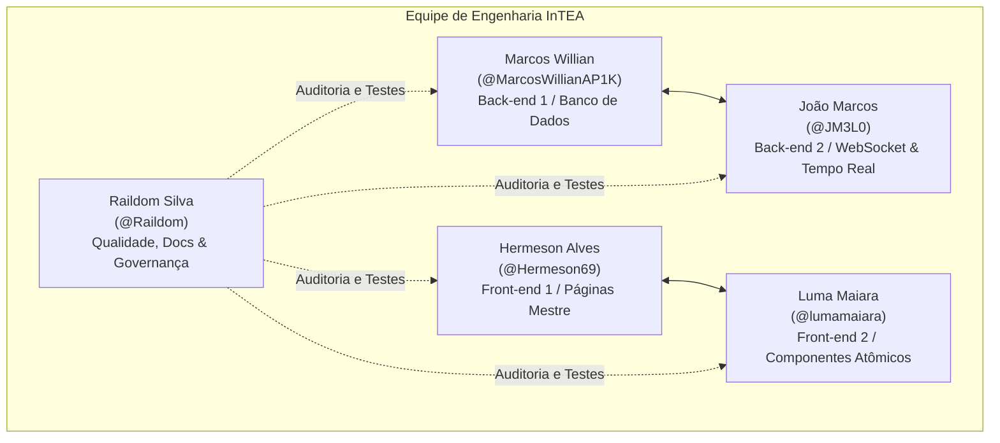

# Cronograma, Equipe e Marcos Evolutivos — InTEA

> **Projeto:** InTEA — Interface do Terapeuta para Orquestração do Ecossistema de Games Terapêuticos  
> **Instituição:** Sistemas de Informação — Universidade Federal do Piauí (UFPI)  
> **Documento Mestre:** [Projeto_de_InTEA.pdf](file:///c:/Users/MWSS/OneDrive/Desktop/InTEA/docs/Projeto_de_InTEA.pdf)  
> **Hub de Navegação:** [Índice Geral](file:///c:/Users/MWSS/OneDrive/Desktop/InTEA/docs/README.md)

---

## 1. Cronograma Geral do Projeto por Sprints

O desenvolvimento do InTEA foi estruturado em ciclos iterativos semanais (sprints), percorrendo desde a definição conceitual e requisitos clínicos até a homologação em ambiente piloto com terapeutas parceiros. A Tabela 1 a seguir espelha o cronograma oficial registrado no Documento Mestre do projeto:

### Tabela 1: Cronograma Detalhado do Projeto por Sprints

| Sprint | Data Final | Item / Marco Central | Descrição do Escopo e Entregas |
| :---: | :---: | :--- | :--- |
| **Sprint 1** | 13/08/2026 | Apresentação da Disciplina | Apresentação das diretrizes, metodologias e dinâmica da disciplina. |
| **Sprint 2** | 20/08/2026 | Proposta e Cronograma | Definição da problemática, proposta da interface InTEA e validação do cronograma. |
| **Sprint 3** | 27/08/2026 | Documentação Técnica | Levantamento de RF (01 a 21), RNF (01 a 07), RN (01 a 05) e elaboração dos 5 diagramas UML/ER. |
| **Sprint 4** | 03/09/2026 | Design de Contratos e Figma | Definição dos 4 Contratos JSON (Manifesto, Telemetria, Contexto, Relatório) e prototipação no Figma. |
| **Sprint 5** | 10/09/2026 | Validação e Modelagem | Refinamento do protótipo de alta fidelidade, validação clínica e modelagem do banco relacional. |
| **Sprint 6** | 17/09/2026 | Fundação do Projeto | Setup do repositório, pipeline de CI/CD no GitHub Actions, Docker Compose e banco de dados Supabase. |
| **Sprint 7** | 24/09/2026 | Pacientes e Biblioteca de Jogos | CRUD de pacientes com soft delete (**RN05**), vínculo multi-terapeuta (**RF18**) e catálogo de jogos (**RF09**). |
| **Sprint 8** | 01/10/2026 | Pareamento Remoto | Fluxo de pareamento via `session_token` (**RF10**), gateway Socket.IO e suíte de regressão (228 testes). |
| **Sprint 9** | 08/10/2026 | Gestão de Sessão e Telemetria | FSM da sessão (`em_andamento`), ingestão em lote via WebSocket, reconexão de 60s e Cockpit em tempo real. |
| **Sprint 10** | 15/10/2026 | Tela de Resultados e Relatórios | Tela de Resultados (**RF14**), normalização 3FN de relatórios, síntese da IA e exportação em PDF (**RF20**). |
| **Sprint 11** | 22/10/2026 | Histórico e Gráficos | Renderizador dinâmico de gráficos pautado em `metric_type` e linha do tempo longitudinal (**RF15**). |
| **Sprint 12** | 29/10/2026 | Anotações e Contexto | Bloco de anotações clínicas com autoria (**RF16**, **RF21**) e injeção parametrizada de contexto pré-sessão (**RF17**). |
| **Sprint 13** | 05/11/2026 | Regras Multi-terapeuta | Visibilidade compartilhada de prontuário por vínculo (**RN04**), concorrência e testes de integração. |
| **Sprint 14** | 12/11/2026 | Polimento Técnico e Hardening | Correção de débitos técnicos, melhorias de ergonomia visual (UX/UI), auditoria e documentação viva. |
| **Sprint 15** | 19/11/2026 | Validação Clínica Fechada | Execução de casos de teste orientados por terapeutas parceiros e coleta estruturada de feedbacks. |
| **Sprint 16** | 26/11/2026 | Deploy Piloto | Ajustes resultantes da homologação clínica e publicação em ambiente de nuvem para testes reais. |
| **Sprint 17** | 03/12/2026 | Apresentação Final | Defesa pública do projeto, demonstração funcional ponta a ponta e exibição dos resultados coletados. |

---

## 2. Estrutura e Atribuições da Equipe de Desenvolvimento

O projeto InTEA é conduzido por 5 integrantes com responsabilidades bem delimitadas, garantindo isolamento de código e fluxo de desenvolvimento sem bloqueios mútuos:

### Matriz de Responsabilidades por Integrante

1. **Back-end 1 — Marcos Willian (`@MarcosWillianAP1K`):**
   * *Escopo Técnico:* Modelagem relacional (`Database/migrations/`), `database.sql`, Models, Services e Controllers dos módulos centrais (Paciente, Terapeuta, Sessão, Anotações, Auditoria), controle de permissões institucionais (**RN04**), soft delete (**RN05**) e suítes de testes Vitest da API REST.
2. **Back-end 2 — João Marcos (`@JM3L0`):**
   * *Escopo Técnico:* Comunicação WebSocket/Socket.IO (`Backend/core/websocket/`), gateways de eventos em tempo real, streaming de telemetria, controles de resiliência e reconexão (janela de 60s), rate limiting contra flooding de sockets e serviços de exportação estruturada (**RF20**).
3. **Front-end 1 — Hermeson Alves (`@Hermeson69`):**
   * *Escopo Técnico:* Páginas Mestre centralizadas da aplicação SPA (`Frontend/src/pages/`), casca e layouts visuais (`SidebarLayout`, `FocusLayout`, Cockpit, Tela de Resultados, Gestão de Pacientes), gerenciamento de rotas e transições, cabeçalhos clínicos e orquestração dos fluxos de tela.
4. **Front-end 2 — Luma Maiara (`@lumamaiara`):**
   * *Escopo Técnico:* Modais e Overlays centralizados (`Frontend/src/pages/modal/`), componentes visuais atômicos e especializados (`Frontend/src/features/*/components/`), cards de telemetria e métricas consolidadas, gráficos temporais SVG e sparklines, diagnóstico de hardware (bateria/latência) e testes unitários de UI.
5. **Documentação / Qualidade — Raildom Silva (`@Raildom`):**
   * *Escopo Técnico:* Redação técnica acadêmica em LaTeX e Markdown, especificação OpenAPI/Swagger (`docs/api-pacientes-jogos.md`), casos de teste manuais formais (`docs/roteiro-testes.md`), matriz de rastreabilidade e governança operacional do GitHub Projects (Kanban, issues, labels e milestones).

---

## 3. Metodologia de Trabalho e Governança Anti-Conflito

Para extinguir conflitos de merge e dependências circulares, a equipe opera sob um protocolo estrito de engenharia:

* **Sprints Semanais com 20 Cards Principais:** Exatamente 4 cards por membro por sprint, formalizados com fronteira de arquivos exclusiva e critérios de aceite mensuráveis.
* **Ordem Sequencial Canônica:**
  * **Dias 1 a 2 (Fundação):** Migrações de banco e contratos DTO $\rightarrow$ Cascas de páginas mestre no Front $\rightarrow$ Stubs desacoplados em memória.
  * **Dias 3 a 4 (Integração):** Integração dos componentes nos slots visuais e serviços reais consumindo a persistência.
  * **Dia 5 (Hardening e Auditoria):** Implementação de regras de autorização (**RN04**), trilhas de auditoria e exportação de relatórios.
  * **Dia 6 (Qualidade e Fechamento):** Execução das suítes de testes automatizados com Vitest (100% verde mandatório) e homologação dos casos de teste manuais.
* **Critérios de Aceite Sempre Desmarcados:** Todos os critérios de aceite nos arquivos de planejamento permanecem obrigatoriamente desmarcados (`[ ]`) para validação soberana do usuário no ambiente do projeto.

---

## 4. Evidências Visuais e Infraestrutura

* `[Imagem 21: Pipeline de CI/CD]` — Fluxo automatizado de integração contínua no GitHub Actions com validação de tipagem (`tsc`), execução de testes Vitest e compilação de produção.
* `[Imagem 22: Containers Iniciais]` — Orquestração de contêineres Docker para desenvolvimento local reproduzível e padronizado.
