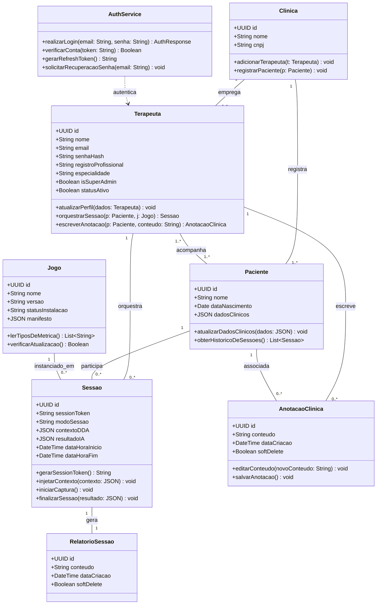

# Diagrama de Classes UML — InTEA

> **Projeto:** InTEA — Interface do Terapeuta para Orquestração do Ecossistema de Games Terapêuticos  
> **Instituição:** Sistemas de Informação — Universidade Federal do Piauí (UFPI)  
> **Documento Mestre:** [Projeto_de_InTEA.pdf](file:///c:/Users/MWSS/OneDrive/Desktop/InTEA/docs/Projeto_de_InTEA.pdf) (Seção 5.4, Página 10)  
> **Hub de Navegação:** [Índice Geral](file:///c:/Users/MWSS/OneDrive/Desktop/InTEA/docs/README.md)

---

## 1. Visão Geral e Estrutura Estática do Domínio

O **Diagrama de Classes UML** representa a visão estática do domínio de negócio do InTEA, detalhando as entidades centrais, seus atributos canônicos (padronizados com identificadores UUID), métodos operacionais de negócio e os relacionamentos de associação, agregação e dependência que estruturam a arquitetura de software.

---

## 2. Dicionário das Classes de Domínio

### 2.1. `Clinica`
Representa a instituição de saúde ou consultório multidisciplinar. Atua como raiz do isolamento multi-tenant (**RN04**), agrupando os profissionais de saúde e os pacientes atendidos.

### 2.2. `AuthService`
Serviço central de segurança e controle de identidade. Responsável pela emissão e rotação de tokens JWT, autenticação criptográfica e integração com o Supabase Auth.

### 2.3. `Terapeuta`
Entidade que encapsula o profissional de saúde habilitado (psicólogo, fonoaudiólogo, terapeuta ocupacional). Possui flags de controle como `isSuperAdmin` (acesso irrestrito) e `statusAtivo` (soft delete de credenciais).

### 2.4. `Paciente`
Entidade de registro clínico que representa o indivíduo no espectro autista. Não possui credenciais de acesso nem autentica na aplicação web (**RF06**). Seus dados clínicos e sensoriais são preservados com sigilo estrito.

### 2.5. `Jogo`
Catálogo de jogos terapêuticos digitais homologados. Armazena o manifesto técnico estruturado em JSON com a declaração obrigatória dos tipos de métrica aceitos (**RN02**).

### 2.6. `Sessao`
Entidade orquestradora da intervenção lúdica. Gerencia o ciclo de vida completo da partida, o código PIN efêmero de pareamento (`sessionToken`), o modo de operação (clínico ou livre — **RN01**) e a injeção do contexto pré-sessão para o DDA (**RN03**).

### 2.7. `AnotacaoClinica`
Registros livres de evolução e prontuário médico. Vinculados compulsoriamente a um terapeuta autor (**RF21**) e a um paciente, admitindo exclusão apenas lógica via `softDelete` (**RN05**).

### 2.8. `RelatorioSessao`
Consolidação analítica pós-intervenção gerada em relação 1:1 estrita com a sessão clínica (**3FN**). Contém as métricas consolidadas e o parecer automatizado do Agente de IA.

---

## 3. Evidência Visual

* `[Imagem 1: Diagrama de Classes UML do Sistema InTEA]` — Diagrama de classes oficial publicado no Documento Mestre do projeto.
