# Diagrama de Casos de Uso do Ecossistema — InTEA

> **Projeto:** InTEA — Interface do Terapeuta para Orquestração do Ecossistema de Games Terapêuticos  
> **Instituição:** Sistemas de Informação — Universidade Federal do Piauí (UFPI)  
> **Documento Mestre:** [Projeto_de_InTEA.pdf](file:///c:/Users/MWSS/OneDrive/Desktop/InTEA/docs/Projeto_de_InTEA.pdf) (Seção 5.5, Página 11)  
> **Hub de Navegação:** [Índice Geral](file:///c:/Users/MWSS/OneDrive/Desktop/InTEA/docs/README.md)

---

## 1. Visão Geral dos Casos de Uso

O **Diagrama de Casos de Uso** ilustra as interações funcionais entre os atores humanos e computacionais do ecossistema e as fronteiras de serviços oferecidas pelo sistema InTEA. O modelo contempla quatro atores fundamentais: o **Terapeuta**, o **SuperAdmin**, o **Agente de IA** e o **Game Externo** (tablet/dispositivo do paciente).

```mermaid
flowchart TB
    subgraph Atores ["Atores do Ecossistema"]
        T["Terapeuta Clínico\n(Usuário Principal)"]
        SA["Super Admin\n(Gestão Global)"]
        IA["Agente de IA\n(Motor DDA & Analítica)"]
        GE["Game Externo\n(Tablet do Paciente)"]
    end

    subgraph Fronteira ["Fronteira da Aplicação InTEA"]
        direction TB

        UC01(["UC01: Autenticar-se no Sistema"])
        UC02(["UC02: Gerenciar Perfil e Preferências"])
        UC03(["UC03: Cadastrar e Gerenciar Pacientes"])
        UC04(["UC04: Acessar Biblioteca de Jogos"])
        UC05(["UC05: Orquestrar Sessão Terapêutica"])
        UC06(["UC06: Configurar Contexto Clínico DDA"])
        UC07(["UC07: Realizar Pareamento Remoto"])
        UC08(["UC08: Finalizar Sessão Terapêutica"])
        UC09(["UC09: Executar Jogo em Modo Livre"])
        UC10(["UC10: Registrar Anotações de Prontuário"])
        UC11(["UC11: Visualizar Histórico e Relatórios"])
        UC12(["UC12: Exportar Relatório em PDF"])

        UC13(["UC13: Gerenciar Terapeutas e Usuários"])
        UC14(["UC14: Auditar Vínculos e Acessos"])

        UC15(["UC15: Ajustar Dificuldade Dinâmica (DDA)"])
        UC16(["UC16: Sintetizar Relatório Analítico Final"])
    end

    %% Terapeuta
    T --> UC01
    T --> UC02
    T --> UC03
    T --> UC04
    T --> UC05
    T --> UC09
    T --> UC10
    T --> UC11

    %% Relacionamentos de Inclusão e Extensão
    UC05 -. "<<include>>" .-> UC06
    UC05 -. "<<include>>" .-> UC07
    UC05 -. "<<include>>" .-> UC08
    UC11 -. "<<extend>>" .-> UC12

    %% Super Admin
    SA --> UC01
    SA --> UC13
    SA --> UC14

    %% Game Externo
    GE --> UC07
    GE --> UC08

    %% Agente de IA
    IA --> UC15
    IA --> UC16
```

---

## 2. Detalhamento dos Atores e seus Papéis

| Ator | Tipo | Papel e Responsabilidade no Ecossistema |
| :--- | :---: | :--- |
| **Terapeuta** | Usuário Primário | Profissional de saúde (psicólogo, terapeuta ocupacional, fonoaudiólogo) que gerencia pacientes, prescreve jogos, injeta o contexto pré-sessão, acompanha o cockpit em tempo real e emite pareceres. |
| **SuperAdmin** | Usuário Administrativo | Gestor da instituição responsável pela governança da plataforma, cadastro global de clínicas, reativação de contas inativadas e auditoria de segurança da informação. |
| **Agente de IA** | Sistema Externo | Motor inteligente que processa a telemetria via WebSocket em tempo real, calcula adaptações com base no contexto pré-sessão e emite a síntese estatística final pós-sessão. |
| **Game Externo** | Dispositivo Externo | Aplicativo executado no tablet do paciente. Não possui login individual: consome o `session_token` no pareamento, transmite telemetria e executa modulações de estímulo. |

---

## 3. Matriz de Relacionamentos «include» e «extend»

* **«include» em Orquestrar Sessão Terapêutica (UC05):**
  * Toda sessão terapêutica clínica requer compulsoriamente a injeção do contexto DDA (**UC06**, **RN03**), o pareamento remoto via PIN (**UC07**, **RF10**) e a finalização controlada com encerramento de conexões (**UC08**, **RF13**).
* **«extend» em Visualizar Histórico e Relatórios (UC11):**
  * A exportação do laudo em PDF (**UC12**, **RF20**) estende a visualização em tela sob demanda explícita do terapeuta para compartilhamento institucional ou entrega à família.

---

## 4. Evidência Visual

* `[Imagem 2: Diagrama de Casos de Uso do Ecossistema InTEA]` — Diagrama de Casos de Uso oficial publicado no Documento Mestre do projeto.
