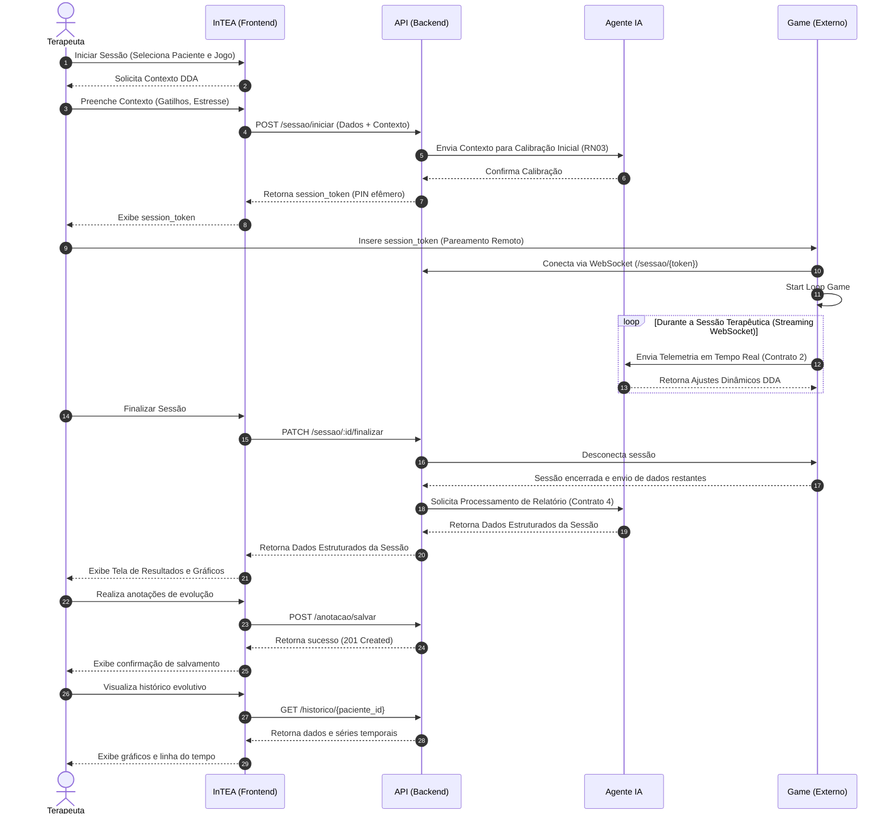

# Diagrama de Sequência do Ciclo de Sessão e Telemetria — InTEA

> **Projeto:** InTEA — Interface do Terapeuta para Orquestração do Ecossistema de Games Terapêuticos  
> **Instituição:** Sistemas de Informação — Universidade Federal do Piauí (UFPI)  
> **Documento Mestre:** [Projeto_de_InTEA.pdf](file:///c:/Users/MWSS/OneDrive/Desktop/InTEA/docs/Projeto_de_InTEA.pdf) (Seção 5.6, Página 12)  
> **Hub de Navegação:** [Índice Geral](file:///c:/Users/MWSS/OneDrive/Desktop/InTEA/docs/README.md)

---

## 1. Visão Geral do Comportamento Dinâmico

O **Diagrama de Sequência** detalha a troca temporal de mensagens e o fluxo de dados entre os quatro componentes centrais da arquitetura do InTEA:
1. **Terapeuta (Ator Clínico)**
2. **InTEA Frontend (Interface Web SPA)**
3. **API Backend (Servidor REST e Gateway WebSocket)**
4. **Agente de IA (Motor de DDA e Síntese Analítica)**
5. **Game Externo (Tablet/Dispositivo do Paciente)**

O fluxo completo compreende **29 passos operacionais**, cobrindo desde a calibração inicial pré-sessão, pareamento remoto via PIN, streaming contínuo de telemetria, encerramento com laudo analítico até anotações de evolução e consulta ao histórico.

---

## 2. Diagrama de Sequência Oficial (29 Passos)

---

## 3. Detalhamento Passo a Passo dos 29 Eventos

| Passo | Emissor $\rightarrow$ Receptor | Mensagem / Operação | Detalhamento Técnico e Regra Aplicada |
| :---: | :---: | :--- | :--- |
| **1** | Terapeuta $\rightarrow$ Frontend | Iniciar Sessão | Seleciona o paciente com vínculo ativo e o jogo na biblioteca (**RF12**). |
| **2** | Frontend $\rightarrow$ Terapeuta | Solicita Contexto DDA | Abre modal para preenchimento de variáveis basais do paciente (**RF17**). |
| **3** | Terapeuta $\rightarrow$ Frontend | Preenche Contexto | Informa nível de estresse (1 a 5), gatilhos sensoriais a evitar e objetivo da sessão. |
| **4** | Frontend $\rightarrow$ Backend | `POST /sessao/iniciar` | Despacha DTO com identificadores e contexto clínico pré-sessão (**Contrato 3**). |
| **5** | Backend $\rightarrow$ Agente IA | Envia Contexto Inicial | Entrega parâmetros de calibração ao Agente antes do início do jogo (**RN03**). |
| **6** | Agente IA $\rightarrow$ Backend | Confirma Calibração | Agente confirma recepção e inicializa modelo comportamental da criança. |
| **7** | Backend $\rightarrow$ Frontend | Retorna `session_token` | Backend gera PIN alfanumérico amigável (TTL de 15 minutos, **RF10**). |
| **8** | Frontend $\rightarrow$ Terapeuta | Exibe `session_token` | Tela exibe código em destaque e QR Code opcional para o pareamento. |
| **9** | Terapeuta $\rightarrow$ Game | Insere `session_token` | Código é digitado na tela do tablet externo do paciente sem login (**RF10**). |
| **10** | Game $\rightarrow$ Backend | Conexão WebSocket | Game consome o token e abre socket na sala `/sessao/{token}`. |
| **11** | Game $\rightarrow$ Game | Start Loop Game | Jogo inicia a interface lúdica e o motor gráfico no dispositivo. |
| **12** | Game $\rightarrow$ Agente IA | Streaming de Telemetria | Envio contínuo de eventos atômicos (toques, latência, erros) (**Contrato 2**). |
| **13** | Agente IA $\rightarrow$ Game | Ajustes Dinâmicos (DDA) | IA modula velocidade, contraste e estímulos auditivos para manter engajamento. |
| **14** | Terapeuta $\rightarrow$ Frontend | Finalizar Sessão | Terapeuta clica no comando de encerramento no cockpit web (**RF13**). |
| **15** | Frontend $\rightarrow$ Backend | `PATCH /sessao/:id/finalizar` | Backend valida permissão via `sessaoMiddleware` e registra timestamp final. |
| **16** | Backend $\rightarrow$ Game | Desconecta Sessão | Servidor notifica o tablet para encerrar a partida e fechar conexões. |
| **17** | Game $\rightarrow$ Backend | Dados Restantes | Tablet transmite buffer final de métricas residuais acumuladas. |
| **18** | Backend $\rightarrow$ Agente IA | Solicita Relatório | Backend aciona endpoint de fechamento do Agente de IA (**Contrato 4**). |
| **19** | Agente IA $\rightarrow$ Backend | Retorna Dados Estruturados | IA devolve agregação estatística, médias e parecer analítico final. |
| **20** | Backend $\rightarrow$ Frontend | Retorna Resultados | Backend persiste em `relatorio_sessao` (**3FN**) e responde ao cliente HTTP. |
| **21** | Frontend $\rightarrow$ Terapeuta | Exibe Tela de Resultados | Renderiza cartões de métricas consolidadas e gráficos (**RF14**, **Imagem 12**). |
| **22** | Terapeuta $\rightarrow$ Frontend | Realiza Anotações | Terapeuta redige observações clínicas qualitativas de prontuário (**RF16**). |
| **23** | Frontend $\rightarrow$ Backend | `POST /anotacao/salvar` | Salva registro vinculando autoria obrigatória do terapeuta logado (**RF21**). |
| **24** | Backend $\rightarrow$ Frontend | Retorna Sucesso | Confirmação de persistência com código `201 Created` e payload salvo. |
| **25** | Frontend $\rightarrow$ Terapeuta | Notifica Salvamento | Alerta visual de sucesso na interface do usuário. |
| **26** | Terapeuta $\rightarrow$ Frontend | Visualiza Histórico | Profissional navega até o prontuário evolutivo do paciente (**RF15**). |
| **27** | Frontend $\rightarrow$ Backend | `GET /historico/{paciente_id}` | Valida vínculo institucional (**RN04**) e busca histórico de sessões. |
| **28** | Backend $\rightarrow$ Frontend | Retorna Séries Temporais | Responde com lista ordenada de sessões e pontos para gráficos. |
| **29** | Frontend $\rightarrow$ Terapeuta | Exibe Dados e Gráficos | Renderiza a linha do tempo longitudinal de evolução terapêutica (**Imagem 13**). |

---

## 4. Evidência Visual

* `[Imagem 3: Diagrama de Sequência - Ciclo de Vida da Sessão e Telemetria]` — Diagrama de sequência oficial publicado no Documento Mestre do projeto.
