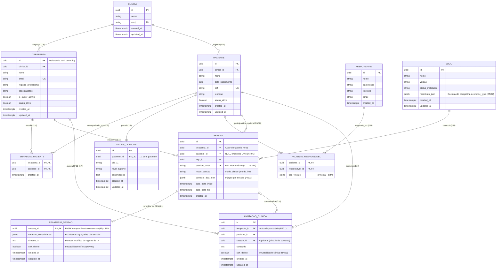

# Diagrama Entidade-Relacionamento (DER Físico Supabase 3FN) — InTEA

> **Projeto:** InTEA — Interface do Terapeuta para Orquestração do Ecossistema de Games Terapêuticos  
> **Instituição:** Sistemas de Informação — Universidade Federal do Piauí (UFPI)  
> **Documento Mestre:** [Projeto_de_InTEA.pdf](file:///c:/Users/MWSS/OneDrive/Desktop/InTEA/docs/Projeto_de_InTEA.pdf) (Seção 5.7, Página 13; Seção 7.10.2, Página 34)  
> **Hub de Navegação:** [Índice Geral](file:///c:/Users/MWSS/OneDrive/Desktop/InTEA/docs/README.md)

---

## 1. Visão Geral do Modelo Relacional e Físico

O **Diagrama Entidade-Relacionamento (DER Físico)** reflete o esquema relacional implementado no banco de dados PostgreSQL gerenciado pelo Supabase. A modelagem segue estritamente as diretrizes de engenharia do InTEA:
* Todas as chaves primárias (PK) e estrangeiras (FK) utilizam identificadores universais únicos (**UUID** via `gen_random_uuid()`), extinguindo vulnerabilidades de adivinhação ou enumeração sequencial;
* Conformidade integral com a **3ª Forma Normal (3FN)**, em especial na relação 1:1 estrita entre `sessao` e `relatorio_sessao` via chave primária compartilhada;
* Isolamento multi-tenant por instituição (`clinica_id`);
* Soft delete clínico imutável via triggers de banco (**RN05**).

---

## 2. Invariantes de Integridade Referencial no Banco

1. **Relação 1:1 Estrita em `relatorio_sessao` (3FN):**
   * A coluna `sessao_id` é simultaneamente Chave Primária e Chave Estrangeira com restrição `REFERENCES public.sessao(id) ON DELETE RESTRICT`.
   * Não há duplicação de `paciente_id` ou `terapeuta_id`, eliminando qualquer redundância funcional ou anomalia de atualização.
2. **Multi-Tenancy por `clinica_id`:**
   * Todas as tabelas que contêm entidades pertencentes a instituições (`terapeuta`, `paciente`) carregam `clinica_id UUID NOT NULL REFERENCES clinica(id)`.
   * Consultas de listagem filtram obrigatoriamente a clínica do solicitante autenticado (**RN04**).
3. **Chave Primária Composta em Vínculos N:N:**
   * A tabela associativa `terapeuta_paciente` utiliza `PRIMARY KEY (terapeuta_id, paciente_id)`, impedindo vínculos duplicados.
4. **Proteção de Histórico contra Hard Delete (RN05):**
   * Triggers de banco (`BEFORE DELETE`) bloqueiam qualquer exclusão física de registros clínicos em produção, exigindo atualização de `soft_delete = true` ou `status_ativo = false`.

---

## 3. Evidências Visuais e Estrutura Física

* `[Imagem 4: Diagrama Entidade-Relacionamento (DER Físico Supabase 3FN)]` — Diagrama ER físico de alta resolução publicado no Documento Mestre.
* `[Imagem 18: Tabelas das Classes no Banco de Dados]` — Painel de classes instanciadas no PostgreSQL.
* `[Imagem 19: Tabela de Clínicas no Banco de Dados]` — Tabela institucional multi-tenant.
* `[Imagem 20: Tabela Associativa Terapeuta-Paciente]` — Tabela associativa com chave composta.
* `[Imagem 23: Classes e Tabelas Físicas do Banco]` — Catálogo de tabelas físicas no Supabase Studio.
