# Diagrama de Atividades Operacional da Sessão — InTEA

> **Projeto:** InTEA — Interface do Terapeuta para Orquestração do Ecossistema de Games Terapêuticos  
> **Instituição:** Sistemas de Informação — Universidade Federal do Piauí (UFPI)  
> **Documento Mestre:** [Projeto_de_InTEA.pdf](file:///c:/Users/MWSS/OneDrive/Desktop/InTEA/docs/Projeto_de_InTEA.pdf) (Seção 5.8, Página 14)  
> **Hub de Navegação:** [Índice Geral](file:///c:/Users/MWSS/OneDrive/Desktop/InTEA/docs/README.md)

---

## 1. Visão Geral do Fluxo Operacional

O **Diagrama de Atividades** modela o fluxo de trabalho operacional e a lógica de processos executada durante a preparação, pareamento, streaming de telemetria contínua, adaptação de dificuldade por inteligência artificial (DDA) e encerramento analítico de uma sessão clínica no InTEA.

O processo compreende decisões de calibração pré-sessão (**RN03**), bifurcações de fluxo de fallback, estabelecimento de canal seguro via token efêmero (**RF10**), loops iterativos de ajuste comportamental em tempo real (**RNF01**) e consolidação final de dados em tela (**RF14**).

---

## 2. Diagrama de Atividades Oficial em Mermaid

```mermaid
flowchart TD
    Inicio([Início]) --> Acesso["Terapeuta acessa a Gestão de Sessão"]
    Acesso --> Selecao["Seleciona Paciente e Jogo"]

    Selecao --> DecisaoContexto{"Deseja configurar contexto\nclínico para o DDA?"}

    DecisaoContexto -- "Sim" --> InformaContexto["Terapeuta informa nível de estresse (1-5)\ne gatilhos a suprimir"]
    InformaContexto --> EnviaContexto["Sistema envia contexto prévio\nao Agente de IA (RN03)"]

    DecisaoContexto -- "Não" --> FallbackContexto["Sistema assume métricas padrão\nhomologadas (Fallback Clínico)"]

    EnviaContexto --> GeraToken["InTEA gera e exibe o session_token (PIN)"]
    FallbackContexto --> GeraToken

    GeraToken --> Aguardando["Sessão aguardando conexão remota...\n(Status: aguardando_pareamento)"]

    Aguardando --> JogoEnviaToken["Jogo (em dispositivo externo)\nenvia session_token para a API"]

    JogoEnviaToken --> PareamentoOk["Pareamento Remoto estabelecido com sucesso\n(Status: em_andamento)"]

    PareamentoOk --> SessaoIniciada["Sessão Terapêutica Iniciada"]
    SessaoIniciada --> InteracaoPaciente["Paciente interage com o Jogo no Tablet"]

    subgraph LoopDDA ["Loop de Telemetria e DDA em Tempo Real (WebSocket)"]
        InteracaoPaciente --> EnviaTelemetria["Jogo envia Telemetria Contínua\n(WebSocket / Socket.IO)"]
        EnviaTelemetria --> AnaliseIA["Agente IA analisa dados em tempo real"]
        AnaliseIA --> AplicaDDA["Agente IA calcula e aplica Ajuste Dinâmico (DDA)"]
        AplicaDDA --> ModificaJogo["Jogo é modificado de acordo com ajuste necessário\n(Velocidade, Estímulos, Desafios)"]
    end

    ModificaJogo --> DecisaoFinalizar{"Terapeuta clicou em\n'Finalizar Sessão'?"}

    DecisaoFinalizar -- "Não" --> InteracaoPaciente
    DecisaoFinalizar -- "Sim" --> ProcessaRelatorio["Agente IA processa relatório final\ne agrega métricas estruturadas"]

    ProcessaRelatorio --> ConsolidaResultados["InTEA consolida relatório em 3FN\ne exibe a Tela de Resultados"]

    ConsolidaResultados --> Fim([Fim da Sessão])
```

---

## 3. Análise das Etapas e Pontos Críticos de Decisão

### 3.1. Calibração Pré-Sessão e Injeção de Contexto (RN03)
* Se o terapeuta optar por configurar o contexto personalizado, a interface coleta o nível de estresse atual do paciente e os gatilhos sensoriais críticos.
* Caso opte por não detalhar no momento, o sistema aciona parâmetros padrão de segurança (*fallback* com limiares conservadores), garantindo que o Agente de IA nunca execute sem calibração prévia.

### 3.2. Pareamento Remoto Efêmero e Timeout (RF10, RNF03)
* A emissão do `session_token` alfanumérico coloca a sessão no estado `aguardando_pareamento`.
* O tablet externo não necessita de credenciais de terapeuta: basta inserir o PIN gerado.
* Se o pareamento não ocorrer dentro da janela de 15 minutos (TTL), a sessão é cancelada automaticamente (`410 Gone`).

### 3.3. Ciclo Dinâmico de Modulação DDA (RNF01)
* Durante a partida, a cada evento capturado pelo jogo, pacotes contínuos de telemetria trafegam via WebSocket até o Agente de IA.
* O motor calcula a probabilidade de fadiga ou frustração e devolve imediatamente comandos de compensação para manter a criança engajada na zona de desenvolvimento proximal.

### 3.4. Finalização e Apresentação de Laudo (RF14, 3FN)
* Quando o terapeuta comanda o encerramento no cockpit, as conexões remotas são desfeitas graciosamente.
* O Agente de IA calcula médias, percentis e emite a síntese clínica textual, a qual é salva no banco em relação 1:1 (`relatorio_sessao`) e renderizada na Tela de Resultados.

---

## 4. Evidência Visual

* `[Imagem 5: Diagrama de Atividades Operacional da Sessão]` — Diagrama de atividades oficial publicado no Documento Mestre do projeto.
