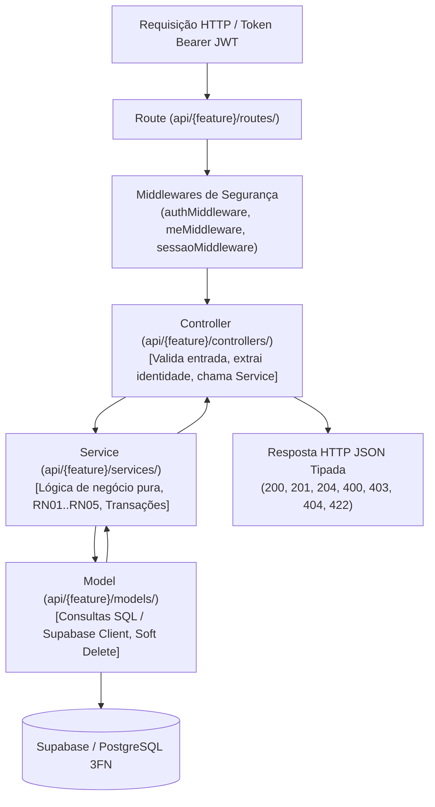

# Padrões Arquiteturais, Engenharia e Stack Tecnológica — InTEA

> **Projeto:** InTEA — Interface do Terapeuta para Orquestração do Ecossistema de Games Terapêuticos  
> **Instituição:** Sistemas de Informação — Universidade Federal do Piauí (UFPI)  
> **Documento Mestre:** [Projeto_de_InTEA.pdf](file:///c:/Users/MWSS/OneDrive/Desktop/InTEA/docs/Projeto_de_InTEA.pdf)  
> **Regras de Arquitetura:** [architecture.md](file:///c:/Users/MWSS/OneDrive/Desktop/InTEA/docs/architecture.md)  
> **Hub de Navegação:** [Índice Geral](file:///c:/Users/MWSS/OneDrive/Desktop/InTEA/docs/README.md)

---

## 1. Visão Geral da Pilha Tecnológica (Stack)

O InTEA é construído sobre um monorepo desacoplado com responsabilidade única por camada, padronizado em **TypeScript Estrito** (com proibição absoluta do tipo `any`) e ferramentas de alto desempenho:

| Camada | Tecnologia Principal | Versão | Papel e Responsabilidade Arquitetural |
| :--- | :--- | :---: | :--- |
| **Runtime Backend** | Node.js (LTS) + Express | ^4.x | Servidor de aplicação HTTP RESTful e despachante de rotas. |
| **Linguagem Backend** | TypeScript | ^5.x / ^7.x | Tipagem estrita com compilação sem emissão de erros (`tsc --noEmit`). |
| **Persistência / Auth** | Supabase (PostgreSQL 15+) | ^2.x SDK | Banco relacional, autenticação JWT, RLS e Storage de laudos médicos. |
| **Comunicação Tempo Real** | Socket.IO | ^4.x | Gateway WebSocket para pareamento remoto e streaming de telemetria. |
| **Testes Automatizados** | Vitest | ^5.x | Execução ultra-rápida de testes unitários e de integração (548+ testes). |
| **Interface Frontend** | React | ^19.x | Biblioteca SPA moderna com renderização reativa e componentes declarativos. |
| **Build Tool Frontend** | Vite | ^7.x | Bundler de ultra-alta velocidade e ambiente de desenvolvimento modular. |
| **Estilização Visual** | Tailwind CSS | ^4.x | Framework de classes utilitárias via `@theme inline` sem redundância de CSS. |
| **Roteamento SPA** | React Router DOM | ^7.x | Roteamento declarativo com layouts aninhados e proteção de rotas privadas. |
| **Estado Global** | Zustand | ^5.x | Gerenciamento de estado leve e modular com persistência em `localStorage`. |
| **Primitivos de UI** | Radix UI + shadcn | ^1.x | Componentes primitivos com acessibilidade nativa (WCAG 2.1 AA). |
| **Iconografia** | Lucide React | ^0.575.x | Biblioteca de ícones padronizada para interfaces médicas e clínicas. |

---

## 2. Padrão Arquitetural Backend: Camadas Limpas (Clean MVC)

O backend do InTEA implementa uma variação moderna do padrão **MVC (Model-View-Controller)** adaptado para APIs RESTful, com forte separação de conceitos:



### Princípios Invioláveis por Camada:
1. **Rotas (`routes/`):**
   * Define exclusivamente verbos HTTP e associa os middlewares de proteção.
   * Documenta contratos OpenAPI utilizando anotações canônicas `@swagger`.
   * **Proibição:** Não deve conter lógica condicional nem manipulação direta de payloads.
2. **Controllers (`controllers/`):**
   * Extrai e valida parâmetros de rota (`req.params`), busca (`req.query`) e corpo (`req.body`).
   * Extrai o identificador do profissional do token autenticado (`req.user.id`), **nunca confiando em IDs passados no corpo da requisição** (**RF21**).
   * Mapeia retornos do Service para os códigos HTTP adequados. Todos os métodos devem ser `static async`.
   * **Proibição:** É terminantemente proibido executar queries diretas de banco de dados no Controller.
3. **Services (`services/`):**
   * Contém as validações de domínio clínico, checagens de vínculo de clínicas (**RN04**), cálculos e orquestração de transações atômicas.
4. **Models (`models/`):**
   * Executa queries no Supabase client (`supabase.from(...)`), trata códigos de erro do PostgreSQL e mapeia dados para DTOs.
   * Aplica filtros de registros ativos por padrão (`status_ativo = true`).
   * **Proibição:** Proibido executar `delete()` físico em entidades clínicas (**RN05**).

---

## 3. Convenções Canônicas de Nomenclatura de Código

A equipe segue rigorosamente a tabela de convenções estabelecida no projeto:

| Elemento | Convenção Obrigatória | Exemplo Correto | Exemplo Inválido (Proibido) |
| :--- | :---: | :--- | :--- |
| **Métodos de Classes** | **`camelCase`** | `deletarHard()`, `buscarPorId()` | `deletar_hard()`, `buscar_por_id()` |
| **Arquivos TypeScript** | **`kebab-case`** | `paciente.model.ts`, `auth.routes.ts` | `PacienteModel.ts`, `auth_routes.ts` |
| **Interfaces e Types** | **`PascalCase`** | `CriarPacienteDTO`, `Sessao` | `criarPacienteDTO`, `sessao_interface` |
| **Recursos de Rotas REST** | **Singular (`kebab-case`)** | `/api/paciente`, `/api/sessao` | `/api/pacientes`, `/api/sessoes` |
| **Sub-ações REST** | **Ação Semântica no Final** | `DELETE /api/paciente/:id/hard` | `/api/paciente/hard/:id` |
| **Tabelas do Banco** | **`snake_case`** | `terapeuta_paciente`, `relatorio_sessao` | `TerapeutaPaciente`, `Relatorio` |
| **Colunas do Banco** | **`snake_case`** | `clinica_id`, `data_nascimento` | `clinicaId`, `DataNascimento` |

---

## 4. Estrutura Modular do Frontend por Features (Feature-Driven Clean Architecture)

O frontend React adota uma arquitetura orientada a features verticais independentes e desacopladas, com isolamento estrito de domínios clínicos e suporte nativo a dados mockados via `bdmock.ts`:

```
Frontend/src/
├── core/                       # Infraestrutura central da aplicação
│   ├── api/
│   │   ├── http-client.ts      # Cliente HTTP resiliente oficial (HttpClient) com interceptores JWT e retries
│   │   └── endpoints.ts        # Constantes tipadas de rotas RESTful (/api/paciente, /api/terapeuta, etc.)
│   └── web.socket.ts           # Cliente e hooks reativos de Socket.IO para telemetria em tempo real
├── routes/                     # Central de rotas SPA (React Router DOM v7)
├── layout/                     # Casca mestre com SidebarProvider responsiva e headers contextuais
├── features/                   # Módulos verticais por domínio clínico
│   ├── auth/                   # Autenticação, recuperação de sessão e permissões
│   │   ├── hooks/              # useAuth
│   │   ├── services/           # auth.service.ts
│   │   ├── store/              # authStore
│   │   └── types/              # auth.types.ts e bdmock.ts
│   ├── terapeuta/              # Gestão do perfil do terapeuta e equipe multidisciplinar
│   │   ├── services/           # terapeuta.service.ts
│   │   └── types/              # terapeuta.types.ts e bdmock.ts
│   ├── paciente/               # Gestão cadastral e prontuários (alias/retrocompatibilidade com patients)
│   │   ├── components/         # Form e listagem de pacientes
│   │   ├── pages/              # PacientesPage
│   │   ├── services/           # paciente.service.ts
│   │   ├── store/              # patients.store.ts
│   │   └── types/              # paciente.types.ts e bdmock.ts
│   ├── jogos/                  # Biblioteca e leitura de manifestos de jogos terapêuticos
│   │   ├── components/         # JogoCard, JogosFiltros
│   │   ├── pages/              # BibliotecaJogosPage
│   │   ├── services/           # jogos.service.ts (com fallback jogosService.ts)
│   │   └── types/              # jogos.types.ts e bdmock.ts
│   ├── sessao/                 # Orquestração de sessões e cockpit de intervenção clínica
│   │   ├── components/         # Telemetria, anotações, controles clínicos
│   │   ├── hooks/              # useLiveTelemetry, useSessionPersistence, useClinicalTimer
│   │   ├── pages/              # CockpitSessaoPage, ResultadoSessaoPage
│   │   ├── services/           # sessao.service.ts (com fallback sessaoService.ts)
│   │   ├── store/              # sessionStore.ts
│   │   └── types/              # sessao.types.ts e bdmock.ts
│   ├── anotacao/               # Anotações clínicas e histórico de prontuário
│   │   ├── services/           # anotacao.service.ts
│   │   └── types/              # anotacao.types.ts e bdmock.ts
│   ├── dashboard/              # Painel consolidado do terapeuta e métricas rápidas
│   │   ├── components/         # Cards e navegação do painel
│   │   ├── pages/              # dashboardPage.tsx
│   │   ├── services/           # dashboard.service.ts
│   │   └── types/              # dashboard.types.ts e bdmock.ts
│   └── settings/               # Preferências visuais e dados profissionais
│       ├── pages/              # settingsPage.tsx
│       ├── store/              # settingsStore.ts
│       └── types/              # settings.types.ts e bdmock.ts
└── shared/                     # Código e utilitários compartilhados
    ├── components/ui/          # Primitivos visuais shadcn / Radix UI
    ├── hooks/                  # Apenas hooks utilitários de browser (use-mobile.ts, useDebounce)
    ├── lib/                    # Utilitários puros (utils.ts com cn())
    ├── providers/              # ThemeProvider e contextos globais
    ├── types/                  # Tipagens de API (api.types.ts) e bdmock.ts com fixtures globais
    └── utils/                  # request.ts (motor base do HttpClient)
```

### Regras de Domínio e Dados Mockados (`bdmock.ts`):
1. **Dados Mockados por Domínio:** Toda feature possui seu próprio `types/bdmock.ts` contendo fixtures realistas (IDs UUID válidos, datas ISO 8601, estruturas em conformidade com o backend).
2. **Isolamento de Testes e Telas:** Enquanto a integração ao vivo com a API REST não estiver ativa, os serviços e stores consomem preferencialmente os dados de `bdmock.ts`, permitindo que testes unitários e telas funcionem 100% desconectados.
3. **Mocks Compartilhados:** A pasta `shared/types/bdmock.ts` centraliza entidades comuns a múltiplas telas (como clínicas de demonstração e terapeutas simulados).
4. **Ausência de Arquivos Vazios:** Não são permitidos arquivos 0-byte ou stubs incompletos.


---

## 5. Evidência Visual

* `[Imagem 24: Estrutura de Diretórios do Frontend]` — Organização modular de diretórios por features e componentes compartilhados.
