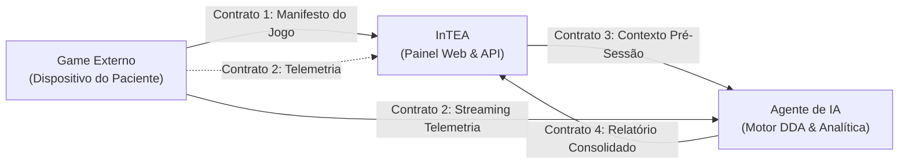

# Especificação dos Contratos JSON do Ecossistema — InTEA

> **Projeto:** InTEA — Interface do Terapeuta para Orquestração do Ecossistema de Games Terapêuticos  
> **Instituição:** Sistemas de Informação — Universidade Federal do Piauí (UFPI)  
> **Documento Mestre:** [Projeto_de_InTEA.pdf](file:///c:/Users/MWSS/OneDrive/Desktop/InTEA/docs/Projeto_de_InTEA.pdf) (Seção 4, Página 7; Sprint 4, Página 15)  
> **Arquivos Fonte:** [`docs/ModelosDeContratos/`](file:///c:/Users/MWSS/OneDrive/Desktop/InTEA/docs/ModelosDeContratos/)  
> **Hub de Navegação:** [Índice Geral](file:///c:/Users/MWSS/OneDrive/Desktop/InTEA/docs/README.md)

---

## 1. Visão Geral da Interoperabilidade por Contratos

Para garantir que novos jogos terapêuticos sejam integrados sem necessidade de alteração no código-fonte do InTEA ou do Agente de IA (**RNF02**), toda a comunicação no ecossistema é governada por **quatro contratos JSON padronizados, tipados e versionados**.



---

## 2. Contrato 1: Manifesto Técnico do Jogo (`manifestoGame.json`)

* **Finalidade:** Metadados do jogo, objetivos clínicos e declaração formal dos tipos de métricas geradas.
* **Emissor:** Desenvolvedor do Jogo / Jogo Externo $\rightarrow$ **Receptor:** InTEA Backend.
* **Canal:** Arquivo estático persistido no banco de dados (`jogo.manifesto_json`) e consumido em `GET /api/jogos/:id`.
* **Regra de Negócio Crítica (**RN02**):** É **estritamente obrigatório** declarar o `tipo_metrica` para cada item em `metricas_suportadas`. Manifestos sem essa informação são rejeitados com `422 Unprocessable Entity`.

### Esquema do JSON do Manifesto:
```json
{
  "id_jogo": "game-core-01",
  "nome": "Aventura Cognitiva",
  "versao": "1.0.0",
  "metricas_suportadas": [
    {
      "id_metrica": "tempo_resposta",
      "tipo_metrica": "numerica",
      "unidade": "segundos"
    },
    {
      "id_metrica": "nivel_frustracao",
      "tipo_metrica": "categorica",
      "valores": ["baixo", "medio", "alto"]
    }
  ]
}
```

### Dicionário de Campos:
| Campo | Tipo | Obrigatório | Descrição |
| :--- | :---: | :---: | :--- |
| `id_jogo` | `string` | Sim | Identificador único alfanumérico do jogo homologado. |
| `nome` | `string` | Sim | Nome comercial/clínico exibido no catálogo de jogos (**RF09**). |
| `versao` | `string` | Sim | Versão semântica (SemVer) da compilação do jogo. |
| `metricas_suportadas` | `array` | Sim | Lista de métricas geradas durante a intervenção. |
| `id_metrica` | `string` | Sim | Chave interna da métrica (ex.: `tempo_resposta`). |
| `tipo_metrica` | `string` | Sim | Domínio obrigatório: `numerica`, `categorica`, `ordinal` ou `booleana`. |
| `unidade` | `string` | Não | Unidade física de medida (segundos, ms, pontos). |
| `valores` | `array` | Condicional | Lista finita de rótulos permitidos quando `tipo_metrica == "categorica"`. |

---

## 3. Contrato 2: Streaming de Telemetria Contínua (`telemetria.json`)

* **Finalidade:** Transmissão em alta frequência de eventos atômicos e dados comportamentais da partida.
* **Emissor:** Game Externo (Tablet) $\rightarrow$ **Receptor:** Agente de IA e Gateway WebSocket do InTEA.
* **Canal:** Conexão persistente WebSocket / Socket.IO no canal `session_{token}` (**RNF01**).
* **Frequência:** Até 20 pacotes por segundo, operando sob *sliding window rate limiter*.

### Esquema do JSON de Telemetria:
```json
{
  "token_sessao": "a1b2c3d4-token",
  "data_hora": "2026-09-01T15:30:22Z",
  "tipo_evento": "interacao_paciente",
  "dados": {
    "id_metrica": "tempo_resposta",
    "valor": 3.5
  }
}
```

### Dicionário de Campos:
| Campo | Tipo | Obrigatório | Descrição |
| :--- | :---: | :---: | :--- |
| `token_sessao` | `string` | Sim | PIN/token da sessão ativa vinculado ao pareamento. |
| `data_hora` | `string (ISO 8601)` | Sim | Timestamp UTC exato do evento com resolução em milissegundos. |
| `tipo_evento` | `string` | Sim | Categoria: `interacao_paciente`, `erro`, `conclusao_fase`, `pausa`. |
| `dados.id_metrica` | `string` | Sim | Identificador da métrica compatível com o manifesto do jogo (**RN02**). |
| `dados.valor` | `number \| string \| boolean` | Sim | Valor aferido estritamente correspondente ao tipo declarado. |

---

## 4. Contrato 3: Injeção de Contexto Pré-Sessão para DDA (`contextoPreSessao.json`)

* **Finalidade:** Envio do estado basal da criança para calibração inicial do motor de inteligência artificial.
* **Emissor:** InTEA Backend $\rightarrow$ **Receptor:** Agente de IA.
* **Canal:** Requisição HTTP REST / Webhook antes da liberação do streaming de jogo (**RN03**).
* **Regra de Negócio (**RN03**):** O DDA não pode processar telemetria sem antes ter recebido este pacote.

### Esquema do JSON de Contexto Pré-Sessão:
```json
{
  "token_sessao": "a1b2c3d4-token",
  "id_terapeuta": "terapeuta-99",
  "id_paciente": "paciente-99",
  "contexto_paciente": {
    "nivel_estresse_inicial": "medio",
    "gatilhos_sensoriais_evitar": ["luz_piscante", "som_agudo"],
    "objetivo_clinico": "foco_atencional"
  }
}
```

### Dicionário de Campos:
| Campo | Tipo | Obrigatório | Descrição |
| :--- | :---: | :---: | :--- |
| `token_sessao` | `string` | Sim | Código PIN da sessão inicializada. |
| `id_terapeuta` | `string (UUID)` | Sim | Identificador do terapeuta autor da orquestração (**RF21**). |
| `id_paciente` | `string (UUID)` | Sim | Identificador do paciente atendido (nulo em modo livre — **RN01**). |
| `nivel_estresse_inicial` | `string` | Sim | Escala clínica: `baixo`, `medio` ou `alto`. |
| `gatilhos_sensoriais_evitar` | `array[string]` | Sim | Lista de estímulos a serem suprimidos pelo jogo (luz, som). |
| `objetivo_clinico` | `string` | Sim | Meta terapêutica da intervenção (ex.: `foco_atencional`, `linguagem`). |

---

## 5. Contrato 4: Relatório Consolidado da Sessão (`relatorio.json`)

* **Finalidade:** Síntese analítica, métricas agregadas e parecer automatizado pós-intervenção gerado pela IA.
* **Emissor:** Agente de IA $\rightarrow$ **Receptor:** InTEA Backend (`POST /api/sessao/:id/resultado`).
* **Canal:** HTTP REST com payload assinado digitalmente para garantia de integridade.
* **Persistência Relacional:** Salvo na tabela `relatorio_sessao` estruturada em 3ª Forma Normal (**3FN**).

### Esquema do JSON do Relatório Analítico:
```json
{
  "token_sessao": "a1b2c3d4-token",
  "duracao_segundos": 1200,
  "resumo": {
    "taxa_conclusao": 85.5,
    "intervencoes_dda": 4
  },
  "analises_ia": [
    "O paciente demonstrou excelente regulação após os primeiros 5 minutos.",
    "Houve necessidade de redução de dificuldade em estímulos sonoros."
  ],
  "metricas_agregadas": [
    {
      "id_metrica": "nivel_frustracao",
      "valor_dominante": "baixo",
      "tendencia": "estavel"
    }
  ]
}
```

### Dicionário de Campos:
| Campo | Tipo | Obrigatório | Descrição |
| :--- | :---: | :---: | :--- |
| `token_sessao` | `string` | Sim | Código de pareamento da sessão correspondente. |
| `duracao_segundos` | `number` | Sim | Tempo total líquido de interação terapêutica ativa. |
| `resumo.taxa_conclusao` | `number` | Sim | Percentual de tarefas ou fases finalizadas com sucesso. |
| `resumo.intervencoes_dda` | `number` | Sim | Total de modulações de dificuldade executadas pela IA. |
| `analises_ia` | `array[string]` | Sim | Lista de pareceres clínicos descritivos gerados pelo modelo. |
| `metricas_agregadas` | `array[object]`| Sim | Resumo consolidado de cada métrica coletada na sessão. |

---

## 6. Critérios de Homologação dos Contratos

* [ ] Validação estrutural com biblioteca de DTOs rejeitando campos desconhecidos ou malformados.
* [ ] Rejeição imediata de pacotes de telemetria cujo `id_metrica` não conste no manifesto homologado (**RN02**).
* [ ] Bloqueio de relatórios pós-sessão em sessões marcadas como Modo Livre (**RN01**).
