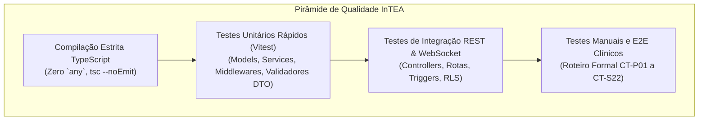
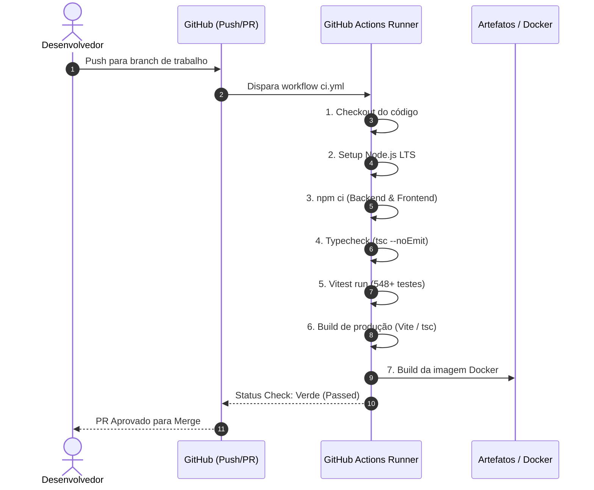

# Estratégia de Testes Automatizados e Pipeline CI/CD — InTEA

> **Projeto:** InTEA — Interface do Terapeuta para Orquestração do Ecossistema de Games Terapêuticos  
> **Instituição:** Sistemas de Informação — Universidade Federal do Piauí (UFPI)  
> **Documento Mestre:** [Projeto_de_InTEA.pdf](file:///c:/Users/MWSS/OneDrive/Desktop/InTEA/docs/Projeto_de_InTEA.pdf)  
> **Regras de Arquitetura:** [architecture.md](file:///c:/Users/MWSS/OneDrive/Desktop/InTEA/docs/architecture.md) (Seção 7)  
> **Hub de Navegação:** [Índice Geral](file:///c:/Users/MWSS/OneDrive/Desktop/InTEA/docs/README.md)

---

## 1. Visão Geral da Pirâmide de Testes e Qualidade

A garantia de qualidade no InTEA apoia-se em uma estratégia de **validação contínua e não-regressão**, combinando tipagem estrita com TypeScript, testes unitários de serviços e middlewares no **Vitest**, testes de integração da API RESTful e uma esteira automatizada no **GitHub Actions**.

A política de engenharia do projeto é categórica: **nenhum código é mesclado na branch principal (`main`) sem que 100% dos testes passem com status verde**.



---

## 2. A Suíte de Testes com Vitest (548+ Testes)

O Vitest foi selecionado pela sua compatibilidade nativa com módulos ESM, suporte imediato a TypeScript e velocidade de execução em memória.

### 2.1. Estrutura de Arquivos de Teste
Cada módulo do backend possui sua respectiva suíte isolada na pasta `test/`:
```
Backend/
├── api/
│   ├── auth/test/auth.test.ts
│   ├── paciente/test/paciente.test.ts
│   ├── terapeuta/test/terapeuta.test.ts
│   ├── sessao/test/sessao.test.ts
│   ├── anotacao/test/anotacao.test.ts
│   └── jogos/test/jogos.test.ts
└── core/test/
    ├── me.middleware.test.ts        # 14 cenários anti-IDOR e titularidade
    ├── sessao.middleware.test.ts    # 10 cenários de ciclo de vida e PIN
    ├── auth.middleware.test.ts
    └── validators.test.ts
```

### 2.2. Comandos Operacionais de Teste e Compilação
Todos os comandos devem ser executados a partir do diretório raiz ou dos respectivos módulos:

| Finalidade | Backend (`Backend/`) | Frontend (`Frontend/`) |
| :--- | :--- | :--- |
| **Instalação de Dependências** | `npm ci` | `npm ci` |
| **Checagem Estrita de Tipos** | `npm run typecheck` | `npm run typecheck` |
| **Execução dos Testes** | `npm test` | `npm test` |
| **Build de Produção** | `npm run build` | `npm run build` |

---

## 3. Esteira de Integração Contínua (CI/CD no GitHub Actions)

O pipeline de CI/CD é acionado automaticamente a cada abertura de *Pull Request* ou *push* direcionado à branch `main`.



### Regras de Qualidade Inegociáveis do Pipeline:
* Falhas em qualquer caso de teste abortam a esteira imediatamente.
* Erros de compilação ou presença de tipos `any` não tratados travam o processo de build.
* A aprovação manual de pelo menos um revisor de código é pré-requisito para o merge.

---

## 4. Evidências Visuais e Infraestrutura

* `[Imagem 21: Pipeline de CI/CD]` — Execução da esteira no GitHub Actions com todas as etapas aprovadas.
* `[Imagem 22: Containers Iniciais]` — Configuração do ambiente local em contêineres Docker para execução padronizada.

---

## 5. Critérios de Homologação de Qualidade

> [!IMPORTANT]
> **Homologação Manual do Usuário:** Os critérios permanecem obrigatoriamente desmarcados (`[ ]`).

* [ ] `npm run typecheck` no Backend e Frontend finaliza com código 0 (zero erros de tipo).
* [ ] `npm test` no Backend executa 100% dos testes sem falhas (32+ arquivos de teste aprovados).
* [ ] Suíte de middlewares (`me.middleware.test.ts` e `sessao.middleware.test.ts`) valida todos os cenários anti-IDOR.
* [ ] Pipeline do GitHub Actions compila com sucesso as imagens de produção.
