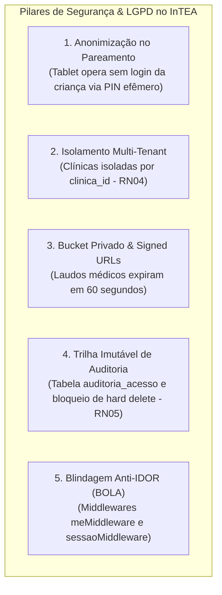

# Auditoria, Segurança e Conformidade com a LGPD — InTEA

> **Projeto:** InTEA — Interface do Terapeuta para Orquestração do Ecossistema de Games Terapêuticos  
> **Instituição:** Sistemas de Informação — Universidade Federal do Piauí (UFPI)  
> **Documento Mestre:** [Projeto_de_InTEA.pdf](file:///c:/Users/MWSS/OneDrive/Desktop/InTEA/docs/Projeto_de_InTEA.pdf)  
> **Alvo Normativo:** Lei Geral de Proteção de Dados (LGPD - Lei nº 13.709/2018), OWASP API Security Top 10 (2023)  
> **Hub de Navegação:** [Índice Geral](file:///c:/Users/MWSS/OneDrive/Desktop/InTEA/docs/README.md)

---

## 1. Contexto Jurídico e Clínico: Dados Sensíveis de Saúde e Infância

O sistema InTEA processa informações de saúde mental relacionadas a crianças e adolescentes com Transtorno do Espectro Autista (TEA). Nos termos da legislação brasileira (**LGPD — Lei nº 13.709/2018**):
* **Art. 11 (Dados Pessoais Sensíveis):** Dados referentes à saúde ou à vida sexual, dado genético ou biométrico exigem salvaguardas reforçadas de segurança e finalidade específica.
* **Art. 14 (Crianças e Adolescentes):** O tratamento de dados deve ocorrer no melhor interesse do menor, mediante consentimento específico e em destaque dado por pelo menos um dos pais ou responsável legal.

A arquitetura do InTEA foi concebida sob o paradigma de **Privacy by Design** (Privacidade desde a Concepção e por Padrão), incorporando controles técnicos em nível de banco de dados, rede e aplicação.

---

## 2. Pilares de Conformidade Técnica da Plataforma

### 2.1. Pareamento Sem Credenciais do Menor (RF10, RNF06)
* O paciente no espectro autista atua exclusivamente como **entidade de registro clínico**, sem possuir conta, usuário, e-mail ou senha na plataforma (**RF06**).
* O dispositivo externo (tablet) consome unicamente um código PIN efêmero (`session_token`) de 6 caracteres gerado dinamicamente pelo terapeuta com validade de 15 minutos.
* O endpoint público de pareamento do tablet (`GET /api/sessao/:token/status`) retorna apenas metadados operacionais de conexão, **sem nunca expor CPF, nome completo ou dados cadastrais do paciente**.

### 2.2. Armazenamento Seguro de Laudos Médicos (Supabase Storage)
* Todos os laudos de anamnese, relatórios médicos e diagnósticos em formato PDF são armazenados no bucket `'laudos'`, configurado com visibilidade estritamente privada (`public = false`).
* O acesso ao documento ocorre exclusivamente por meio de **Signed URLs temporárias com tempo de vida de 60 segundos**, geradas sob demanda após validação de autorização JWT do profissional.

### 2.3. Imutabilidade e Bloqueio de Hard Delete (RN05)
* Registros de prontuário, sessões e anotações médicas não podem sofrer deleção física.
* Triggers PostgreSQL no banco abortam qualquer instrução `DELETE` direta, garantindo que o histórico permaneça íntegro para eventuais auditorias de conselhos de classe (CRP/CRM) e perícias judiciais.

---

## 3. Alinhamento com a OWASP API Security Top 10 (2023)

O InTEA implementa proteções ativas contra os principais vetores de ataque cibernético em APIs:

| Vulnerabilidade OWASP | Risco Clínico Potencial | Mitigação Implementada no InTEA |
| :--- | :--- | :--- |
| **API1:2023 — Broken Object Level Authorization (BOLA/IDOR)** | Terapeuta acessando prontuários de outros pacientes manipulando IDs na URL. | Implementação de `sessaoMiddleware`, `meMiddleware` e `verificarVisibilidadePaciente`, exigindo vínculo ativo (**RN04**). |
| **API2:2023 — Broken Authentication** | Sequestro de credenciais ou reutilização de tokens expirados. | Tokens JWT de curta duração, renovação via *refresh token* com rotação automática (**RF03**) e validação no Supabase Auth. |
| **API3:2023 — Broken Object Property Level Authorization** | Terapeuta comum forjando permissão de SuperAdmin ou alterando seu `clinica_id`. | Sanitização preventiva em `TerapeutaService.atualizar` bloqueando campos restritos com código `403 Forbidden`. |
| **API4:2023 — Unrestricted Resource Consumption** | Ataque de negação de serviço (DoS) por flooding de pacotes WebSocket no servidor. | *Sliding window rate limiter* limitando o streaming de telemetria em até **20 eventos por segundo por sessão**. |
| **API5:2023 — Broken Function Level Authorization** | Usuário convencional executando rotas exclusivas de gestão administrativa. | `adminMiddleware` validando no banco de dados a flag `is_super_admin = true` antes de liberar rotas sensíveis. |

---

## 4. Trilha de Auditoria Institucional (`public.auditoria_acesso`)

Toda consulta e manipulação de dados clínicos gera um registro imutável no banco de dados contendo:
* Identificador universal do terapeuta requisitante (`terapeuta_id`);
* Identificador universal do paciente alvo (`paciente_id`);
* Ação semântica executada (`leitura_prontuario`, `edicao_anotacao`, `exportacao_pdf`);
* Endereço IP e User-Agent da conexão;
* Carimbo de data/hora UTC (`created_at`).

---

## 5. Critérios de Homologação de Segurança

> [!IMPORTANT]
> **Homologação Manual do Usuário:** Os critérios permanecem obrigatoriamente desmarcados (`[ ]`).

* [ ] URLs assinadas para download de laudos expiram impreterivelmente após 60 segundos.
* [ ] Rota pública de PIN do tablet rejeita tentativas de enumeração retornando `400` para padrões fora do regex.
* [ ] Tentativa de IDOR em `PUT /api/terapeuta/:id` com ID de terceiro retorna `403 Forbidden` sem consultar o banco alvo.
* [ ] Trilha de auditoria grava registro com sucesso em toda operação de leitura de prontuário médico.
* [ ] Execução de `DELETE` físico em tabelas clínicas dispara exceção de trigger de banco (**RN05**).
