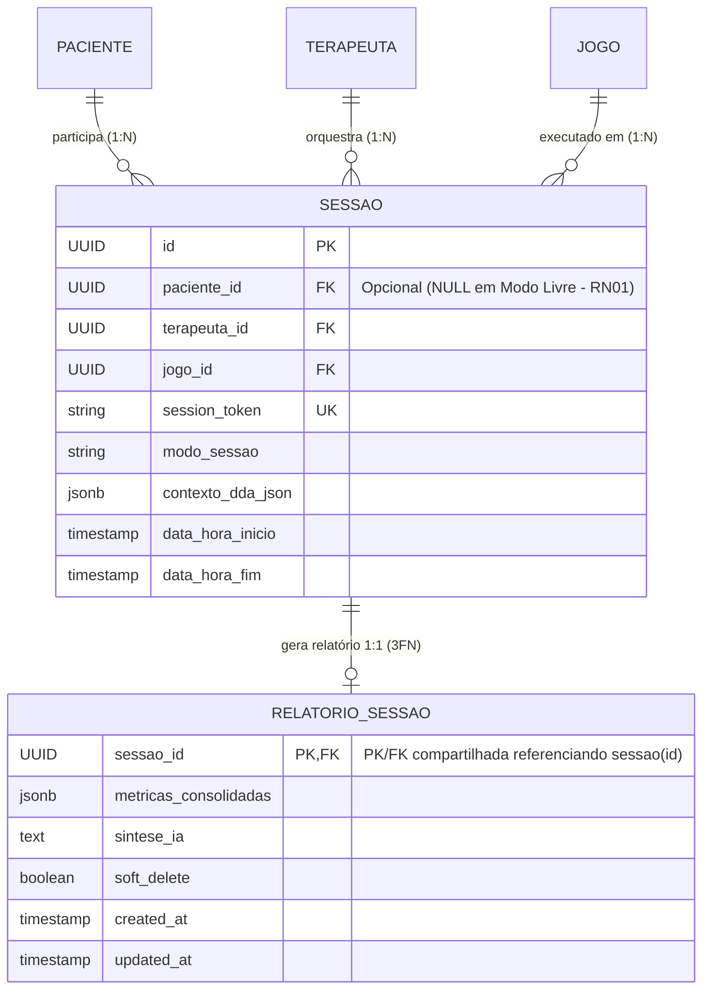

# Regras de Negócio e Invariantes Clínicos (RN01 a RN05 e 3FN) — InTEA

> **Projeto:** InTEA — Interface do Terapeuta para Orquestração do Ecossistema de Games Terapêuticos  
> **Instituição:** Sistemas de Informação — Universidade Federal do Piauí (UFPI)  
> **Documento Mestre:** [Projeto_de_InTEA.pdf](file:///c:/Users/MWSS/OneDrive/Desktop/InTEA/docs/Projeto_de_InTEA.pdf) (Seção 5.3, Página 9; Seção 7.10.2, Páginas 34 e 35)  
> **Hub de Navegação:** [Índice Geral](file:///c:/Users/MWSS/OneDrive/Desktop/InTEA/docs/README.md)

---

## 1. Visão Geral dos Invariantes de Negócio

No ecossistema InTEA, as **Regras de Negócio (RN)** constituem os pilares normativos e clínicos invioláveis do sistema. Diferente de preferências visuais ou opções configuráveis, uma violação de RN acarreta perda de integridade do prontuário, quebra de sigilo ético-médico ou risco de desregulação sensorial para o paciente no espectro autista.

Por essa razão, essas regras são impostas de forma redundante em múltiplos níveis: validação de esquemas no Frontend, middlewares de autorização no Backend e *triggers* / restrições de chave no PostgreSQL.

> [!IMPORTANT]
> **Regra de Homologação Soberana:** Todas as caixas de verificação de critérios de aceite abaixo permanecem obrigatoriamente desmarcadas (`[ ]`) para validação e auditoria manual pelo usuário no ambiente de testes.

---

## 2. Invariantes Clínicos Centrais (RN01 a RN05)

### RN01 — Modo Livre sem Persistência Clínica
* **Definição Normativa:** Partidas executadas em Modo Livre não gravam telemetria em prontuário médico, não acionam o motor de inteligência artificial para Ajuste Dinâmico de Dificuldade (DDA) e possuem compulsoriamente `paciente_id = NULL`.
* **Mecânica Real e Justificativa:**
  * O Modo Livre existe para testes rápidos de jogos pelo terapeuta, calibração técnica de hardware ou entretenimento lúdico descompromissado da criança na sala de espera.
  * Permitir que dados de uma partida recreativa sejam gravados no prontuário de um paciente geraria **poluição estatística irreversível**, distorcendo os gráficos evolutivos e falseando os relatórios clínicos longitudinais.
  * No banco de dados, o registro em `sessao` é instanciado com `modo_sessao = 'modo_livre'` e `paciente_id = NULL`. O gateway WebSocket descarta pacotes de telemetria direcionados a prontuários e não dispara o webhook do Agente de IA.
* **Critérios de Aceite:**
  * [ ] Rejeição no Backend caso um request com `modo_sessao = 'modo_livre'` contenha `paciente_id` preenchido.
  * [ ] Bloqueio de inserção de registros na tabela `relatorio_sessao` para sessões em modo livre.
  * [ ] Restrição de visualização da sessão livre exclusivamente ao terapeuta que a iniciou ou SuperAdmin (`sessaoMiddleware`).

---

### RN02 — Fallback de Métrica Proibido / Tipagem Estrita
* **Definição Normativa:** Toda métrica coletada por um jogo DEVE ter seu atributo `tipo_metrica` explicitamente declarado no Manifesto Técnico do jogo. É **estritamente PROIBIDO** converter métricas sem tipo em categóricas por fallback automático no código. Telemetria com tipo incompatível ou fora do domínio clínico deve ser rejeitada com código HTTP **`422 Unprocessable Entity`**.
* **Mecânica Real e Justificativa:**
  * Sistemas ingênuos frequentemente recorrem a fallbacks (ex.: "se não sei o tipo, trato como texto ou categórico"). No contexto do TEA, essa prática é catastrófica: um tempo de reação de 1.200 ms tratado como categoria `"1200"` destrói o cálculo de desvio padrão e inviabiliza a detecção de crises sensoriais.
  * Se um jogo tentar enviar um valor numérico para uma métrica declarada como booleana, ou se omitir o `tipo_metrica` no manifesto, o InTEA recusa o processamento.
* **Domínios Canônicos de Métrica:**
  * `numerico_continuo`: valores reais (tempo em segundos, latência de resposta, precisão percentual).
  * `ordinal_discreto`: contadores inteiros (tentativas, acertos, fases concluídas).
  * `categorico`: estados discretos finitos (cores selecionadas, rota escolhida).
  * `booleano`: verdadeiro/falso (completou objetivo, acionou ajuda).
* **Critérios de Aceite:**
  * [ ] Validação do Manifesto do jogo rejeitando manifestos com métricas sem `tipo_metrica`.
  * [ ] Emissão imediata de `422 Unprocessable Entity` quando um pacote de telemetria violar o domínio tipado.
  * [ ] Proibição no Frontend de renderizadores genéricos que disfarcem erros de tipagem.

---

### RN03 — Contexto Obrigatório no Início da Sessão Terapêutica
* **Definição Normativa:** O contexto clínico pré-sessão (nível de estresse, gatilhos sensoriais a evitar, objetivo da intervenção) DEVE ser entregue ao Agente de IA antes do processamento do primeiro evento de telemetria do jogo.
* **Mecânica Real e Justificativa:**
  * Um motor de DDA que inicia "a frio" sem conhecer o estado emocional da criança pode cometer o erro de aplicar desafios complexos para um paciente que chegou ao consultório já sobrecarregado ou sob estresse agudo, desencadeando crises de desregulação sensorial.
  * O fluxo de pareamento exige que, antes de liberar o botão de início ou aceitar telemetria do tablet, o terapeuta preencha ou confirme o formulário de contexto pré-sessão (**Contrato 3**). Se o profissional optar pelo modo rápido, parâmetros clínicos homologados de segurança mínima são injetados como linha de base.
* **Critérios de Aceite:**
  * [ ] Bloqueio da transição da sessão para `em_andamento` até que o contexto tenha sido despachado.
  * [ ] Gravação do payload de contexto no campo `contexto_dda_json` da tabela `sessao`.
  * [ ] Confirmação de recebimento do contexto pelo Agente de IA registrada na linha do tempo da sessão.

---

### RN04 — Visibilidade por Vínculo Institucional e Multi-Tenancy
* **Definição Normativa:** O acesso aos dados e prontuários de um paciente é estritamente restrito aos terapeutas que possuem vínculo ativo na tabela associativa `terapeuta_paciente` E pertençam à mesma instituição clínica (`clinica_id`). Tentativas de acesso indevido devem ser bloqueadas com código **`403 Forbidden`**.
* **Mecânica Real e Justificativa:**
  * Em conformidade com o sigilo profissional em saúde mental e a LGPD, um terapeuta não pode visualizar prontuários de pacientes com os quais não atua, mesmo que trabalhem na mesma clínica (a menos que seja formalmente vinculado à equipe multidisciplinar do caso).
  * Profissionais de clínicas distintas possuem isolamento absoluto (*multi-tenant* estrito).
  * O `verificarVisibilidadePaciente` intercepta a requisição, valida a correspondência de `clinica_id` e a presença do par `(terapeuta_id, paciente_id)` antes de qualquer query aos prontuários.
* **Critérios de Aceite:**
  * [ ] Tentativa de acesso de terapeuta sem vínculo com o paciente retornando `403 Forbidden`.
  * [ ] Tentativa de acesso entre terapeutas e pacientes de clínicas distintas retornando `403 Forbidden`.
  * [ ] SuperAdmin com visibilidade global mantida para fins de suporte e governança da plataforma.

---

### RN05 — Inalterabilidade e Imutabilidade do Histórico Clínico
* **Definição Normativa:** Visando a integridade legal e clínica do prontuário, pacientes, anotações de evolução e relatórios de sessões anteriores NÃO PODEM ser excluídos de forma física (*hard delete*) do banco de dados, admitindo-se unicamente a exclusão lógica (*soft delete* com `status_ativo = false` ou `soft_delete = true`).
* **Mecânica Real e Justificativa:**
  * A legislação sanitária e o Código de Ética Profissional proíbem a destruição arbitrária de históricos clínicos de pacientes atendidos.
  * No PostgreSQL do Supabase, triggers de banco de dados (`impedir_hard_delete_clinico`) interceptam qualquer instrução `DELETE` disparada contra as tabelas `paciente`, `anotacao_clinica` e `relatorio_sessao`, lançando uma exceção SQL caso a operação seja tentada fora do ambiente de testes de SuperAdmin.
  * Métodos de listagem filtram registros inativos por padrão, mantendo a tela limpa enquanto preservam a trilha histórica para eventuais perícias médicas.
* **Critérios de Aceite:**
  * [ ] `DELETE /api/paciente/:id` aplicando exclusivamente `status_ativo = false`.
  * [ ] `DELETE /api/anotacao/:id` aplicando exclusivamente `soft_delete = true` (204 No Content).
  * [ ] Trigger de banco bloqueando execução manual de `DELETE` físico em produção.

---

## 3. A Normalização em 3ª Forma Normal (3FN) da Entidade `relatorio_sessao`

### 3.1. Contextualização da Refatoração Arquitetural
Na concepção inicial do projeto (Sprint 3), os diagramas preliminares continham redundâncias denormalizadas: a tabela `relatorio_sessao` mantinha cópias de `paciente_id` e `terapeuta_id`, além de um identificador sequencial `id` próprio.

Durante a evolução técnica e a homologação da Sprint 10, essa modelagem foi formalmente corrigida para atingir a **3ª Forma Normal Estrita (3FN)**:
1. **Relação 1:1 Estrita:** Toda sessão clínica gera no máximo um único relatório analítico consolidado, e todo relatório decorre necessariamente de uma sessão.
2. **Chave Primária Compartilhada:** A coluna `sessao_id` atua simultaneamente como Chave Primária (PK) e Chave Estrangeira (FK) referenciando `public.sessao(id)`.
3. **Eliminação de Dependências Transitivas:** Os identificadores `paciente_id` e `terapeuta_id` foram expurgados da tabela `relatorio_sessao`. Como a sessão associada já aponta univocamente para o paciente e para o terapeuta autor, mantê-los no relatório configuraria dependência funcional transitiva e risco de inconsistência.
4. **Isolamento de Modo Livre (RN01):** Sessões em Modo Livre (`paciente_id = NULL`) não possuem e nunca receberão tuplas na tabela `relatorio_sessao`.

---

### 3.2. Tabela 2: Dicionário de Dados Oficial — `public.relatorio_sessao` (3FN)

A tabela abaixo reproduz o Dicionário de Dados canônico registrado na Tabela 2 do documento mestre do projeto:

| Campo / Coluna | Tipo de Dado | Restrições / Chaves | Descrição e Papel Clínico |
| :--- | :---: | :---: | :--- |
| **`sessao_id`** | `UUID` | `PK`, `FK` $\rightarrow$ `sessao(id)` | Identificador unívoco da sessão e chave primária compartilhada (relação 1:1 estrita). |
| **`metricas_consolidadas`** | `JSONB` | `NOT NULL` | Objeto estruturado contendo médias, dispersões, taxas de acerto e tempo de reação da sessão. |
| **`sintese_ia`** | `TEXT` | `NULLABLE` | Parecer analítico e recomendações clínicas geradas pelo Agente de IA (**Contrato 4**). |
| **`soft_delete`** | `BOOLEAN` | `DEFAULT FALSE`, `NOT NULL` | Indicador de exclusão lógica em conformidade com o invariante clínico **RN05**. |
| **`created_at`** | `TIMESTAMPTZ` | `DEFAULT TIMEZONE('utc', NOW())` | Carimbo de data e hora exatos da geração e consolidação do laudo analítico. |
| **`updated_at`** | `TIMESTAMPTZ` | `DEFAULT TIMEZONE('utc', NOW())` | Registro de auditoria temporal de eventuais atualizações ou pareceres complementares. |

---

## 4. Evidências Visuais e Modelagem Relacional

* `[Imagem 4: Diagrama Entidade-Relacionamento (DER Físico Supabase 3FN)]` — Mapeamento relacional completo do banco de dados com chaves UUID e integridade referencial.
* `[Imagem 18: Tabelas das Classes no Banco de Dados]` — Estrutura física das tabelas instanciadas no PostgreSQL do Supabase.
* `[Imagem 19: Tabela de Clínicas no Banco de Dados]` — Isolamento multi-tenant institucional garantindo o cumprimento de **RN04**.
* `[Imagem 20: Tabela Associativa Terapeuta-Paciente]` — Tabela associativa com chave composta gerenciando vínculos de equipe multidisciplinar.

---

## 5. Governança da Equipe Multidisciplinar, Concorrência e Auditoria (Sprint 13)

### 5.1. Matriz de Permissões: Leitura Compartilhada (RF18) vs. Escrita por Autoria (RF21)

Em clínicas multidisciplinares, múltiplos especialistas (Psicólogos ABA, Fonoaudiólogos, Terapeutas Ocupacionais) compartilham o acompanhamento do mesmo paciente. Para garantir interoperabilidade clínica e resguardar a autoria indelével perante conselhos de classe (CRP, CREFITO), o InTEA aplica uma assimetria deliberada entre operações de leitura e escrita:

| Operação Clínica | Endpoint / Ação | Terapeuta Criador / Condutor | Outro Especialista Vinculado | Especialista Sem Vínculo ou Outra Clínica | SuperAdmin |
| :--- | :--- | :---: | :---: | :---: | :---: |
| **Consultar Prontuário e Histórico** | `GET /api/paciente/:id`, `/historico` | `200 OK` | `200 OK` (Leitura Compartilhada **RF18**) | `403 Forbidden` (**RN04**) | `200 OK` |
| **Listar Sessões do Paciente** | `GET /api/sessao?pacienteId=:id` | `200 OK` | `200 OK` (Vê sessões de todos os colegas) | `403 Forbidden` (**RN04**) | `200 OK` |
| **Visualizar Resultado de Sessão** | `GET /api/sessao/:id/resultado` | `200 OK` | `200 OK` (Identifica o condutor) | `403 Forbidden` (**RN04**) | `200 OK` |
| **Listar Anotações Clínicas** | `GET /api/anotacao/paciente/:id` | `200 OK` | `200 OK` (Vê todas as notas com autor) | `403 Forbidden` (**RN04**) | `200 OK` |
| **Criar Nova Anotação** | `POST /api/anotacao` | `201 Created` | `201 Created` (Assinada com seu próprio JWT) | `403 Forbidden` (**RN04**) | `201 Created` |
| **Editar Anotação Existente** | `PATCH /api/anotacao/:id` | `200 OK` | **`403 Forbidden`** (Escrita Isolada **RF21**) | `403 Forbidden` | `200 OK` |
| **Inativar Anotação (Soft Delete)** | `DELETE /api/anotacao/:id` | `204 No Content` | **`403 Forbidden`** (Escrita Isolada **RF21**) | `403 Forbidden` | `204 No Content` |
| **Iniciar Sessão Clínica** | `POST /api/sessao/iniciar` | `201 Created` | `201 Created` (se não houver outra ativa) | `403 Forbidden` (**RN04**) | `201 Created` |
| **Finalizar Sessão Ativa** | `PATCH /api/sessao/:id/finalizar` | `200 OK` | **`403 Forbidden`** (Apenas condutor **RF21**) | `403 Forbidden` | `200 OK` |
| **Cancelar Sessão Ativa** | `DELETE /api/sessao/:id/cancelar` | `200 OK` | **`403 Forbidden`** (Apenas condutor **RF21**) | `403 Forbidden` | `200 OK` |
| **Comando de Jogo via WebSocket** | Evento `sessao:comando` | Aceito e emitido ao tablet | **`PERMISSAO_NEGADA`** (`observador_equipe`) | Conexão rejeitada | Aceito |
| **Telemetria via WebSocket** | Evento `sessao:telemetria` | Streaming em tempo real | Streaming em tempo real (Modo Observador) | Conexão rejeitada | Streaming |

### 5.2. Prevenção de Paciente Órfão (RF18 / Integridade Clínica)
* **Regra:** Nenhum paciente na clínica pode ficar sem ao menos um profissional de saúde responsável pelo seu prontuário.
* **Comportamento da API:** Ao executar `DELETE /api/paciente/:id/terapeutas/:terapeutaId`, o serviço consulta atomicamente `contarTerapeutasAtivosVinculados(pacienteId)`. Caso o terapeuta a ser removido seja o único profissional ativo associado ao paciente (`total <= 1`), a requisição é bloqueada imediatamente com status **`409 Conflict`**.
* **Comportamento na Interface:** O botão de remoção é desabilitado visualmente no `<PainelEquipeMultidisciplinar />` quando `especialistas.length <= 1`, exibindo tooltip orientador ao usuário.

### 5.3. Trava de Sessões Simultâneas Concorrentes (RF13 / Concorrência)
* **Regra:** Um mesmo paciente não pode ser submetido a duas sessões clínicas simultâneas com terapeutas diferentes.
* **Comportamento da API:** No endpoint `POST /api/sessao/iniciar`, o `SessaoConcorrenciaService` verifica se já existe registro em `sessao` com o mesmo `paciente_id` e status em `'aguardando_pareamento'` (com `expira_em` não expirado), `'conectado'` ou `'em_andamento'`. Caso detectada sessão concorrente, a criação da segunda sessão é rejeitada com **`409 Conflict`**, retornando os dados da sessão ativa e o especialista condutor.
* **Comportamento no WebSocket:** Caso outro especialista da equipe abra a sessão em andamento no Cockpit, ele é conectado à sala Socket.IO sob o papel `'observador_equipe'`, recebendo telemetria passiva sem capacidade de intervenção motora ou interrupção do jogo.

### 5.4. Trilha de Auditoria Institucional de Vínculos e Acessos (RF08, RNF05)
* **Regra:** Todas as alterações na equipe do paciente (inclusão ou exclusão de vínculos em `terapeuta_paciente`) e consultas de auditoria devem ser imutáveis e auditáveis.
* **Comportamento da API:** Disparo de eventos registrando autor da mutação (`req.user.id`), terapeuta alvo, paciente, tipo de ação (`vinculo_equipe_criado`, `vinculo_equipe_removido`), endereço IP e timestamp UTC. O endpoint `GET /api/auditoria` expõe filtros por `pacienteId` e `tipoAcao`, com isolamento obrigatório por `clinica_id` (**RN04**).

### 5.5. Nomenclatura Clínica Homologada (Seção 7.7 do Projeto InTEA)
* Conforme validação clínica qualitativa realizada com psicólogos e terapeutas (Página 32 do Projeto InTEA), é **terminantemente PROIBIDO** utilizar o termo *"Co-Terapeuta"* nos componentes visuais, mensagens da API e relatórios.
* Devem ser empregadas exclusivamente as expressões **"Equipe Multidisciplinar"** ou **"Especialistas Vinculados"**, garantindo o reconhecimento da horizontalidade e autonomia das diferentes especialidades clínicas envolvidas no plano terapêutico singular.
