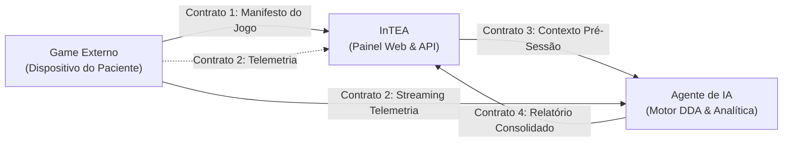
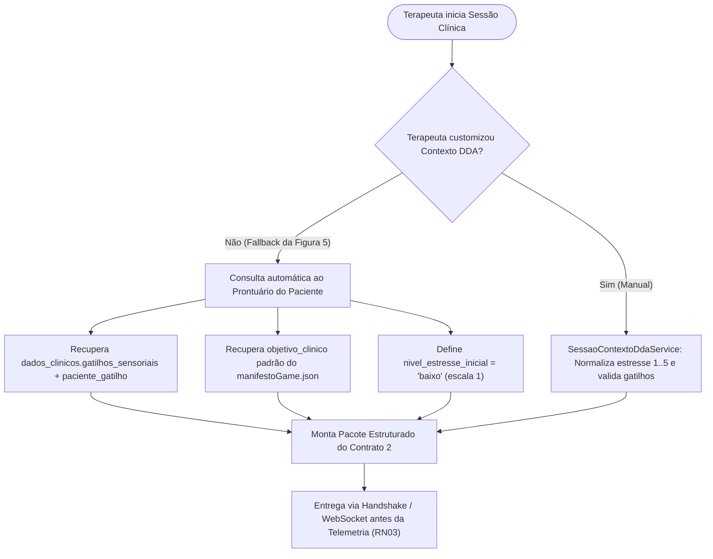

# Especificação dos Contratos JSON do Ecossistema — InTEA

> **Projeto:** InTEA — Interface do Terapeuta para Orquestração do Ecossistema de Games Terapêuticos  
> **Instituição:** Sistemas de Informação — Universidade Federal do Piauí (UFPI)  
> **Documento Mestre:** [Projeto_de_InTEA.pdf](file:///c:/Users/MWSS/OneDrive/Desktop/InTEA/docs/Projeto_de_InTEA.pdf) (Seção 4, Página 7; Sprint 4, Página 15)  
> **Arquivos Fonte:** [`docs/ModelosDeContratos/`](file:///c:/Users/MWSS/OneDrive/Desktop/InTEA/docs/ModelosDeContratos/)  
> **Hub de Navegação:** [Índice Geral](file:///c:/Users/MWSS/OneDrive/Desktop/InTEA/docs/README.md)

---

## 1. Visão Geral da Interoperabilidade por Contratos

Para garantir que novos jogos terapêuticos sejam integrados sem necessidade de alteração no código-fonte do InTEA ou do Agente de IA (**RNF02**), toda a comunicação no ecossistema é governada por **quatro contratos JSON padronizados, tipados e versionados**.



---

## 2. Contrato 1: Manifesto Técnico do Jogo (`manifestoGame.json`)

* **Finalidade:** Metadados do jogo, objetivos clínicos e declaração formal dos tipos de métricas geradas.
* **Emissor:** Desenvolvedor do Jogo / Jogo Externo $\rightarrow$ **Receptor:** InTEA Backend.
* **Canal:** Arquivo estático persistido no banco de dados (`jogo.manifesto_json`) e consumido em `GET /api/jogos/:id`.
* **Regra de Negócio Crítica (**RN02**):** É **estritamente obrigatório** declarar o `tipo_metrica` para cada item em `metricas_suportadas`. Manifestos sem essa informação são rejeitados com `422 Unprocessable Entity`.

### Esquema do JSON do Manifesto:
```json
{
  "id_jogo": "game-core-01",
  "nome": "Aventura Cognitiva",
  "versao": "1.0.0",
  "metricas_suportadas": [
    {
      "id_metrica": "tempo_resposta",
      "tipo_metrica": "numerica",
      "unidade": "segundos"
    },
    {
      "id_metrica": "nivel_frustracao",
      "tipo_metrica": "categorica",
      "valores": ["baixo", "medio", "alto"]
    }
  ]
}
```

### Dicionário de Campos:
| Campo | Tipo | Obrigatório | Descrição |
| :--- | :---: | :---: | :--- |
| `id_jogo` | `string` | Sim | Identificador único alfanumérico do jogo homologado. |
| `nome` | `string` | Sim | Nome comercial/clínico exibido no catálogo de jogos (**RF09**). |
| `versao` | `string` | Sim | Versão semântica (SemVer) da compilação do jogo. |
| `metricas_suportadas` | `array` | Sim | Lista de métricas geradas durante a intervenção. |
| `id_metrica` | `string` | Sim | Chave interna da métrica (ex.: `tempo_resposta`). |
| `tipo_metrica` | `string` | Sim | Domínio obrigatório: `numerica`, `categorica`, `ordinal` ou `booleana`. |
| `unidade` | `string` | Não | Unidade física de medida (segundos, ms, pontos). |
| `valores` | `array` | Condicional | Lista finita de rótulos permitidos quando `tipo_metrica == "categorica"`. |

---

## 3. Contrato 2: Streaming de Telemetria Contínua (`telemetria.json`)

* **Finalidade:** Transmissão em alta frequência de eventos atômicos e dados comportamentais da partida.
* **Emissor:** Game Externo (Tablet) $\rightarrow$ **Receptor:** Agente de IA e Gateway WebSocket do InTEA.
* **Canal:** Conexão persistente WebSocket / Socket.IO no canal `session_{token}` (**RNF01**).
* **Frequência:** Até 20 pacotes por segundo, operando sob *sliding window rate limiter*.

### Esquema do JSON de Telemetria:
```json
{
  "token_sessao": "a1b2c3d4-token",
  "data_hora": "2026-09-01T15:30:22Z",
  "tipo_evento": "interacao_paciente",
  "dados": {
    "id_metrica": "tempo_resposta",
    "valor": 3.5
  }
}
```

### Dicionário de Campos:
| Campo | Tipo | Obrigatório | Descrição |
| :--- | :---: | :---: | :--- |
| `token_sessao` | `string` | Sim | PIN/token da sessão ativa vinculado ao pareamento. |
| `data_hora` | `string (ISO 8601)` | Sim | Timestamp UTC exato do evento com resolução em milissegundos. |
| `tipo_evento` | `string` | Sim | Categoria: `interacao_paciente`, `erro`, `conclusao_fase`, `pausa`. |
| `dados.id_metrica` | `string` | Sim | Identificador da métrica compatível com o manifesto do jogo (**RN02**). |
| `dados.valor` | `number \| string \| boolean` | Sim | Valor aferido estritamente correspondente ao tipo declarado. |

---

## 4. Contrato 2 / Contrato 3: Injeção de Contexto Pré-Sessão para DDA (`contextoPreSessao.json`)

> [!NOTE]
> **Identificação Canônica:** No documento mestre [Projeto_de_InTEA.pdf](file:///c:/Users/MWSS/OneDrive/Desktop/InTEA/docs/Projeto_de_InTEA.pdf) (Seção 7.4.2), este contrato é formalmente denominado **Contrato 2** do ecossistema terapêutico. No diagrama macro de fluxo de dados, corresponde ao **Contrato 3** (troca de mensagens de pré-sessão entre o painel InTEA e o motor de Inteligência Artificial DDA).

* **Finalidade:** Envio do estado basal e sensório-motor da criança para calibração inicial do motor de DDA (Dynamic Difficulty Adjustment) do Agente de IA.
* **Emissor:** InTEA Backend $\rightarrow$ **Receptor:** Agente de IA e Jogo Remoto pareado (Tablet/VR).
* **Canal:** Handshake de pareamento (`POST /api/sessao/parear`), canal WebSocket dedicado (`SessaoGateway` nos eventos `entrar_sessao` / `dispositivo_conectado` / `contexto_dda_inicial`) e persistência em `sessao.contexto_dda_json`.
* **Regra de Negócio Crítica (**RN03**):** O motor de inteligência artificial e o jogo remoto estão terminantemente proibidos de processar qualquer pacote de telemetria contínua sem que o pacote estruturado deste contrato tenha sido validado e entregue previamente.
* **Invariante de Modo Livre (**RN01**):** Em sessões de Modo Livre (`paciente_id = NULL`), o sistema suprime qualquer injeção de contexto DDA e rejeita tentativas com status **`400 Bad Request`**.

### Esquema do JSON de Contexto Pré-Sessão (`contextoPreSessao.json`):
```json
{
  "token_sessao": "a1b2c3d4-token",
  "id_terapeuta": "44444444-4444-4444-4444-444444444444",
  "id_paciente": "22222222-2222-2222-2222-222222222222",
  "contexto_paciente": {
    "nivel_estresse_inicial": "medio",
    "gatilhos_sensoriais_evitar": [
      "Sons Altos ou Repentinos",
      "Luzes Estroboscópicas / Piscantes"
    ],
    "objetivo_clinico": "Foco atencional e regulação sensorial"
  }
}
```

### Dicionário de Campos:
| Campo | Tipo | Obrigatório | Descrição |
| :--- | :---: | :---: | :--- |
| `token_sessao` | `string` | Sim | Código PIN/token da sessão clínica inicializada. |
| `id_terapeuta` | `string (UUID)` | Sim | Identificador do terapeuta autor da intervenção (**RF21**). |
| `id_paciente` | `string (UUID)` | Sim | UUID do paciente atendido (rejeitado em modo livre — **RN01**). |
| `contexto_paciente.nivel_estresse_inicial` | `string` | Sim | Escala canônica normalizada: `"baixo"`, `"medio"` ou `"alto"`. |
| `contexto_paciente.gatilhos_sensoriais_evitar` | `array[string]` | Sim | Lista de estímulos sensoriais a serem suprimidos pelo jogo. |
| `contexto_paciente.objetivo_clinico` | `string` | Sim | Meta terapêutica da intervenção cadastrada ou herdada. |

---

### 4.1. Mapeamento Determinístico da Escala de Estresse (Sprint 12)

Para garantir flexibilidade ergonômica ao terapeuta na interface web (**Figura 11**) e rigor semântico no motor de inteligência artificial, o serviço `SessaoContextoDdaService` aplica conversão determinística:

| Entrada na API / Frontend | Escala Numérica | Nível Canônico Contrato 2 | Semântica e Modulação DDA |
| :---: | :---: | :---: | :--- |
| `1` ou `2` ou `"baixo"` | $1 \le x \le 2$ | **`"baixo"`** | Paciente calmo, responsivo e regulado. O motor de jogo inicia com estímulos padrão completos. |
| `3` ou `"medio"` / `"médio"` | $x = 3$ | **`"medio"`** | Paciente com saturação sensorial moderada. IA atenua velocidade de transições e saturação de cores. |
| `4` ou `5` ou `"alto"` | $4 \le x \le 5$ | **`"alto"`** | Paciente desregulado, com hiperreatividade ou crise iminente. IA suprime sons agudos e reduz ritmo. |
| *Outros valores* | Fora de `1..5` | **Erro `400 Bad Request`** | Rejeição imediata por violação de domínio clínico. |

---

### 4.2. Mecanismo de Fallback Clínico Parametrizado (Figura 5 — Diagrama de Atividades)

O fluxo da **Figura 5** do documento mestre define que a parametrização manual de contexto DDA pelo terapeuta é uma comodidade clínica opcional. Caso o profissional opte por iniciar rapidamente a intervenção selecionando `"Usar Parâmetros Padrão Homologados (Fallback)"` (`usar_fallback_padrao: true`) ou omita campos no formulário:



1. **Gatilhos Sensoriais:** O serviço consulta o cadastro do paciente em `dados_clinicos` (campo JSONB `gatilhos_sensoriais`) e na tabela `paciente_gatilho` (via `JOIN` com a tabela `gatilhos`), consolidando uma lista única e sanitizada;
2. **Nível de Estresse:** Assume o valor basal conservador `nivel_estresse_inicial: "baixo"` (`1`);
3. **Objetivo Clínico:** Herda o objetivo primário registrado no manifesto homologado do jogo selecionado (`manifestoGame.json`), com fallback seguro para `"foco_atencional"`;
4. **Persistência e Rastreabilidade:** O pacote consolidado é gravado em `sessao.contexto_dda_json` e fica registrado no histórico longitudinal do atendimento.

---

## 5. Contrato 4: Relatório Consolidado da Sessão (`relatorio.json`)

* **Finalidade:** Síntese analítica, métricas agregadas e parecer automatizado pós-intervenção gerado pela IA.
* **Emissor:** Agente de IA $\rightarrow$ **Receptor:** InTEA Backend (`POST /api/sessao/:id/resultado`).
* **Canal:** HTTP REST com payload assinado digitalmente para garantia de integridade.
* **Persistência Relacional:** Salvo na tabela `relatorio_sessao` estruturada em 3ª Forma Normal (**3FN**).

### Esquema do JSON do Relatório Analítico:
```json
{
  "token_sessao": "a1b2c3d4-token",
  "duracao_segundos": 1200,
  "resumo": {
    "taxa_conclusao": 85.5,
    "intervencoes_dda": 4
  },
  "analises_ia": [
    "O paciente demonstrou excelente regulação após os primeiros 5 minutos.",
    "Houve necessidade de redução de dificuldade em estímulos sonoros."
  ],
  "metricas_agregadas": [
    {
      "id_metrica": "nivel_frustracao",
      "valor_dominante": "baixo",
      "tendencia": "estavel"
    }
  ]
}
```

### Dicionário de Campos:
| Campo | Tipo | Obrigatório | Descrição |
| :--- | :---: | :---: | :--- |
| `token_sessao` | `string` | Sim | Código de pareamento da sessão correspondente. |
| `duracao_segundos` | `number` | Sim | Tempo total líquido de interação terapêutica ativa. |
| `resumo.taxa_conclusao` | `number` | Sim | Percentual de tarefas ou fases finalizadas com sucesso. |
| `resumo.intervencoes_dda` | `number` | Sim | Total de modulações de dificuldade executadas pela IA. |
| `analises_ia` | `array[string]` | Sim | Lista de pareceres clínicos descritivos gerados pelo modelo. |
| `metricas_agregadas` | `array[object]`| Sim | Resumo consolidado de cada métrica coletada na sessão. |

---

## 6. Critérios de Homologação dos Contratos

* [ ] Validação estrutural com biblioteca de DTOs rejeitando campos desconhecidos ou malformados.
* [ ] Rejeição imediata de pacotes de telemetria cujo `id_metrica` não conste no manifesto homologado (**RN02**).
* [ ] Bloqueio de relatórios pós-sessão em sessões marcadas como Modo Livre (**RN01**).
