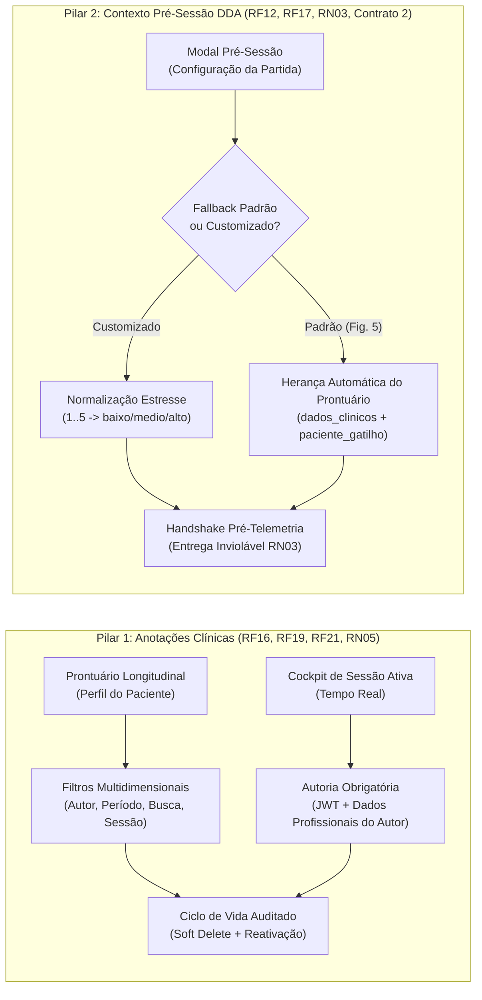

# Sprint 12 Detalhada: Bloco de Anotações Clínicas e Injeção de Contexto Pré-Sessão DDA

> **Período planejado:** 22/10/2026 a 29/10/2026  
> **Tema da Sprint:** Bloco de Anotações Clínicas com Autoria Indelével, Timeline Longitudinal de Prontuário, Anotações em Tempo Real no Cockpit e Injeção Parametrizada de Contexto DDA Pré-Sessão  
> **Composição da equipe:** Marcos Willian (`@MarcosWillianAP1K`) — Implementação Técnica (BD, Back, Front e Testes) · Raildom Silva (`@Raildom`) — Documentação OpenAPI, Especificação de Contratos, Casos de Teste e Governança Kanban  
> **Requisitos centrais do PDF:** RF12 (Gestão de Sessão), RF13 (Cockpit e Comandos), RF16 (Bloco de Anotações Clínicas), RF17 (Injeção de Contexto DDA), RF19 (Filtros Avançados), RF21 (Autoria Obrigatória e Anti-Spoofing), RN01 (Isolamento de Modo Livre), RN03 (Injeção Obrigatória Pré-Telemetria), RN04 (Vínculo Institucional), RN05 (Inalterabilidade e Soft Delete), RNF02 (Interoperabilidade por Contratos), RNF05 (Tempo Real), RNF07 (Acessibilidade e Ergonomia Clínica)  
> **Referências Visuais Mestres:** Figura 5 (Diagrama de Atividades com Fallback DDA), Figura 11 (Tela de Configuração Pré-Sessão), Figura 12 (Tela de Resultados) e Figura 16 (Prontuário do Paciente)  
> **Cards Detalhados:** [task_sprint_12.md](file:///c:/Users/MWSS/OneDrive/Desktop/InTEA/docs/DocsSprints/tasks/task_sprint_12.md)  
> **Hub Geral de Tarefas:** [visao_geral.md](file:///c:/Users/MWSS/OneDrive/Desktop/InTEA/docs/DocsSprints/visao_geral.md)  

---

## 1. Visão Geral e Contexto Clínico da Sprint 12

A **Sprint 12** consolida dois pilares vitais para a eficácia e a segurança da intervenção terapêutica no ecossistema InTEA: o **registro longitudinal do raciocínio clínico com autoria indelével** e a **calibração precoce do motor de adaptação dinâmica de dificuldade (DDA)** baseada nas particularidades sensoriais de cada criança no espectro autista.

### 1.1. Pilar 1: Bloco de Anotações Clínicas e Autoria Profissional (RF16, RF21, RN05)
- **Eliminação de UUIDs Crus:** As anotações clínicas realizam `JOIN` relacional com o cadastro do profissional em `terapeuta`, retornando o objeto sanitizado `autor: { id, nome, registro_profissional, crefito, especialidade }`. A interface web exibe de forma legível e perene a assinatura do terapeuta responsável;
- **Guarda Anti-Spoofing e Autoria JWT:** O `terapeuta_id` é vinculado compulsoriamente a partir das credenciais do token JWT (`req.user.id`). Qualquer tentativa de submissão forçando autoria de terceiro é bloqueada imediatamente com status **`403 Forbidden`** (**RF21**);
- **Anotações em Tempo Real no Cockpit:** O terapeuta pode registrar apontamentos comportamentais durante a sessão ativa via `ModalAnotacaoSessaoAtiva.tsx`. As notas persistem assincronamente no banco relacional indexadas pelo `sessao_id`, eliminando a necessidade de aguardar o laudo pós-sessão e aparecendo de imediato no bloco de anotações da Tela de Resultados (`BlocoAnotacoesClinicas.tsx`);
- **Filtros Avançados no Prontuário Longitudinal:** Suporte a filtros combinados por autor (`terapeutaId`), vínculo de sessão (`sessaoId`, `somenteSemSessao`), intervalo de datas (`dataInicio`, `dataFim`), termo textual (`busca`) e paginação (`page`, `limit` — **RF19**);
- **Ciclo de Vida Auditado e Inalterabilidade (RN05):** Inativação lógica (*soft delete*) e reativação expressa (`PATCH /api/anotacao/:id/reativar`) restritas exclusivamente ao autor original da nota ou SuperAdmin institucional, preservando o prontuário contra adulteração por coterapeutas.

### 1.2. Pilar 2: Injeção de Contexto DDA Pré-Sessão — Contrato 2 (RF17, RN03)
- **Aderência Estrita ao Contrato 2 (`contextoPreSessao.json`):** Estrutura padronizada de payload contendo `token_sessao`, `id_terapeuta`, `id_paciente` e `contexto_paciente: { nivel_estresse_inicial, gatilhos_sensoriais_evitar, objetivo_clinico }`;
- **Mapeamento Determinístico de Estresse:** O sistema aceita a escala intuitiva de 1 a 5 na interface e mapeia deterministicamente para os níveis canônicos:
  - $1 \le x \le 2 \rightarrow$ `"baixo"` (estímulos padrão completos);
  - $x = 3 \rightarrow$ `"medio"` (modulação preventiva e redução de saturação cromática);
  - $4 \le x \le 5 \rightarrow$ `"alto"` (regulação imediata, supressão de agudos e redução de ritmo);
- **Fallback Clínico Parametrizado (Figura 5 — Diagrama de Atividades):** Quando o terapeuta não customiza o contexto manualmente ou opta por `"usar_fallback_padrao": true`, o serviço `SessaoContextoDdaService` herda automaticamente os gatilhos cadastrados na anamnese (`dados_clinicos` e `paciente_gatilho`), define estresse basal `"baixo"` (`1`) e adota o objetivo clínico padrão do manifesto do jogo homologado;
- **Invariante RN03 (Entrega Prévia à Telemetria):** O pacote estruturado é persistido em `sessao.contexto_dda_json` e transmitido ao canal do jogo externo no handshake de pareamento (`POST /api/sessao/parear` ou evento Socket.IO) antes da aceitação do primeiro evento de telemetria contínua;
- **Invariante RN01 (Isolamento de Modo Livre):** Partidas em `modo_livre` (`paciente_id = NULL`) têm qualquer calibração de paciente suprimida, rejeitando tentativas com status **`400 Bad Request`**.

---

## 2. Estrutura de Trabalho e Divisão das Responsabilidades

A execução da Sprint 12 adotou o modelo de **Implementação Técnica Solo + Governança e Documentação Dedicada**:

| Integrante | Papel na Sprint 12 | GitHub | Escopo de Domínio e Fronteira de Arquivos |
| :--- | :--- | :--- | :--- |
| **Marcos Willian** | **Implementação Técnica Solo** (BD, Back, Front e Testes) | `@MarcosWillianAP1K` | Migração `016` e `database.sql`, Models e Services de Anotação e Sessão DDA, Controllers REST, Gateway WebSocket, componentes visuais React (`GerenciadorAnotacoesProntuario`, `CardAnotacaoClinica`, `FiltrosAnotacoesClinicas`, `FormularioContextoDDA`, `ModalAnotacaoSessaoAtiva`) e suíte de testes Vitest. |
| **Raildom Silva** | **Documentação, Especificação e Governança** | `@Raildom` | Seção 7.12 do relatório oficial em LaTeX, especificação OpenAPI em `docs/api-pacientes-jogos.md` e `02-especificacao-api-restful.md`, detalhamento do Contrato 2 em `03-contratos-json-ecossistema.md`, roteiro de testes manuais CT-S29 a CT-S34 em `roteiro-testes.md` e governança do Kanban. |

---

## 3. Entregas Técnicas por Camada da Arquitetura

### 3.1. Banco de Dados Relacional (PostgreSQL / Supabase)
- **Migração `016_indices_anotacao_e_contexto_dda.sql`:**
  - Criação de índice parcial composto `idx_anotacao_paciente_autor_data` em `anotacao_clinica(paciente_id, terapeuta_id, created_at DESC) WHERE soft_delete = false`, acelerando listagens com filtros por profissional e ordenação temporal;
  - Criação de índice funcional `idx_anotacao_conteudo_trgm` para buscas textuais parciais case-insensitive;
  - Criação de índice B-Tree em `sessao(paciente_id, data_hora_inicio DESC)` para recuperação eficiente da última sessão clínica do paciente;
  - Sincronização rigorosa do arquivo mestre `Database/database.sql`.

### 3.2. Backend RESTful API e WebSocket Gateway
- **Módulo de Anotações (`Backend/api/anotacao/`):**
  - Model `AnotacaoClinicaModel` enriquecido com consulta relacional em `terapeuta(id, nome, registro_profissional, crefito, especialidade)`, retornando o objeto `autor`;
  - Service `AnotacaoService` com lógica unificada de listagem com filtros combinados (`terapeutaId`, `sessaoId`, `somenteSemSessao`, `incluirDeletadas`, `dataInicio`, `dataFim`, `busca`);
  - Endpoint `PATCH /api/anotacao/:id/reativar` com verificação de permissão estrita (autor ou SuperAdmin institucional);
  - Thin Controllers com Envelope Pattern Categorizado (`data: { anotacao | anotacoes, meta }, message`).
- **Módulo de Sessão e Contexto DDA (`Backend/api/sessao/`):**
  - Serviço especializado `SessaoContextoDdaService` para validação e normalização estrita de escala de estresse e sanitização de gatilhos;
  - Mecanismo de Fallback Clínico Parametrizado (Figura 5);
  - Endpoint `GET /api/sessao/contexto-sugerido/:pacienteId` protegido por `verificarVisibilidadePaciente` (**RN04**);
  - Injeção obrigatória do pacote DDA no handshake de pareamento antes de pacotes de telemetria (**RN03**);
  - Bloqueio imediato de injeção de contexto ou anotação em Modo Livre (**RN01**).

### 3.3. Frontend SPA (React 19, TypeScript Estrito e Tailwind CSS)
- **Componentes do Prontuário de Anotações (`features/anotacao/components/`):**
  - `CardAnotacaoClinica.tsx`: renderização da autoria com nome e registro CREFITO/CRP (**RF21**), badge de vínculo com sessão, botões de edição inline e soft delete com confirmação modal exibidos apenas para o autor original;
  - `FiltrosAnotacoesClinicas.tsx`: barra de busca por texto, seletor de terapeuta autor, filtro por vínculo (todas / avulsas / em sessão) e filtro de datas;
  - `GerenciadorAnotacoesProntuario.tsx`: composição modular com formulário de nova anotação, contador de caracteres, proteção contra múltiplos envios (`isSubmitting`) e cobertura integral dos 4 estados de UI (Skeleton Loader, Empty State, Error State com retry e Success State).
- **Módulo de Calibração Pré-Sessão (`features/sessao/components/`):**
  - `FormularioContextoDDA.tsx`: espelha fielmente a **Figura 11**, contendo seletor de estresse 1 a 5, chips de gatilhos sensoriais a evitar, seletor de objetivo clínico e alternador para parâmetros homologados padrão (Fallback);
  - Integração no `ModalPreSessao.tsx` carregando automaticamente os gatilhos cadastrados na anamnese e transmitindo o payload do Contrato 2 no início da partida.
- **Cockpit de Sessão Ativa (`features/sessao/components/`):**
  - `ModalAnotacaoSessaoAtiva.tsx`: botão de ação rápida no painel de controle do Cockpit ($\ge 44\times 44\text{px}$ — **RNF07**) abrindo gaveta/modal contextualizado com `sessao_id` e `paciente_id`;
  - Histórico cronológico das observações tomadas durante a intervenção corrente e persistência imediata assíncrona;
  - Desativação automática do botão em sessões de Modo Livre (**RN01**).

---

## 4. Matriz de Rastreabilidade da Sprint 12

| Requisito / Regra | Camada | Artefato de Código | Comportamento Clínico Garantido |
| :--- | :---: | :--- | :--- |
| **RF12** (Gestão de Sessão) | Back/Front | `sessao-contexto-dda.service.ts`, `ModalPreSessao.tsx` | Ciclo de vida da sessão orquestrado com injeção de parâmetros DDA. |
| **RF13** (Cockpit do Terapeuta) | Front/Back | `ModalAnotacaoSessaoAtiva.tsx`, `CockpitSessaoPage.tsx` | Registro de anotações clínicas em tempo real durante a sessão ativa. |
| **RF16** (Bloco de Anotações) | Back/Front | `anotacao.service.ts`, `GerenciadorAnotacoesProntuario.tsx` | Prontuário livre com histórico cronológico, edição e soft delete. |
| **RF17** (Contexto Clínico DDA) | Back/Front | `SessaoContextoDdaService`, `FormularioContextoDDA.tsx` | Calibração prévia do Agente de IA com nível de estresse e gatilhos sensoriais. |
| **RF19** (Filtros Avançados) | Back/Front | `AnotacaoPacienteController`, `FiltrosAnotacoesClinicas.tsx` | Filtros combinados por autor, sessão, período e busca textual. |
| **RF21** (Autoria Obrigatória) | Back/Front | `auth.middleware.ts`, `CardAnotacaoClinica.tsx` | Autoria compulsória extraída do JWT; exibição de nome e conselho de classe. |
| **RN01** (Isolamento Modo Livre) | Back/Front | `sessao.controller.ts`, `ModalAnotacaoSessaoAtiva.tsx` | Bloqueio de anotações e calibração DDA em sessões livres (`paciente_id = null`). |
| **RN03** (Injeção Obrigatória DDA) | Back | `sessao.routes.ts`, `SessaoGateway` | Entrega do Contrato 2 no handshake antes do primeiro evento de telemetria. |
| **RN04** (Vínculo Institucional) | Back | `visibilidade.middleware.ts` | Bloqueio com `403 Forbidden` para terapeutas sem vínculo na mesma clínica. |
| **RN05** (Inalterabilidade e Soft Delete) | Back/BD | `016_indices_anotacao_e_contexto_dda.sql`, `anotacao.model.ts` | Histórico imutável; exclusão física banida; reativação controlada. |
| **RNF02** (Contrato 2) | Docs/Back | `docs/ModelosDeContratos/contextoPreSessao.json` | Paridade 100% de tipos e chaves JSON com os clientes externos. |
| **RNF05** (Tempo Real) | Back/Front | `ModalAnotacaoSessaoAtiva.tsx`, `anotacao.routes.ts` | Persistência assíncrona não bloqueante sem degradação do streaming. |
| **RNF07** (Ergonomia e Acessibilidade) | Front | `GerenciadorAnotacoesProntuario.tsx`, `FormularioContextoDDA.tsx` | Alvos de toque $\ge 44\times 44\text{px}$, Skeleton sem CLS e contraste WCAG. |

---

## 5. Casos de Teste Manuais Elaborados (CT-S29 a CT-S34)

| Caso de Teste | Tipo | Requisitos Rastreados | Cenário de Teste e Validação |
| :---: | :---: | :--- | :--- |
| **CT-S29** | Positivo | RF16, RF21, RN04 | Criação de anotação clínica no prontuário e exibição do objeto enriquecido `autor` (nome, CREFITO e especialidade). |
| **CT-S30** | Negativo | RF21, RN04 | Tentativa de edição (`PATCH`) ou exclusão (`DELETE`) de anotação por outro profissional da clínica, validando bloqueio com **`403 Forbidden`**. |
| **CT-S31** | Positivo | RF19, RN05 | Busca longitudinal com filtros combinados, aplicação de soft delete e restauração via `PATCH /api/anotacao/:id/reativar`. |
| **CT-S32** | Positivo | RF17, RN03, Contrato 2 | Calibração personalizada pré-sessão (estresse escala 1..5, gatilhos e meta) e entrega prévia ao primeiro pacote de telemetria. |
| **CT-S33** | Positivo | RF17, Figura 5 | Início de intervenção com Fallback Clínico Parametrizado, herdando automaticamente gatilhos da anamnese do paciente. |
| **CT-S34** | Negativo | RN01 | Tentativa de injetar contexto DDA ou criar anotação clínica em partida de Modo Livre, validando rejeição com **`400 Bad Request`**. |

---

## 6. Critérios de Homologação da Sprint 12

> [!IMPORTANT]
> **Homologação Soberana do Usuário:** Todas as caixas de seleção permanecem obrigatoriamente desmarcadas (`[ ]`) para conferência e validação manual do usuário no Git e GitHub Projects.

* [ ] Migração SQL `016_indices_anotacao_e_contexto_dda.sql` executada com sucesso e `Database/database.sql` sincronizado.
* [ ] Rota `GET /api/anotacao/paciente/:pacienteId` retorna lista paginada com objeto sanitizado `autor` e suporte aos filtros de terapeuta, período e busca textual.
* [ ] Rota `PATCH /api/anotacao/:id/reativar` restaura anotações inativadas exclusivamente para o autor ou SuperAdmin institucional (**RN05**, **RF21**).
* [ ] Tentativas de edição ou exclusão de anotações por terapeutas terceiros bloqueadas com **`403 Forbidden`** (**RF21**, **RN04**).
* [ ] Serviço `SessaoContextoDdaService` valida o Contrato 2, converte escala de estresse 1..5 e aplica o Fallback Clínico Parametrizado da **Figura 5**.
* [ ] Entrega comprovada do pacote de Contexto DDA no handshake antes da ingestão do primeiro pacote de telemetria contínua (**RN03**).
* [ ] Partidas em Modo Livre rejeitam injeção de contexto DDA e criação de notas de prontuário com status **`400 Bad Request`** (**RN01**).
* [ ] Componentes `GerenciadorAnotacoesProntuario`, `CardAnotacaoClinica` e `FiltrosAnotacoesClinicas` integrados na Página de Perfil do Paciente sem exibição de UUIDs crus.
* [ ] Componente `FormularioContextoDDA` integrado ao `ModalPreSessao` com pré-carregamento dos gatilhos sensoriais do paciente selecionado.
* [ ] Modal de anotação clínica em tempo real (`ModalAnotacaoSessaoAtiva`) funcional no Cockpit de sessão ativa, com supressão automática em Modo Livre.
* [ ] 100% dos testes unitários e de integração passando no Vitest (`npm test` no Backend e Frontend).
* [ ] Especificações OpenAPI e de Contratos JSON atualizadas em conformidade caractere por caractere.
* [ ] Casos de teste CT-S29 a CT-S34 cadastrados no roteiro de testes manuais.

