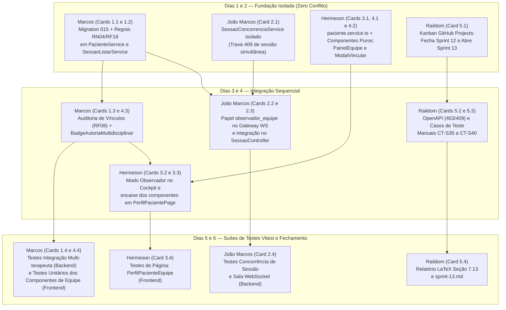

# Cards de Tarefas — Sprint 13: Regras Multi-terapeuta, Concorrência e Cobertura de Testes

> **Sprint:** 13  
> **Período:** 29/10/2026 a 05/11/2026  
> **Tema Central:** Regras Multi-terapeuta (Visibilidade Compartilhada de Prontuário, Autoria Concorrente, Trava de Sessões Simultâneas e Cobertura de Testes Unitários/Integração)  
> **Documento Mestre:** [Projeto_de_InTEA.pdf](file:///c:/Users/MWSS/OneDrive/Desktop/InTEA/docs/Projeto_de_InTEA.pdf) (Tabela 1, Seção 5.1 RF08/RF18/RF21, Seção 5.3 RN04/RN05, Seção 7.7 e Seção 7.13)  
> **Diretrizes e Quality Gate:** [AGENTS.md](file:///c:/Users/MWSS/OneDrive/Desktop/InTEA/AGENTS.md) (Seção 6.9)  
> **Hub de Tarefas Geral:** [visao_geral.md](file:///c:/Users/MWSS/OneDrive/Desktop/InTEA/docs/DocsSprints/visao_geral.md)  

---

## 1. Roteiro Operacional Passo a Passo para a Equipe (Guia Anti-Erro e Ordem de Execução)

> [!IMPORTANT]
> **Leia Antes de Codar — Por que a Sprint 13 é Crítica?**  
> A Sprint 13 **NÃO é apenas uma sprint de testes**. Ela fecha o modelo clínico multidisciplinar do InTEA (**RF18**, **RN04**, **RF08**, **RF21**), onde múltiplos especialistas da mesma clínica (Terapeuta Ocupacional, Psicólogo ABA, Fonoaudiólogo) acompanham o mesmo paciente.  
> Para que a equipe trabalhe em paralelo **sem quebrar o código uns dos outros e sem gerar conflitos de merge no Git**, todos os 5 integrantes DEVEM seguir estritamente o roteiro e as fronteiras de arquivos abaixo.

### 1.1. As 5 Regras Arquiteturais Inegociáveis da Sprint 13 (Resumo de `AGENTS.md` Seção 6.9)

| # | Regra de Negócio / Arquitetura | Comportamento Obrigatório no Código | Código HTTP Esperado |
| :-: | :--- | :--- | :---: |
| **1** | **Leitura Compartilhada na Equipe (`RF18` + `RN04`)** | Qualquer terapeuta ativo da mesma clínica vinculado em `terapeuta_paciente` vê **todo o prontuário, todas as sessões passadas (inclusive de outros colegas) e todas as anotações** daquele paciente. Em `GET /api/sessao?pacienteId=:id`, **não** restringir por `terapeuta_id = req.user.id` se houver vínculo ativo! | **`200 OK`** (com vínculo) / **`403 Forbidden`** (sem vínculo ou outra clínica) |
| **2** | **Escrita Isolada por Autoria (`RF21`)** | Todo especialista vinculado pode criar (`POST`) novas anotações ou sessões em seu próprio nome. Porém, **ninguém pode editar (`PATCH`) ou excluir (`DELETE`) anotação de outro colega**, nem finalizar/cancelar sessão conduzida por outro terapeuta. | **`403 Forbidden`** ao tentar alterar registro de outro autor |
| **3** | **Proibição de Paciente Órfão (`RF18`)** | Ao desvincular um profissional em `DELETE /api/paciente/:id/terapeutas/:terapeutaId`, se ele for o **último terapeuta ativo vinculado ao paciente**, bloquear a remoção para que o prontuário não fique órfão na clínica. | **`409 Conflict`** |
| **4** | **Trava de Sessão Clínica Simultânea (`RF13` / Concorrência)** | Um mesmo paciente **não pode ter duas sessões clínicas ativas ao mesmo tempo** (`aguardando_pareamento`, `conectado` ou `em_andamento`). No WebSocket, colegas da equipe que abrirem a sessão entram apenas como `observador_equipe` (somente leitura). | **`409 Conflict`** ao tentar iniciar 2ª sessão simultânea |
| **5** | **Nomenclatura Clínica na Interface (Seção 7.7 do PDF)** | Conforme validação clínica com terapeutas (PDF pág. 32), **NUNCA usar o termo "Co-Terapeuta"** nas telas. Utilizar sempre **"Equipe Multidisciplinar"** ou **"Especialistas Vinculados"**. | Conformidade Visual UX/UI |

---

### 1.2. Fluxograma de Dependências e Sequenciamento da Equipe (Dias 1 a 6)

---

### 1.3. Roteiro Diário de Execução por Integrante (Como Seguir em Ordem)

1. **Passo 1 — Dias 1 e 2 (Trabalhos Independentes):**
   * **Marcos (`@MarcosWillianAP1K`):** Executa os **Cards 1.1 e 1.2**. Sobe a migration `015`, ajusta `PacienteService` (bloqueio 403 entre clínicas diferentes e bloqueio 409 do último terapeuta) e corrige `SessaoListarService` para que terapeutas vinculados vejam todas as sessões do paciente compartilhado.
   * **João Marcos (`@JM3L0`):** Executa o **Card 2.1** criando o arquivo novo `Backend/api/sessao/services/sessao-concorrencia.service.ts` (não edita arquivos do Marcos).
   * **Hermeson (`@Hermeson69`):** Executa os **Cards 3.1, 4.1 e 4.2**, criando os métodos de equipe em `paciente.service.ts` e desenvolvendo diretamente os componentes visuais puros `<PainelEquipeMultidisciplinar />` e `<ModalVincularEspecialista />` em `Frontend/src/features/paciente/components/`.
   * **Raildom (`@Raildom`):** Executa o **Card 5.1** organizando o quadro do GitHub Projects.
2. **Passo 2 — Dias 3 e 4 (Integração):**
   * **Marcos (`@MarcosWillianAP1K`):** Executa o **Card 1.3** conectando os eventos de vínculo à trilha de auditoria (`RF08`) e desenvolve o **Card 4.3** (`BadgeAutoriaMultidisciplinar.tsx`).
   * **João Marcos (`@JM3L0`):** Executa os **Cards 2.2 e 2.3**, integrando o `SessaoConcorrenciaService` no `SessaoController.iniciar` e diferenciando `terapeuta_condutor` de `observador_equipe` no `sessao.gateway.ts`.
   * **Hermeson (`@Hermeson69`):** Executa os **Cards 3.2 e 3.3**, preparando o modo somente-leitura em `CockpitSessaoPage.tsx` e integrando `<PainelEquipeMultidisciplinar />`, `<ModalVincularEspecialista />` e `<BadgeAutoriaMultidisciplinar />` dentro de `PerfilPacientePage.tsx` e `HistoricoPacientePage.tsx`.
   * **Raildom (`@Raildom`):** Executa os **Cards 5.2 e 5.3** atualizando o OpenAPI (`docs/api-pacientes-jogos.md`) e o roteiro de testes manuais (`docs/roteiro-testes.md`).
3. **Passo 3 — Dias 5 e 6 (Bateria Obrigatória de Testes Automatizados e Homologação):**
   * **Marcos (`@MarcosWillianAP1K`):** Executa o **Card 1.4** (testes de integração no Backend) e o **Card 4.4** (testes unitários dos componentes visuais de equipe no Frontend).
   * **João Marcos (`@JM3L0`):** Executa o **Card 2.4** (testes de concorrência e WebSocket no Backend).
   * **Hermeson (`@Hermeson69`):** Executa o **Card 3.4** (testes de renderização da página de perfil e histórico no Frontend).
   * **Regra Antes do Pull Request:** Nenhum membro pode abrir PR sem rodar `npm test` e `npx tsc --noEmit` na sua camada (`Backend/` ou `Frontend/`) garantindo 100% dos testes verdes.
   * **Raildom (`@Raildom`):** Executa o **Card 5.4** fechando o relatório `sprint-13.md` e a Seção 7.13 do LaTeX.

---

## 2. Cards por Integrante (20 Cards Principais da Sprint 13)

---

### 2.1. Back-end 1 — Marcos Willian (`@MarcosWillianAP1K`)

---

### BD/Back: Migração de Vínculos Multidisciplinares, Proteção Anti-Órfão e Modelagem RN04 (Tipo: Feature)

* **Tipo:** Feature
* **Responsável:** Marcos Willian (`@MarcosWillianAP1K`)
* **Fronteira de Arquivos:** `Database/migrations/015_vinculo_multiterapeuta_e_auditoria_acesso.sql`, `Database/database.sql`, `Backend/api/paciente/models/paciente.model.ts`
* **Ordem de Execução / Dependência:** **DEVE FAZER PRIMEIRO (Dias 1 a 2)**. Estabelece as garantias de banco de dados e métodos de model para a gestão multi-terapeuta.
* **Requisitos:** RF08, RF18, RN04, RN05, RNF05
* **Referência Documentação:** Projeto_de_InTEA.pdf (Tabela 1 — Sprint 13, Seção 5.1 RF08/RF18, Figura 20 — Tabela associativa `terapeuta_paciente`, Seção 7.13), AGENTS.md (Seção 6.9)
* **Descrição:** Criar a migração SQL idempotente `015_vinculo_multiterapeuta_e_auditoria_acesso.sql` e sincronizar `Database/database.sql`:
  1. Enriquecer `public.terapeuta_paciente` com metadados opcionais auditáveis (`papel_equipe VARCHAR(50) DEFAULT 'especialista'`, `vinculado_por UUID REFERENCES public.terapeuta(id) ON DELETE SET NULL`) e índice reverso `idx_terapeuta_paciente_paciente_id ON public.terapeuta_paciente(paciente_id, terapeuta_id)`;
  2. Criar a tabela imutável `public.auditoria_vinculo_acesso` (ou estender a estrutura de auditoria institucional — **RF08**) para registrar operações de vínculo/desvínculo de equipe multidisciplinar e acessos inter-terapeutas ao prontuário;
  3. Evoluir `PacienteModel` (`vincularTerapeuta`, `desvincularTerapeuta`, `listarTerapeutasVinculados`, `contarTerapeutasAtivosVinculados`): validar afinidade estrita de `clinica_id` (**RN04**), retornar objetos de terapeutas com `nome`, `email`, `crefito`, `registro_profissional`, `especialidade` e `created_at` (data de ingresso na equipe), e implementar a verificação atômica que impede remover o vínculo quando `contarTerapeutasAtivosVinculados(pacienteId) <= 1` (prevenção de paciente órfão).
* **Critérios de Aceite:**
  * [ ] Migração `015_vinculo_multiterapeuta_e_auditoria_acesso.sql` 100% idempotente (`IF NOT EXISTS`) e sincronizada em `Database/database.sql`.
  * [ ] Índice `idx_terapeuta_paciente_paciente_id` criado otimizando consultas de equipe por `paciente_id`.
  * [ ] Método `PacienteModel.contarTerapeutasAtivosVinculados(pacienteId)` retornando a contagem exata de especialistas ativos vinculados ao paciente.
  * [ ] `PacienteModel.listarTerapeutasVinculados(pacienteId)` retornando os dados profissionais completos e sanitizados de todos os especialistas vinculados ao paciente.
  * [ ] Código em TypeScript estrito (zero `any`) e métodos em `camelCase`.

---

### Back: Visibilidade Compartilhada de Sessões e Prontuário para Equipe Vinculada (Tipo: Feature)

* **Tipo:** Feature
* **Responsável:** Marcos Willian (`@MarcosWillianAP1K`)
* **Fronteira de Arquivos:** `Backend/api/paciente/services/paciente.service.ts`, `Backend/api/paciente/controllers/paciente.controller.ts`, `Backend/api/sessao/services/sessao-listar.service.ts`, `Backend/api/sessao/models/sessao.model.ts`
* **Ordem de Execução / Dependência:** **FAZ DEPOIS DE (Card 1.1 — Dia 2)**. Ajusta os serviços de listagem e gestão de vínculos para cumprir integralmente **RF18** e **RN04**.
* **Requisitos:** RF18, RF19, RN04, RN05
* **Referência Documentação:** Projeto_de_InTEA.pdf (Seção 5.1 RF18 — Multi-terapeuta por Paciente; Seção 5.3 RN04; Seção 7.13), AGENTS.md (Seção 6.9)
* **Descrição:** Ajustar as regras de visibilidade compartilhada e códigos HTTP canônicos para equipes multidisciplinares:
  1. Em `SessaoListarService.listar` e `SessaoModel.listar`: corrigir a regra de visibilidade quando `filtros.pacienteId` for informado. Se o terapeuta autenticado possuir vínculo ativo com o `pacienteId` em `terapeuta_paciente` (e mesma `clinica_id`), **não restringir a query por `terapeuta_id = usuarioLogado.id`**, permitindo que o especialista visualize todas as sessões clínicas daquele paciente conduzidas por qualquer membro da equipe multidisciplinar (**RF18**), enriquecendo cada sessão retornada com o nome e especialidade do terapeuta condutor. Caso `pacienteId` seja informado e o terapeuta não possua vínculo ativo, rejeitar com **`403 Forbidden`** (**RN04**);
  2. Em `PacienteService.vincularTerapeuta` e `PacienteController.vincularTerapeuta`: retornar **`403 Forbidden`** (e não 400) quando houver tentativa de vincular um terapeuta de outra `clinica_id` (**RN04**), e **`409 Conflict`** caso o terapeuta já esteja vinculado;
  3. Em `PacienteService.desvincularTerapeuta` e `PacienteController.desvincularTerapeuta`: retornar **`409 Conflict`** quando a operação tentar desvincular o último terapeuta ativo do paciente (impedindo prontuário órfão).
* **Critérios de Aceite:**
  * [ ] `GET /api/sessao?pacienteId=:id` retorna **`200 OK`** com todas as sessões clínicas do paciente (de todos os especialistas da equipe) quando o requisitante possui vínculo ativo em `terapeuta_paciente` (**RF18**).
  * [ ] `GET /api/sessao?pacienteId=:id` retorna **`403 Forbidden`** quando o terapeuta requisitante não possui vínculo ativo com o paciente solicitado (**RN04**).
  * [ ] `POST /api/paciente/:id/terapeutas` retorna **`403 Forbidden`** ao tentar vincular profissional de outra clínica (**RN04**).
  * [ ] `DELETE /api/paciente/:id/terapeutas/:terapeutaId` retorna **`409 Conflict`** ao tentar remover o único terapeuta ativo vinculado ao paciente.
  * [ ] Sessões em `modo_livre` (**RN01**) permanecem estritamente visíveis apenas ao seu próprio criador ou SuperAdmin.

---

### Back: Auditoria Institucional de Vínculos (RF08) e Guarda de Autoria Concorrente (Tipo: Feature)

* **Tipo:** Feature
* **Responsável:** Marcos Willian (`@MarcosWillianAP1K`)
* **Fronteira de Arquivos:** `Backend/api/auditoria/models/auditoria.model.ts`, `Backend/api/auditoria/services/auditoria.service.ts`, `Backend/api/auditoria/controllers/auditoria.controller.ts`, `Backend/core/middlewares/visibilidade.middleware.ts`
* **Ordem de Execução / Dependência:** **Dias 3 a 4**. Implementa a rastreabilidade institucional exigida por **RF08** e **RNF05**.
* **Requisitos:** RF08, RF18, RF21, RN04, RNF05, RNF06
* **Referência Documentação:** Projeto_de_InTEA.pdf (Seção 5.1 RF08 — Auditar vínculos e acessos dentro da clínica; RNF05), AGENTS.md (Seção 6.9)
* **Descrição:** Expandir o módulo de auditoria (`Backend/api/auditoria/`) e o middleware `verificarVisibilidadePaciente` para registrar e consultar eventos de governança multi-terapeuta (**RF08**):
  1. Ao vincular (`POST /api/paciente/:id/terapeutas`) ou desvincular (`DELETE /api/paciente/:id/terapeutas/:terapeutaId`) um profissional da equipe do paciente, emitir evento assíncrono registrando na auditoria: `terapeuta_autor_id` (`req.user.id`), `terapeuta_alvo_id`, `paciente_id`, `acao` (`vinculo_equipe_criado` | `vinculo_equipe_removido`), `ip` e `timestamp`;
  2. Permitir que `GET /api/auditoria` filtre eventos por `pacienteId` e `tipoAcao`, restringindo a visualização de terapeutas comuns aos eventos de sua própria clínica (`clinica_id`) e concedendo visão global apenas a SuperAdmin (**RF07**, **RF08**, **RN04**).
* **Critérios de Aceite:**
  * [ ] Registro automático e imutável de auditoria a cada adição ou remoção de vínculo em `terapeuta_paciente` (**RF08**, **RNF05**).
  * [ ] Consulta `GET /api/auditoria` suportando filtro por `pacienteId` e isolando registros por `clinica_id` (**RN04**).
  * [ ] Nenhuma mutação de auditoria bloqueia ou degrada a latência das rotas principais de paciente.

---

### Back: Suíte de Testes de Integração Multi-terapeuta, Visibilidade RN04 e Auditoria RF08 (Tipo: Validação)

* **Tipo:** Validação
* **Responsável:** Marcos Willian (`@MarcosWillianAP1K`)
* **Fronteira de Arquivos:** `Backend/api/paciente/test/multiterapeuta_rn04.test.ts`, `Backend/api/auditoria/test/auditoria_vinculos_rf08.test.ts`
* **Ordem de Execução / Dependência:** **Dias 5 a 6 (Após Cards 1.1, 1.2 e 1.3)**. Validação automatizada de fechamento do backend REST.
* **Requisitos:** Qualidade de Software, RF08, RF16, RF18, RF21, RN04, RN05
* **Referência Documentação:** Projeto_de_InTEA.pdf (Seção 7.13), AGENTS.md (Seção 6.9)
* **Descrição:** Desenvolver suíte completa de testes automatizados no Vitest simulando um cenário real de clínica multidisciplinar com 3 terapeutas (Terapeuta A e Terapeuta B da Clínica 1 vinculados ao Paciente X; Terapeuta C da Clínica 2 sem vínculo):
  1. Terapeuta A cadastra Paciente X e vincula Terapeuta B (`201 Created`);
  2. Terapeuta B consulta prontuário (`GET /api/paciente/:id`), histórico longitudinal (`GET /api/paciente/:id/historico`), sessões conduzidas pelo Terapeuta A (`GET /api/sessao?pacienteId=:id`) e anotações do Terapeuta A (`GET /api/anotacao/paciente/:id`), recebendo **`200 OK`** em todas (**RF18**);
  3. Terapeuta B cria sua própria anotação no Paciente X (`201 Created`), mas tenta editar (`PATCH`) ou excluir (`DELETE`) a anotação criada pelo Terapeuta A, recebendo **`403 Forbidden`** (**RF21**);
  4. Tentativa de vincular Terapeuta C (Clínica 2) ao Paciente X retorna **`403 Forbidden`** (**RN04**);
  5. Após desvincular Terapeuta B (`200 OK`), tentativa de desvincular o Terapeuta A (último especialista ativo do Paciente X) retorna **`409 Conflict`** (proteção anti-órfão);
  6. Conferência da geração dos logs de vínculo na trilha de auditoria (**RF08**).
* **Critérios de Aceite:**
  * [ ] 100% dos testes passando no Vitest (`npm test` em `Backend/`).
  * [ ] Cobertura explícita dos status HTTP `200`, `201`, `400`, `403`, `404` e `409`.
  * [ ] Comprovação automatizada de leitura compartilhada (`RF18`) combinada à escrita isolada por autoria (`RF21`).

---

### 2.2. Back-end 2 — João Marcos (`@JM3L0`)

---

### Back: Serviço de Controle de Concorrência de Sessões Ativas por Paciente (Tipo: Feature)

* **Tipo:** Feature
* **Responsável:** João Marcos (`@JM3L0`)
* **Fronteira de Arquivos:** `Backend/api/sessao/services/sessao-concorrencia.service.ts`, `Backend/api/sessao/dtos/sessao.dto.ts`
* **Ordem de Execução / Dependência:** **DEVE FAZER PRIMEIRO (Dias 1 a 2 — Módulo isolado)**. Cria o serviço de verificação de concorrência em arquivo próprio sem conflitar com outros desenvolvedores.  
  * *Zona Proibida:* Não editar arquivos de `Backend/api/paciente/` ou `Database/`.
* **Requisitos:** RF13, RF18, RF21, RN01, RN04
* **Referência Documentação:** Projeto_de_InTEA.pdf (Tabela 1 — Sprint 13: Concorrência e Regras Multi-terapeuta; Seção 7.13), AGENTS.md (Seção 6.9)
* **Descrição:** Criar o serviço `SessaoConcorrenciaService` em `Backend/api/sessao/services/sessao-concorrencia.service.ts` para gerenciar travas de concorrência em ambientes onde múltiplos terapeutas acompanham o mesmo paciente:
  1. Implementar `verificarSessaoAtivaConcorrente(pacienteId: string, terapeutaSolicitanteId: string)`: consulta se o paciente já possui uma sessão clínica ativa (`status_sessao IN ('aguardando_pareamento', 'conectado', 'em_andamento')` cujo `expira_em` ainda seja válido). Caso exista sessão ativa conduzida por outro terapeuta da equipe, retorna conflito detalhado (`conflito: true, statusHttp: 409`) informando o ID da sessão ativa e o especialista responsável;
  2. Implementar `validarPermissaoMutacaoSessao(sessao: Sessao, usuarioLogadoId: string, isSuperAdmin: boolean)`: garante que ações mutáveis críticas da máquina de estados (`finalizar`, `cancelar`) sejam executadas exclusivamente pelo terapeuta condutor (`sessao.terapeuta_id === usuarioLogadoId`) ou SuperAdmin, retornando `403 Forbidden` caso um segundo terapeuta da equipe tente encerrar a sessão ativa de outro colega (**RF21**).
* **Critérios de Aceite:**
  * [ ] Método `verificarSessaoAtivaConcorrente` detectando com precisão sessões em `aguardando_pareamento` (não expiradas), `conectado` ou `em_andamento` para o mesmo `paciente_id`.
  * [ ] Sessões em `modo_livre` (`paciente_id = NULL` — **RN01**) ou sessões já `finalizada`/`cancelada`/`expirada` não geram bloqueio de concorrência.
  * [ ] Método `validarPermissaoMutacaoSessao` bloqueando com `403 Forbidden` mutações de estado por co-terapeutas que não sejam o autor da sessão (**RF21**).
  * [ ] Código 100% em TypeScript estrito (zero uso de `any`) e métodos em `camelCase`.

---

### Back: Suporte a Especialistas Observadores da Equipe na Sala WebSocket da Sessão (Tipo: Feature)

* **Tipo:** Feature
* **Responsável:** João Marcos (`@JM3L0`)
* **Fronteira de Arquivos:** `Backend/core/websocket/sessao.gateway.ts`
* **Ordem de Execução / Dependência:** **Dias 2 a 3**. Evolui o gateway Socket.IO para suportar acompanhamento multidisciplinar em tempo real sem conflito de comandos.
* **Requisitos:** RF13, RF18, RF21, RNF01
* **Referência Documentação:** Projeto_de_InTEA.pdf (Seção 7.9 e Seção 7.13), AGENTS.md (Seção 6.9)
* **Descrição:** Evoluir o `SessaoGateway` (`Backend/core/websocket/sessao.gateway.ts`) para suportar múltiplos profissionais da equipe multidisciplinar conectados à mesma sala `session_{token}`:
  1. No evento `entrar_sessao` / `entrar_sala`, aceitar o papel `'observador_equipe'` (além de `'terapeuta'` condutor e `'dispositivo'`) e rastrear a lista de especialistas presentes na sala;
  2. Emitir para a sala o evento `equipe_presenca_atualizada` informando quantos especialistas estão acompanhando a intervenção ao vivo;
  3. Em `validarComandoClinico` (`sessao:comando` / `comando_jogo`): bloquear com código `'PERMISSAO_NEGADA_OBSERVADOR'` qualquer tentativa de um socket com `role === 'observador_equipe'` (ou `terapeuta_id` divergente do condutor da sessão) de disparar comandos de intervenção (`pausar_jogo`, `retomar_jogo`, `ajustar_dificuldade_dda`, `solicitar_encerramento`), garantindo que apenas o terapeuta condutor controle o jogo enquanto os demais especialistas vinculados assistem à telemetria em tempo real (**RF18**, **RF21**).
* **Critérios de Aceite:**
  * [ ] Sockets conectados com `role: 'observador_equipe'` recebem normalmente todos os eventos de telemetria (`sessao:telemetria`) e status da sala em tempo real.
  * [ ] Tentativas de emitir `sessao:comando` a partir de um socket com `role: 'observador_equipe'` são rejeitadas com ack `{ sucesso: false, codigo: 'PERMISSAO_NEGADA' }` sem encaminhar o comando ao tablet do paciente (**RF21**).
  * [ ] Emissão do evento `equipe_presenca_atualizada` ao entrar ou sair um especialista da sala.

---

### Back: Integração da Trava de Concorrência (409) e Isolamento de Condutor no Controller de Sessão (Tipo: Feature)

* **Tipo:** Feature
* **Responsável:** João Marcos (`@JM3L0`)
* **Fronteira de Arquivos:** `Backend/api/sessao/controllers/sessao.controller.ts`, `Backend/core/middlewares/sessao.middleware.ts`
* **Ordem de Execução / Dependência:** **FAZ DEPOIS DE (Cards 2.1 e 2.2 — Dias 3 a 4)**. Conecta o `SessaoConcorrenciaService` nas rotas HTTP de sessão.
* **Requisitos:** RF13, RF18, RF21, RN04
* **Referência Documentação:** Projeto_de_InTEA.pdf (Seção 7.13), AGENTS.md (Seção 6.1 — Tabela HTTP 403/409 e Seção 6.9)
* **Descrição:** Integrar o `SessaoConcorrenciaService` em `SessaoController` e `verificarSessaoMiddleware`:
  1. Em `SessaoController.iniciar` (`POST /api/sessao/iniciar`): antes de criar uma nova `sessao_clinica`, invocar `SessaoConcorrenciaService.verificarSessaoAtivaConcorrente`. Caso o paciente já esteja em sessão ativa com outro terapeuta, responder com status **`409 Conflict`** no Envelope Pattern contendo os metadados do conflito;
  2. Em `SessaoController.finalizar` (`PATCH /api/sessao/:id/finalizar`) e `SessaoController.cancelar` (`DELETE /api/sessao/:id/cancelar`): validar via `SessaoConcorrenciaService.validarPermissaoMutacaoSessao` que o usuário autenticado é o `terapeuta_id` condutor da sessão (ou SuperAdmin). Caso seja outro terapeuta da equipe multidisciplinar (que tem permissão de leitura em `GET /api/sessao/:id`, mas não é o condutor), responder com **`403 Forbidden`** (**RF21**).
* **Critérios de Aceite:**
  * [ ] `POST /api/sessao/iniciar` retorna **`409 Conflict`** quando já existe sessão clínica ativa para o mesmo `paciente_id`.
  * [ ] `GET /api/sessao/:id` e `GET /api/sessao/:id/resultado` continuam permitindo leitura (`200 OK`) para todos os especialistas vinculados ao paciente em `terapeuta_paciente` (**RF18**, **RN04**).
  * [ ] `PATCH /api/sessao/:id/finalizar` e `DELETE /api/sessao/:id/cancelar` retornam **`403 Forbidden`** se acionados por um especialista da equipe que não seja o `terapeuta_id` condutor da sessão (**RF21**).

---

### Back: Suíte de Testes de Concorrência de Sessão e Sala WebSocket Multidisciplinar (Tipo: Validação)

* **Tipo:** Validação
* **Responsável:** João Marcos (`@JM3L0`)
* **Fronteira de Arquivos:** `Backend/api/sessao/test/sessao_concorrencia_multiterapeuta.test.ts`
* **Ordem de Execução / Dependência:** **Dias 5 a 6 (Após Cards 2.1, 2.2 e 2.3)**.
* **Requisitos:** Qualidade de Software, RF13, RF18, RF21, RNF01
* **Referência Documentação:** Pipeline CI/CD, Vitest, AGENTS.md (Seção 6.9)
* **Descrição:** Criar suíte de testes automatizados no Vitest (`Backend/api/sessao/test/sessao_concorrencia_multiterapeuta.test.ts`) cobrindo:
  1. Bloqueio `409 Conflict` quando o Terapeuta B tenta iniciar sessão clínica para um paciente que já está em sessão ativa com o Terapeuta A;
  2. Liberação normal (`201 Created`) após a sessão anterior do paciente ser finalizada ou cancelada;
  3. Bloqueio `403 Forbidden` quando o Terapeuta B (vinculado ao paciente, mas não autor da sessão) tenta finalizar ou cancelar a sessão ativa do Terapeuta A;
  4. Permissão `200 OK` para o Terapeuta B consultar os dados e resultados da sessão do Terapeuta A (`GET /api/sessao/:id/resultado`);
  5. No `SessaoGateway`, recepção de telemetria pelo socket `observador_equipe` e rejeição de comandos clínicos emitidos pelo observador.
* **Critérios de Aceite:**
  * [ ] 100% dos testes passando no Vitest (`npm test` em `Backend/`).
  * [ ] Cobertura dos cenários de concorrência HTTP (`409 Conflict`), isolamento de comando (`403 Forbidden` / ack de erro WS) e leitura compartilhada (`200 OK`).
  * [ ] Limpeza adequada de instâncias de socket e mocks ao término de cada teste.

---

### 2.3. Front-end 1 — Hermeson Alves (`@Hermeson69`)

---

### Front: Métodos de Equipe Multidisciplinar no PacienteService e Contratos TypeScript (Tipo: Feature)

* **Tipo:** Feature
* **Responsável:** Hermeson Alves (`@Hermeson69`)
* **Fronteira de Arquivos:** `Frontend/src/features/paciente/services/paciente.service.ts`, `Frontend/src/features/paciente/types/paciente.types.ts`, `Frontend/src/features/paciente/types/bdmock.ts`
* **Ordem de Execução / Dependência:** **DEVE FAZER PRIMEIRO (Dias 1 a 2)**. Expõe os métodos tipados de serviço e mocks para gerenciamento da Equipe Multidisciplinar do paciente.
* **Requisitos:** RF18, RN04
* **Referência Documentação:** Projeto_de_InTEA.pdf (Seção 5.1 RF18, Seção 7.7 e Seção 7.13), `docs/api-pacientes-jogos.md`
* **Descrição:** Expandir `paciente.types.ts`, `bdmock.ts` e `paciente.service.ts` para suportar o fluxo completo de acompanhamento multidisciplinar (**RF18**):
  1. Definir a interface estrita `EspecialistaVinculado` (`id`, `nome`, `email`, `crefito`, `registro_profissional`, `especialidade`, `created_at`) em `paciente.types.ts`;
  2. Adicionar fixtures realistas de equipe multidisciplinar (Terapeuta Ocupacional, Psicóloga ABA, Fonoaudióloga da mesma clínica) em `bdmock.ts`;
  3. Implementar ou refinar em `paciente.service.ts` os métodos `listarTerapeutasVinculados(pacienteId)`, `vincularTerapeuta(pacienteId, terapeutaId)` e `desvincularTerapeuta(pacienteId, terapeutaId)` utilizando `withFallback()`, tratando adequadamente os erros semânticos da API (`403 Forbidden` para clínica divergente e `409 Conflict` ao tentar remover o último especialista do paciente).
* **Critérios de Aceite:**
  * [ ] Métodos `listarTerapeutasVinculados`, `vincularTerapeuta` e `desvincularTerapeuta` implementados em `paciente.service.ts` com TypeScript estrito (sem `any`).
  * [ ] Propagação clara das mensagens de erro de negócio (`403` e `409`) para exibição amigável via toast na interface.
  * [ ] Fixtures de equipe multidisciplinar disponíveis em `bdmock.ts` garantindo funcionamento resiliente em ambiente de testes.

---

### Front: Modo Observador da Equipe no Cockpit e Tratamento de Autoria na Tela de Resultados (Tipo: Feature)

* **Tipo:** Feature
* **Responsável:** Hermeson Alves (`@Hermeson69`)
* **Fronteira de Arquivos:** `Frontend/src/features/sessao/pages/CockpitSessaoPage.tsx`, `Frontend/src/features/sessao/pages/ResultadoSessaoPage.tsx`
* **Ordem de Execução / Dependência:** **Dias 2 a 3**. Ajusta as páginas mestras de sessão para respeitar a autoria concorrente (**RF18**, **RF21**).
* **Requisitos:** RF13, RF14, RF16, RF18, RF21, RNF07
* **Referência Documentação:** Projeto_de_InTEA.pdf (Seção 7.7 — Nomenclatura clínica, Seção 7.13), AGENTS.md (Seção 6.3 e Seção 6.9)
* **Descrição:** Adaptar `CockpitSessaoPage.tsx` e `ResultadoSessaoPage.tsx` para cenários onde o profissional autenticado acompanha uma sessão conduzida por outro especialista da Equipe Multidisciplinar:
  1. Em `CockpitSessaoPage.tsx`: comparar o `terapeuta_id` da sessão ativa com o ID do terapeuta logado (`useAuthStore`). Quando o profissional logado for outro membro da equipe multidisciplinar, exibir um banner superior informativo (`"Modo Acompanhamento da Equipe — Sessão conduzida por [Nome do Especialista]"`), conectar no WebSocket com `role: 'observador_equipe'` e desabilitar os botões de comando de intervenção (`Pausar`, `Ajustar DDA`, `Finalizar Sessão`);
  2. Em `ResultadoSessaoPage.tsx`: exibir com clareza na ficha técnica qual especialista da equipe conduziu aquela sessão específica e permitir que qualquer membro vinculado da equipe adicione uma nova observação complementar identificada com sua própria autoria (**RF16**, **RF21**), bloqueando a edição do parecer original caso pertença a outro colega.
* **Critérios de Aceite:**
  * [ ] Exibição do banner `"Modo Acompanhamento da Equipe"` em `CockpitSessaoPage.tsx` quando o usuário logado não for o terapeuta condutor da sessão.
  * [ ] Controles de mutação de partida (`ControlesClinicos` / botão de encerrar) desabilitados em modo observador (**RF21**).
  * [ ] Identificação clara do especialista condutor da sessão em `ResultadoSessaoPage.tsx` sem uso do termo "Co-Terapeuta" (Seção 7.7 do PDF).

---

### Front: Integração da Equipe Multidisciplinar no Perfil e Histórico do Paciente (Tipo: Feature)

* **Tipo:** Feature
* **Responsável:** Hermeson Alves (`@Hermeson69`)
* **Fronteira de Arquivos:** `Frontend/src/features/paciente/pages/PerfilPacientePage.tsx`, `Frontend/src/features/paciente/pages/HistoricoPacientePage.tsx`
* **Ordem de Execução / Dependência:** **INTEGRAÇÃO SEQUENCIAL — FAZ DEPOIS DE (Cards 4.1 e 4.2 do próprio Hermeson e Card 4.3 de Marcos — Dias 4 a 5)**.  
  * Aloca os componentes `<PainelEquipeMultidisciplinar />`, `<ModalVincularEspecialista />` e `<BadgeAutoriaMultidisciplinar />` nos slots de `PerfilPacientePage.tsx` e `HistoricoPacientePage.tsx`.  
  * *Regra Anti-Conflito:* Somente Hermeson edita `PerfilPacientePage.tsx` e `HistoricoPacientePage.tsx` na Sprint 13.
* **Requisitos:** RF15, RF18, RN04, RNF07
* **Referência Documentação:** Projeto_de_InTEA.pdf (Figura 13, Figura 16, Seção 7.7 e Seção 7.13), AGENTS.md (Seção 5.5 — Regra 2 e Seção 6.9)
* **Descrição:** Integrar a gestão visual da Equipe Multidisciplinar nas páginas mestras do paciente:
  1. Em `PerfilPacientePage.tsx`: alocar o componente `<PainelEquipeMultidisciplinar />` e o `<ModalVincularEspecialista />` (construídos nos Cards 4.1 e 4.2), conectando-os aos métodos de `paciente.service.ts` (`listarTerapeutasVinculados`, `vincularTerapeuta`, `desvincularTerapeuta`) e `terapeuta.service.ts` (para listar especialistas disponíveis na mesma clínica). Exibir feedback visual amigável (toast/alerta) caso a API retorne **`409 Conflict`** ao tentar desvincular o último especialista do paciente ou ao tentar iniciar uma sessão quando outro especialista da equipe já está em atendimento ativo com o paciente;
  2. Em `HistoricoPacientePage.tsx`: exibir `<BadgeAutoriaMultidisciplinar />` nas linhas de sessões anteriores, permitindo identificar rapidamente qual especialista da equipe realizou cada intervenção.
* **Critérios de Aceite:**
  * [ ] Seção **"Equipe Multidisciplinar / Especialistas Vinculados"** renderizada e funcional em `PerfilPacientePage.tsx`, permitindo vincular e desvincular profissionais da mesma clínica (**RF18**, **RN04**).
  * [ ] Tratamento amigável de erro **`409 Conflict`** quando o usuário tentar remover o último especialista vinculado ao paciente ou iniciar sessão simultânea concorrente.
  * [ ] Exibição da identificação do especialista responsável em cada sessão listada em `PerfilPacientePage.tsx` e `HistoricoPacientePage.tsx`.
  * [ ] Cobertura dos 4 estados visuais (Skeleton, Empty, Error com retry e Success) e responsividade para tablets de 10" (**RNF07**).

---

### Front: Testes de Integração da Gestão de Equipe Multidisciplinar na Página de Perfil (Tipo: Validação)

* **Tipo:** Validação
* **Responsável:** Hermeson Alves (`@Hermeson69`)
* **Fronteira de Arquivos:** `Frontend/src/features/paciente/__test__/PerfilPacienteEquipe.test.tsx`
* **Ordem de Execução / Dependência:** **Dia 6 (Após Card 3.3)**.
* **Requisitos:** Qualidade de Software, RF18, RN04, RNF07
* **Referência Documentação:** Pipeline CI/CD, Vitest, Testing Library, AGENTS.md (Seção 6.9)
* **Descrição:** Desenvolver suíte de testes de página em `Frontend/src/features/paciente/__test__/PerfilPacienteEquipe.test.tsx` utilizando Vitest e React Testing Library para validar o fluxo integrado da Equipe Multidisciplinar em `PerfilPacientePage`: listagem dos especialistas vinculados, abertura do modal de vinculação, adição de novo especialista da clínica, exibição de alerta quando a API rejeita a remoção do último especialista (`409 Conflict`) e visualização compartilhada das sessões conduzidas por diferentes membros da equipe.
* **Critérios de Aceite:**
  * [ ] 100% dos testes passando no Vitest (`npm test` em `Frontend/`).
  * [ ] Validação automatizada do fluxo de vincular especialista e do bloqueio de remoção do último especialista (`409 Conflict`).
  * [ ] Verificação de que o termo proibido "Co-Terapeuta" não é utilizado, mantendo a nomenclatura homologada **"Equipe Multidisciplinar"** / **"Especialistas Vinculados"**.

---

### 2.4. Front-end e Componentes Redistribuídos — Hermeson Alves (`@Hermeson69`) e Marcos Willian (`@MarcosWillianAP1K`)

---

### Front: Componente Painel da Equipe Multidisciplinar do Paciente (Tipo: Feature)

* **Tipo:** Feature
* **Responsável:** Hermeson Alves (`@Hermeson69`)
* **Fronteira de Arquivos:** `Frontend/src/features/paciente/components/PainelEquipeMultidisciplinar.tsx`
* **Ordem de Execução / Dependência:** **DEVE FAZER PRIMEIRO (Dias 1 a 2 — Componente atômico puro)**.  
  * Constrói o componente isoladamente orientado a props e o integra no Dia 4 na `PerfilPacientePage.tsx`.
* **Requisitos:** RF18, RN04, RNF07
* **Referência Documentação:** Projeto_de_InTEA.pdf (Seção 5.1 RF18, Seção 7.7 — Orientação clínica sobre nomenclatura da equipe, Figura 16), AGENTS.md (Seção 6.3 e Seção 6.9)
* **Descrição:** Construir o componente visual puro `PainelEquipeMultidisciplinar.tsx` para exibir a lista de profissionais de saúde vinculados ao acompanhamento do paciente:
  1. Utilizar o título clínico homologado **"Equipe Multidisciplinar (Especialistas Vinculados)"** (respeitando a diretriz da Seção 7.7 do PDF de não utilizar o rótulo "Co-Terapeuta");
  2. Renderizar cartões compactos para cada especialista contendo avatar com iniciais, nome completo, conselho profissional (`CREFITO` / `CRP`), especialidade clínica, badge `"Você (Logado)"` quando corresponder ao `usuarioLogadoId`, e botão de desvincular;
  3. Desabilitar automaticamente o botão de desvincular (com tooltip explicativo `"O paciente deve possuir ao menos 1 especialista vinculado"`) quando a lista contiver apenas 1 profissional (`especialistas.length <= 1`), prevenindo prontuário órfão já na camada visual;
  4. Incluir botão `"Adicionar Especialista"` (alvo mínimo 44x44px — **RNF07**) que aciona o callback `onAbrirModalVincular()`, além de cobrir os 4 estados visuais (Skeleton Loader geométrico, Empty State, Error State e Success).
* **Critérios de Aceite:**
  * [ ] Componente 100% puro e orientado a props (`especialistas`, `usuarioLogadoId`, `loading`, `erro`, `removendoId`, `onAbrirModalVincular`, `onDesvincularEspecialista`), sem uso de `any`.
  * [ ] Ausência total do termo "Co-Terapeuta", adotando **"Equipe Multidisciplinar"** / **"Especialistas Vinculados"**.
  * [ ] Botão de remover vínculo desabilitado visualmente quando houver apenas 1 especialista na lista (`especialistas.length <= 1`) ou durante submissão (`removendoId`).
  * [ ] Skeleton Loader geométrico sem salto de layout (zero CLS) e botões com área mínima de toque de 44x44px (**RNF07**).

---

### Front: Modal de Vinculação de Especialista da Clínica ao Paciente (Tipo: Feature)

* **Tipo:** Feature
* **Responsável:** Hermeson Alves (`@Hermeson69`)
* **Fronteira de Arquivos:** `Frontend/src/features/paciente/components/ModalVincularEspecialista.tsx`
* **Ordem de Execução / Dependência:** **DEVE FAZER PRIMEIRO (Dias 2 a 3 — Componente modal puro)**.  
  * Constrói o diálogo modal isolado e o integra no Dia 4 na `PerfilPacientePage.tsx`.
* **Requisitos:** RF18, RF19, RN04, RNF07
* **Referência Documentação:** Projeto_de_InTEA.pdf (Seção 5.1 RF18, Seção 5.3 RN04), AGENTS.md (Seção 6.3 e Seção 6.9)
* **Descrição:** Desenvolver o diálogo modal acessível `ModalVincularEspecialista.tsx` (baseado em Radix UI `Dialog`) para associar novos profissionais da mesma clínica ao prontuário do paciente (**RF18**, **RN04**):
  1. Receber via props a lista de terapeutas ativos da clínica (`terapeutasClinica`) e a lista de IDs já vinculados (`idsJaVinculados`), filtrando ou sinalizando com badge `"Já faz parte da equipe"` os profissionais que já acompanham o paciente;
  2. Oferecer campo de busca rápida por nome, especialidade ou registro profissional (`CREFITO`/`CRP`) (**RF19**);
  3. Implementar trava contra duplo clique (`isSubmitting` com spinner `<Loader2 className="animate-spin" />`) no botão `"Confirmar Vínculo"` e exibir alerta semântico caso ocorra erro de permissão ou conflito (`erroModal`).
* **Critérios de Aceite:**
  * [ ] Modal acessível (`role="dialog"`, fechamento com `ESC`, focus trap) construído de forma pura via props (`isOpen`, `onClose`, `terapeutasDisponiveis`, `idsJaVinculados`, `onConfirmarVinculo`, `isSubmitting`, `erro`).
  * [ ] Filtro instantâneo por nome ou especialidade clínica dentro do modal.
  * [ ] Prevenção de seleção de profissional já vinculado e desabilitação imediata do botão durante o envio (`isSubmitting`).
  * [ ] Alvos de toque com mínimo de 44x44px compatíveis com uso em tablets clínicos (**RNF07**).

---

### Front: Badge de Autoria Multidisciplinar e Indicador de Permissão de Escrita (Tipo: Feature)

* **Tipo:** Feature
* **Responsável:** Marcos Willian (`@MarcosWillianAP1K`)
* **Fronteira de Arquivos:** `Frontend/src/features/paciente/components/BadgeAutoriaMultidisciplinar.tsx`
* **Ordem de Execução / Dependência:** **Dias 3 a 4 (Componente atômico puro)**.  
  * Constrói o badge e disponibiliza para alocação nas tabelas de sessões e anotações.
* **Requisitos:** RF18, RF21, RNF07
* **Referência Documentação:** Projeto_de_InTEA.pdf (Seção 5.1 RF18 e RF21; Seção 7.13), AGENTS.md (Seção 6.9)
* **Descrição:** Criar o componente atômico puro `BadgeAutoriaMultidisciplinar.tsx` para padronizar a identificação visual de autoria em registros compartilhados entre múltiplos terapeutas (sessões na timeline e notas clínicas):
  1. Exibir o nome do especialista autor, sua especialidade/conselho opcional e um indicador semântico claro diferenciando quando o registro foi criado pelo próprio usuário logado (`"Sua Autoria • Editável"`, em tom primário/esmeralda) versus quando foi criado por outro colega da equipe multidisciplinar (`"Equipe • Somente Leitura"`, em tom neutro/azul institucional com ícone de cadeado/olho);
  2. Suportar variante compacta (`size="sm"`) para tabelas de sessões e variante detalhada (`size="md"`) para cabeçalhos de anotações e relatórios.
* **Critérios de Aceite:**
  * [ ] Componente puro em TypeScript estrito (sem `any`) recebendo `autorId`, `autorNome`, `autorEspecialidade`, `autorRegistro`, `usuarioLogadoId` e `size`.
  * [ ] Diferenciação visual e textual acessível (além da cor, inclui ícone e rótulo semântico) entre registros do próprio terapeuta logado e registros de colegas da equipe (**RF21**, **RNF07**).
  * [ ] Suporte completo a tema claro e escuro via tokens do Tailwind CSS.

---

### Front: Testes Unitários dos Componentes da Equipe Multidisciplinar (Tipo: Validação)

* **Tipo:** Validação
* **Responsável:** Marcos Willian (`@MarcosWillianAP1K`)
* **Fronteira de Arquivos:** `Frontend/src/features/paciente/__test__/PainelEquipeMultidisciplinar.test.tsx`
* **Ordem de Execução / Dependência:** **Dias 5 a 6 (Após finalização dos componentes de equipe)**.
* **Requisitos:** Qualidade de Software, RF18, RF21, RNF07
* **Referência Documentação:** Pipeline CI/CD, Vitest, Testing Library, AGENTS.md (Seção 6.3 e Seção 6.9)
* **Descrição:** Construir suíte de testes unitários com Vitest e Testing Library em `Frontend/src/features/paciente/__test__/PainelEquipeMultidisciplinar.test.tsx` validando isoladamente os 3 componentes criados (`PainelEquipeMultidisciplinar`, `ModalVincularEspecialista` e `BadgeAutoriaMultidisciplinar`):
  1. Renderização dos 4 estados visuais do `PainelEquipeMultidisciplinar` (Skeleton, Empty, Error e Success com múltiplos especialistas);
  2. Verificação de que o botão de desvincular fica `disabled` quando há apenas 1 especialista na lista (prevenção de órfão) e habilitado quando há 2 ou mais especialistas;
  3. Busca e disparo do callback `onConfirmarVinculo` no `ModalVincularEspecialista` com bloqueio de duplo clique (`isSubmitting`);
  4. Renderização correta de `"Sua Autoria"` vs `"Equipe • Somente Leitura"` no `BadgeAutoriaMultidisciplinar`.
* **Critérios de Aceite:**
  * [ ] 100% dos testes unitários passando no Vitest (`npm test` em `Frontend/`).
  * [ ] Cobertura dos estados de loading (Skeleton), bloqueio do último especialista, busca no modal e distinção de autoria.
  * [ ] Zero warnings de React ou erros de tipagem TypeScript.

---

### 2.5. Documentação / Qualidade — Raildom Silva (`@Raildom`)

---

### Docs: Governança do Kanban no GitHub Projects — Fechamento Sprint 12 e Abertura Sprint 13 (Tipo: Docs)

* **Tipo:** Docs
* **Responsável:** Raildom Silva (`@Raildom`)
* **Fronteira de Arquivos:** Quadro GitHub Projects do InTEA, `docs/DocsSprints/visao_geral.md`
* **Ordem de Execução / Dependência:** **DEVE FAZER PRIMEIRO (Dias 1 a 2)**. Organiza o quadro Kanban para que os 5 integrantes iniciem a Sprint 13 com suas tarefas atribuídas.
* **Requisitos:** Governança de Engenharia de Software, Rastreabilidade 1:1
* **Referência Documentação:** AGENTS.md (Seção 5.5 — Regra 4 e Seção 6.4 — Item 5), `docs/DocsProjeto/05-sprints-e-evolucao/06-governanca-kanban-e-tasks.md`
* **Descrição:** Executar o ritual de governança do GitHub Projects na abertura da Sprint 13:
  1. Conferir os Pull Requests mergeados da Sprint 12 e mover todos os cards concluídos para a coluna `Done` (`CLOSED`);
  2. Cadastrar e manter os **20 Cards Principais da Sprint 13** distribuídos entre a equipe ativa (Marcos Willian, João Marcos, Hermeson Alves e Raildom Silva) em correspondência exata 1:1 com `docs/DocsSprints/tasks/task_sprint_13.md`;
  3. Configurar em cada issue o responsável único, o Milestone `Sprint 13` (meta `05/11/2026`), as labels de área (`area:bd`, `area:back`, `area:front`, `area:docs`) e tipo (`tipo:feature`, `tipo:validacao`, `tipo:docs`), além de cadastrar os Cards Extras na coluna `Ready` sem responsável atribuído.
* **Critérios de Aceite:**
  * [ ] Cards da Sprint 12 encerrados (`Done`) e os 20 cards principais da Sprint 13 organizados e distribuídos no GitHub Projects.
  * [ ] Todas as issues contendo os 8 campos obrigatórios do template e caixas de critérios de aceite desmarcadas (`[ ]`).
  * [ ] Hub `docs/DocsSprints/visao_geral.md` atualizado com o status e links da Sprint 13.

---

### Docs: Atualização da Especificação OpenAPI — Regras Multi-terapeuta, Concorrência (409) e Auditoria (RF08) (Tipo: Docs)

* **Tipo:** Docs
* **Responsável:** Raildom Silva (`@Raildom`)
* **Fronteira de Arquivos:** `docs/api-pacientes-jogos.md`, `docs/DocsProjeto/04-arquitetura-e-contratos/02-especificacao-api-restful.md`, `docs/DocsProjeto/02-engenharia-requisitos/03-regras-de-negocio.md`
* **Ordem de Execução / Dependência:** **Dias 3 a 4**. Sincroniza os contratos da API com as regras de visibilidade e concorrência implementadas por Marcos e João Marcos.
* **Requisitos:** RF08, RF18, RF21, RN04, RNF02
* **Referência Documentação:** Projeto_de_InTEA.pdf (Seção 5.1 RF08/RF18/RF21, Seção 5.3 RN04, Seção 7.13), AGENTS.md (Seção 6.4 e Seção 6.9)
* **Descrição:** Atualizar a especificação técnica da API RESTful em `docs/api-pacientes-jogos.md` e nos documentos de arquitetura do projeto:
  1. Documentar nas rotas `GET /api/paciente/:id/terapeutas`, `POST /api/paciente/:id/terapeutas` e `DELETE /api/paciente/:id/terapeutas/:terapeutaId` os novos retornos semânticos: **`403 Forbidden`** para tentativa de vínculo entre clínicas distintas (**RN04**) e **`409 Conflict`** para tentativa de remover o último especialista ativo do paciente (prevenção de paciente órfão);
  2. Documentar em `POST /api/sessao/iniciar` o retorno **`409 Conflict`** quando o paciente já possuir uma sessão clínica ativa em andamento conduzida por outro especialista da equipe;
  3. Documentar em `GET /api/sessao` o comportamento de visibilidade compartilhada quando filtrado por `pacienteId` (**RF18**) e os filtros de auditoria institucional em `GET /api/auditoria` (**RF08**).
* **Critérios de Aceite:**
  * [ ] Rotas de equipe multidisciplinar (`/api/paciente/:id/terapeutas`) e de sessão (`/api/sessao/iniciar`) atualizadas em `docs/api-pacientes-jogos.md` com exemplos completos de payloads `200`, `201`, `403` e `409`.
  * [ ] Paridade 100% exata das chaves JSON (`snake_case`) com os controllers do Backend.
  * [ ] Matriz de permissões de Leitura Compartilhada (`RF18`) vs. Escrita por Autoria (`RF21`) documentada em `03-regras-de-negocio.md`.

---

### Docs: Casos de Teste Manuais de Multi-terapeuta, Visibilidade e Concorrência (CT-S35 a CT-S40) (Tipo: Docs)

* **Tipo:** Docs
* **Responsável:** Raildom Silva (`@Raildom`)
* **Fronteira de Arquivos:** `docs/roteiro-testes.md`, `docs/DocsProjeto/06-qualidade-e-testes/02-roteiro-testes-manuais.md`
* **Ordem de Execução / Dependência:** **Dias 4 a 5**. Roteiro determinístico para homologação manual das regras da Sprint 13.
* **Requisitos:** RF08, RF18, RF21, RN04, RN05
* **Referência Documentação:** AGENTS.md (Seção 6.4 — Item 3 e Seção 6.9), `docs/roteiro-testes.md`
* **Descrição:** Elaborar 6 novos Casos de Teste Manuais determinísticos (**`CT-S35` a `CT-S40`**) em `docs/roteiro-testes.md` e sincronizar em `02-roteiro-testes-manuais.md`:
  - **`CT-S35` (Positivo — RF18 / RN04):** Vinculação de segundo especialista da mesma clínica ao paciente (`POST /api/paciente/:id/terapeutas`) e comprovação de que o novo especialista visualiza todo o histórico de sessões e anotações anteriores do paciente;
  - **`CT-S36` (Negativo — RN04):** Tentativa de vincular um terapeuta pertencente a outra clínica (`clinica_id` divergente) ao paciente, validando rejeição com **`403 Forbidden`**;
  - **`CT-S37` (Negativo — RF18 / Prevenção de Órfão):** Tentativa de desvincular o único especialista ativo de um paciente (`DELETE /api/paciente/:id/terapeutas/:terapeutaId`), validando bloqueio com **`409 Conflict`**;
  - **`CT-S38` (Negativo — RF21 / Isolamento de Autoria Concorrente):** Especialista B (vinculado ao paciente) tenta editar (`PATCH`) ou inativar (`DELETE`) uma anotação clínica registrada pelo Especialista A, validando bloqueio com **`403 Forbidden`**;
  - **`CT-S39` (Negativo — RF13 / Concorrência de Sessão):** Especialista B tenta iniciar uma nova sessão clínica (`POST /api/sessao/iniciar`) para um paciente que já está em sessão ativa com o Especialista A, validando retorno **`409 Conflict`**;
  - **`CT-S40` (Positivo — RF08 / RNF05):** Consulta da trilha de auditoria (`GET /api/auditoria`) comprovando o registro imutável das operações de vínculo e desvínculo da equipe multidisciplinar.
* **Critérios de Aceite:**
  * [ ] 6 casos de teste (`CT-S35` a `CT-S40`) documentados com ID único, Tipo (`Positivo`/`Negativo`), Precondições reais, Rota/Método, Payload JSON completo (zero reticências `...`), Passos Numerados e Resultado Esperado mensurável.
  * [ ] Sincronização integral entre `docs/roteiro-testes.md` e `docs/DocsProjeto/06-qualidade-e-testes/02-roteiro-testes-manuais.md`.

---

### Docs: Seção 7.13 do Relatório Oficial LaTeX e Relatório Executivo da Sprint 13 (Tipo: Docs)

* **Tipo:** Docs
* **Responsável:** Raildom Silva (`@Raildom`)
* **Fronteira de Arquivos:** `docs/DocsSprints/sprints/sprint-13.md`, `docs/DocsProjeto/05-sprints-e-evolucao/01-visao-geral-sprints.md`, Relatório oficial LaTeX (`docs/*.tex`)
* **Ordem de Execução / Dependência:** **Dia 6 (Fechamento da Sprint 13 após aprovação das suítes de testes da equipe)**.
* **Requisitos:** Padrão Acadêmico UFPI, RF08, RF18, RF21, RN04, RN05
* **Referência Documentação:** Projeto_de_InTEA.pdf (Seção 7.13, Página 35; Figura 20), AGENTS.md (Seção 6.4 — Item 4)
* **Descrição:** Redigir o relatório executivo `docs/DocsSprints/sprints/sprint-13.md` e expandir a **Seção 7.13 (Sprint 13 - Regras Multi-terapeuta - 05/11/2026)** no documento acadêmico em LaTeX, documentando: o modelo de visibilidade compartilhada por vínculo institucional (**RN04**, **RF18**), a assimetria deliberada entre leitura compartilhada da equipe e escrita isolada por autoria (**RF21**), a prevenção de prontuários órfãos e sessões concorrentes (`409 Conflict`), a trilha de auditoria institucional (**RF08**) e as métricas da suíte de testes unitários e de integração.
* **Critérios de Aceite:**
  * [ ] Documento `docs/DocsSprints/sprints/sprint-13.md` criado detalhando entregas de cada integrante, decisões arquiteturais e matriz de rastreabilidade.
  * [ ] Seção 7.13 do relatório LaTeX compilando sem avisos ou referências quebradas (`[?]` ou `??`).
  * [ ] Atualização do status da Sprint 13 em `docs/DocsProjeto/05-sprints-e-evolucao/01-visao-geral-sprints.md`.

---

## 3. Cards Extras — Backlog de Reforço Arquitetural (Status: Ready — Não atribuído)

> [!NOTE]
> Os cards abaixo **NÃO possuem responsável atribuído** (`Responsável: Não atribuído (Backlog Arquitetural)`) e permanecem com status **`Ready`** no quadro Kanban para adiantamento voluntário por qualquer membro que conclua suas 4 tarefas antecipadamente ou para a Sprint 14.

---

### BD/Back: Controle de Versão Otimista (Optimistic Locking) em Atualizações de Prontuário (Tipo: Feature)

* **Tipo:** Feature
* **Responsável:** Não atribuído (Backlog Arquitetural)
* **Fronteira de Arquivos:** `Backend/api/paciente/models/paciente.model.ts`, `Backend/api/paciente/services/paciente.service.ts`, `Backend/api/paciente/test/paciente_optimistic_lock.test.ts`
* **Ordem de Execução / Dependência:** Independente (Reforço de Concorrência em Edições Cadastrais).
* **Requisitos:** RF06, RF18, RN04, RNF05
* **Referência Documentação:** Projeto_de_InTEA.pdf (Seção 7.13 — Suporte à concorrência)
* **Descrição:** Em clínicas multidisciplinares, dois especialistas vinculados podem abrir o formulário de edição cadastral/clínica do mesmo paciente (`PUT /api/paciente/:id`) simultaneamente. Este card implementa verificação opcional de concorrência otimista baseada no timestamp `updated_at` (ou cabeçalho `If-Unmodified-Since`): se o payload informar `ultimo_updated_at` e o registro no banco tiver sido modificado por outro membro da equipe nesse meio-tempo, o backend rejeita a sobrescrita cega com **`409 Conflict`** (*"Os dados deste paciente foram atualizados recentemente por outro especialista da equipe. Recarregue o prontuário antes de salvar."*).
* **Critérios de Aceite:**
  * [ ] Verificação de `ultimo_updated_at` em `PacienteModel.atualizar` quando o campo for enviado no DTO de atualização.
  * [ ] Retorno de status **`409 Conflict`** caso o `updated_at` atual do banco seja mais recente que o `ultimo_updated_at` recebido.
  * [ ] Retrocompatibilidade total (atualização normal `200 OK`) quando `ultimo_updated_at` não for enviado.
  * [ ] Suíte de testes unitários em `paciente_optimistic_lock.test.ts` passando 100% no Vitest.

---

### Front: Filtro por Especialista da Equipe na Linha do Tempo Longitudinal de Sessões (Tipo: Feature)

* **Tipo:** Feature
* **Responsável:** Não atribuído (Backlog Arquitetural)
* **Fronteira de Arquivos:** `Frontend/src/features/paciente/components/FiltrosHistoricoAvancado.tsx`, `Frontend/src/features/paciente/components/LinhaDoTempoSessoes.tsx`, `Frontend/src/features/paciente/__test__/LinhaDoTempoFiltroEspecialista.test.tsx`
* **Ordem de Execução / Dependência:** Independente (Ergonomia Analítica Multi-terapeuta no Histórico).
* **Requisitos:** RF15, RF18, RF19, RNF07
* **Referência Documentação:** Projeto_de_InTEA.pdf (Seção 5.1 RF15, RF18 e RF19; Figura 13)
* **Descrição:** Adicionar um seletor de filtro por `"Especialista Responsável"` dentro de `FiltrosHistoricoAvancado.tsx` e `LinhaDoTempoSessoes.tsx`, permitindo que o profissional filtre a linha do tempo de sessões do paciente para visualizar ou `"Todas as Sessões da Equipe Multidisciplinar"` ou apenas as intervenções conduzidas por um especialista específico (ex.: apenas sessões da Terapia Ocupacional ou apenas da Fonoaudiologia).
* **Critérios de Aceite:**
  * [ ] Seletor de especialista populado dinamicamente a partir dos terapeutas presentes no histórico do paciente.
  * [ ] Filtragem reativa imediata na `LinhaDoTempoSessoes` preservando os demais filtros de jogo e período (**RF19**).
  * [ ] Teste unitário em `LinhaDoTempoFiltroEspecialista.test.tsx` aprovado no Vitest.
