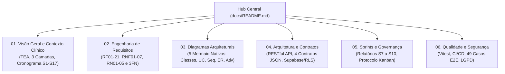

# InTEA — Documentação Técnica Modular do Ecossistema

> **Projeto:** InTEA — Interface do Terapeuta para Orquestração do Ecossistema de Games Terapêuticos  
> **Curso / Instituição:** Sistemas de Informação — Universidade Federal do Piauí (UFPI)  
> **Documento Mestre do Projeto:** [Projeto_de_InTEA.pdf](file:///c:/Users/MWSS/OneDrive/Desktop/InTEA/docs/Projeto_de_InTEA.pdf)  
> **Diretrizes e Quality Gate:** [AGENTS.md](file:///c:/Users/MWSS/OneDrive/Desktop/InTEA/AGENTS.md)  
> **Arquitetura Base:** [architecture.md](file:///c:/Users/MWSS/OneDrive/Desktop/InTEA/docs/architecture.md)

---

## 1. Visão Geral e Navegação do Hub Central

Bem-vindo ao **Hub Central de Documentação do InTEA**. Toda a documentação técnica, especificação de requisitos clínicos, diagramas arquiteturais em Mermaid, contratos JSON de integração e histórico evolutivo de sprints encontram-se estruturados de forma modular nos 6 núcleos temáticos abaixo:

---

## 2. Índice Mestre dos Módulos Técnicos

### [Módulo 01 — Visão Geral e Contexto Clínico](file:///c:/Users/MWSS/OneDrive/Desktop/InTEA/docs/01-visao-geral/)
* [01-contexto-e-problematica.md](file:///c:/Users/MWSS/OneDrive/Desktop/InTEA/docs/01-visao-geral/01-contexto-e-problematica.md): O Transtorno do Espectro Autista (TEA), a sobrecarga cognitiva do terapeuta e a proposta central do InTEA.
* [02-arquitetura-macro-ecossistema.md](file:///c:/Users/MWSS/OneDrive/Desktop/InTEA/docs/01-visao-geral/02-arquitetura-macro-ecossistema.md): As 3 camadas (Game Externo, Motor de Inteligência Contextual DDA e InTEA Web & API).
* [03-cronograma-e-marcos.md](file:///c:/Users/MWSS/OneDrive/Desktop/InTEA/docs/01-visao-geral/03-cronograma-e-marcos.md): Tabela 1 completa de Sprints (1 a 17), matriz de atribuições da equipe e marcos evolutivos.

---

### [Módulo 02 — Engenharia de Requisitos e Invariantes](file:///c:/Users/MWSS/OneDrive/Desktop/InTEA/docs/02-engenharia-requisitos/)
* [01-requisitos-funcionais.md](file:///c:/Users/MWSS/OneDrive/Desktop/InTEA/docs/02-engenharia-requisitos/01-requisitos-funcionais.md): Catálogo completo dos 21 Requisitos Funcionais (**RF01 a RF21**) com critérios mensuráveis.
* [02-requisitos-nao-funcionais.md](file:///c:/Users/MWSS/OneDrive/Desktop/InTEA/docs/02-engenharia-requisitos/02-requisitos-nao-funcionais.md): Catálogo dos 7 Requisitos Não-Funcionais (**RNF01 a RNF07**), com SLAs e métricas auditáveis.
* [03-regras-de-negocio.md](file:///c:/Users/MWSS/OneDrive/Desktop/InTEA/docs/02-engenharia-requisitos/03-regras-de-negocio.md): Invariantes clínicos invioláveis (**RN01 a RN05**), Tabela 2 e a normalização em 3ª Forma Normal (**3FN**) da tabela `relatorio_sessao`.

---

### [Módulo 03 — Diagramas Arquiteturais em Mermaid](file:///c:/Users/MWSS/OneDrive/Desktop/InTEA/docs/03-diagramas-arquiteturais/)
* [01-diagrama-classes.md](file:///c:/Users/MWSS/OneDrive/Desktop/InTEA/docs/03-diagramas-arquiteturais/01-diagrama-classes.md): Diagrama de Classes UML (`classDiagram` nativo) atualizado com chaves UUID e métodos de negócio.
* [02-casos-de-uso.md](file:///c:/Users/MWSS/OneDrive/Desktop/InTEA/docs/03-diagramas-arquiteturais/02-casos-de-uso.md): Diagrama de Casos de Uso (`flowchart TB`) contemplando Terapeuta, SuperAdmin, IA e Game Externo.
* [03-diagrama-sequencia.md](file:///c:/Users/MWSS/OneDrive/Desktop/InTEA/docs/03-diagramas-arquiteturais/03-diagrama-sequencia.md): Diagrama de Sequência (`sequenceDiagram`) com o ciclo completo de 29 passos operacionais.
* [04-entidade-relacionamento.md](file:///c:/Users/MWSS/OneDrive/Desktop/InTEA/docs/03-diagramas-arquiteturais/04-entidade-relacionamento.md): Diagrama ER físico do Supabase (`erDiagram`) em 3FN estrita com chaves UUID e RLS.
* [05-diagrama-atividades.md](file:///c:/Users/MWSS/OneDrive/Desktop/InTEA/docs/03-diagramas-arquiteturais/05-diagrama-atividades.md): Diagrama de Atividades (`flowchart TD`) com calibração DDA, pareamento e telemetria.

---

### [Módulo 04 — Arquitetura de Software e Contratos](file:///c:/Users/MWSS/OneDrive/Desktop/InTEA/docs/04-arquitetura-e-contratos/)
* [01-padroes-arquiteturais-e-stack.md](file:///c:/Users/MWSS/OneDrive/Desktop/InTEA/docs/04-arquitetura-e-contratos/01-padroes-arquiteturais-e-stack.md): Padrão Clean MVC, regras de TypeScript estrito (zero `any`) e convenções `camelCase`.
* [02-especificacao-api-restful.md](file:///c:/Users/MWSS/OneDrive/Desktop/InTEA/docs/04-arquitetura-e-contratos/02-especificacao-api-restful.md): Especificação dos endpoints REST (`/paciente`, `/terapeuta`, `/sessao`, `/anotacao`, `/jogos`), tabela de códigos HTTP e middlewares.
* [03-contratos-json-ecossistema.md](file:///c:/Users/MWSS/OneDrive/Desktop/InTEA/docs/04-arquitetura-e-contratos/03-contratos-json-ecossistema.md): Detalhamento dos 4 Contratos JSON (Manifesto, Telemetria, Contexto Pré-Sessão e Relatório da IA).
* [04-modelagem-banco-e-seguranca.md](file:///c:/Users/MWSS/OneDrive/Desktop/InTEA/docs/04-arquitetura-e-contratos/04-modelagem-banco-e-seguranca.md): Supabase PostgreSQL, governança de migrações (`001_*.sql`), RLS, triggers e trilha de auditoria.

---

### [Módulo 05 — Histórico de Sprints e Governança](file:///c:/Users/MWSS/OneDrive/Desktop/InTEA/docs/05-sprints-e-evolucao/)
* [01-visao-geral-sprints.md](file:///c:/Users/MWSS/OneDrive/Desktop/InTEA/docs/05-sprints-e-evolucao/01-visao-geral-sprints.md): Consolidação executiva das 17 Sprints do cronograma acadêmico.
* [02-sprint-07-pacientes-jogos.md](file:///c:/Users/MWSS/OneDrive/Desktop/InTEA/docs/05-sprints-e-evolucao/02-sprint-07-pacientes-jogos.md): Relatório executivo da Sprint 7 (Pacientes, biblioteca de jogos e leitura de manifestos).
* [03-sprint-08-pareamento-remoto.md](file:///c:/Users/MWSS/OneDrive/Desktop/InTEA/docs/05-sprints-e-evolucao/03-sprint-08-pareamento-remoto.md): Relatório executivo da Sprint 8 (Pareamento remoto via `session_token` e 228 testes Vitest).
* [04-sprint-09-gestao-sessao-telemetria.md](file:///c:/Users/MWSS/OneDrive/Desktop/InTEA/docs/05-sprints-e-evolucao/04-sprint-09-gestao-sessao-telemetria.md): Relatório executivo da Sprint 9 (Sessão ativa, rate limiting de WebSocket e Cockpit).
* [05-sprint-10-resultados-relatorios.md](file:///c:/Users/MWSS/OneDrive/Desktop/InTEA/docs/05-sprints-e-evolucao/05-sprint-10-resultados-relatorios.md): Relatório executivo da Sprint 10 (Tela de resultados, 3FN de relatórios e exportação PDF).
* [06-governanca-kanban-e-tasks.md](file:///c:/Users/MWSS/OneDrive/Desktop/InTEA/docs/05-sprints-e-evolucao/06-governanca-kanban-e-tasks.md): Protocolo de cards do GitHub Projects, regras anti-conflito e checklist de Quality Gate.

---

### [Módulo 06 — Qualidade, Testes e Segurança](file:///c:/Users/MWSS/OneDrive/Desktop/InTEA/docs/06-qualidade-e-testes/)
* [01-estrategia-testes-e-cicd.md](file:///c:/Users/MWSS/OneDrive/Desktop/InTEA/docs/06-qualidade-e-testes/01-estrategia-testes-e-cicd.md): Pirâmide de testes, suítes automatizadas no Vitest (548+ testes) e esteira GitHub Actions.
* [02-roteiro-testes-manuais.md](file:///c:/Users/MWSS/OneDrive/Desktop/InTEA/docs/06-qualidade-e-testes/02-roteiro-testes-manuais.md): Matriz completa dos 49 casos de teste formais de homologação clínica (CT-P01..CT-S22).
* [03-auditoria-e-conformidade-lgpd.md](file:///c:/Users/MWSS/OneDrive/Desktop/InTEA/docs/06-qualidade-e-testes/03-auditoria-e-conformidade-lgpd.md): Conformidade com a LGPD (Lei nº 13.709/2018), proteção de dados de saúde mental, OWASP Top 10 e imutabilidade.

---

## 3. Catálogo Consolidado das 24 Figuras e Telas do Sistema

Todas as figuras do projeto contam com placeholders padronizados e mapeamento contextualizado nos documentos:

| Figura | Placeholder Padronizado | Descrição / Contexto Clínico | Documento de Referência |
| :---: | :--- | :--- | :--- |
| **Fig. 1** | `[Imagem 1: Diagrama de Classes UML do Sistema InTEA]` | Classes de domínio, atributos e métodos com chaves UUID | [01-diagrama-classes.md](file:///c:/Users/MWSS/OneDrive/Desktop/InTEA/docs/03-diagramas-arquiteturais/01-diagrama-classes.md) |
| **Fig. 2** | `[Imagem 2: Diagrama de Casos de Uso do Ecossistema InTEA]` | Casos de uso e interações entre Terapeuta, SuperAdmin, IA e Tablet | [02-casos-de-uso.md](file:///c:/Users/MWSS/OneDrive/Desktop/InTEA/docs/03-diagramas-arquiteturais/02-casos-de-uso.md) |
| **Fig. 3** | `[Imagem 3: Diagrama de Sequência - Ciclo de Vida da Sessão e Telemetria]` | Fluxo de 29 passos: pareamento, telemetria, DDA e encerramento | [03-diagrama-sequencia.md](file:///c:/Users/MWSS/OneDrive/Desktop/InTEA/docs/03-diagramas-arquiteturais/03-diagrama-sequencia.md) |
| **Fig. 4** | `[Imagem 4: Diagrama Entidade-Relacionamento (DER Físico Supabase 3FN)]` | Esquema relacional PostgreSQL em 3FN com chaves UUID e RLS | [04-entidade-relacionamento.md](file:///c:/Users/MWSS/OneDrive/Desktop/InTEA/docs/03-diagramas-arquiteturais/04-entidade-relacionamento.md) |
| **Fig. 5** | `[Imagem 5: Diagrama de Atividades Operacional da Sessão]` | Fluxo operacional: calibração pré-sessão, streaming e DDA | [05-diagrama-atividades.md](file:///c:/Users/MWSS/OneDrive/Desktop/InTEA/docs/03-diagramas-arquiteturais/05-diagrama-atividades.md) |
| **Fig. 6** | `[Imagem 6: Tela de Cadastro do Terapeuta]` | Formulário de credenciais, registro de classe e especialidade | [03-sprint-08-pareamento-remoto.md](file:///c:/Users/MWSS/OneDrive/Desktop/InTEA/docs/05-sprints-e-evolucao/03-sprint-08-pareamento-remoto.md) |
| **Fig. 7** | `[Imagem 7: Tela de Login]` | Acesso seguro de profissionais via Supabase Auth e JWT | [03-sprint-08-pareamento-remoto.md](file:///c:/Users/MWSS/OneDrive/Desktop/InTEA/docs/05-sprints-e-evolucao/03-sprint-08-pareamento-remoto.md) |
| **Fig. 8** | `[Imagem 8: Tela Principal / Dashboard]` | Visão consolidada da rotina clínica, métricas e atalhos operacionais | [01-contexto-e-problematica.md](file:///c:/Users/MWSS/OneDrive/Desktop/InTEA/docs/01-visao-geral/01-contexto-e-problematica.md) |
| **Fig. 9** | `[Imagem 9: Tela de Seleção de Pacientes]` | Interface em cards com foto, idade e estado clínico do paciente | [02-sprint-07-pacientes-jogos.md](file:///c:/Users/MWSS/OneDrive/Desktop/InTEA/docs/05-sprints-e-evolucao/02-sprint-07-pacientes-jogos.md) |
| **Fig. 10** | `[Imagem 10: Tela da Biblioteca de Jogos]` | Catálogo de atividades terapêuticas categorizadas por objetivo clínico | [02-sprint-07-pacientes-jogos.md](file:///c:/Users/MWSS/OneDrive/Desktop/InTEA/docs/05-sprints-e-evolucao/02-sprint-07-pacientes-jogos.md) |
| **Fig. 11** | `[Imagem 11: Tela de Configuração de Sessão]` | Modal pré-sessão com injeção de contexto DDA e PIN efêmero de 15 min | [03-sprint-08-pareamento-remoto.md](file:///c:/Users/MWSS/OneDrive/Desktop/InTEA/docs/05-sprints-e-evolucao/03-sprint-08-pareamento-remoto.md) |
| **Fig. 12** | `[Imagem 12: Tela de Emissão do Relatório de Sessão]` | Resultados consolidados, gráficos vetoriais e parecer da IA (**RF14**) | [05-sprint-10-resultados-relatorios.md](file:///c:/Users/MWSS/OneDrive/Desktop/InTEA/docs/05-sprints-e-evolucao/05-sprint-10-resultados-relatorios.md) |
| **Fig. 13** | `[Imagem 13: Tela de Histórico do Paciente]` | Linha do tempo evolutiva e séries temporais longitudinais (**RF15**) | [05-sprint-10-resultados-relatorios.md](file:///c:/Users/MWSS/OneDrive/Desktop/InTEA/docs/05-sprints-e-evolucao/05-sprint-10-resultados-relatorios.md) |
| **Fig. 14** | `[Imagem 14: Tela de Lista Detalhada de Pacientes]` | Tabela avançada com busca textual, paginação e ações cadastrais | [02-sprint-07-pacientes-jogos.md](file:///c:/Users/MWSS/OneDrive/Desktop/InTEA/docs/05-sprints-e-evolucao/02-sprint-07-pacientes-jogos.md) |
| **Fig. 15** | `[Imagem 15: Tela de Cadastro de Paciente]` | Formulário em 4 blocos para registro sociodemográfico e clínico (**RF06**) | [02-sprint-07-pacientes-jogos.md](file:///c:/Users/MWSS/OneDrive/Desktop/InTEA/docs/05-sprints-e-evolucao/02-sprint-07-pacientes-jogos.md) |
| **Fig. 16** | `[Imagem 16: Tela de Perfil e Prontuário do Paciente]` | Anamnese visual, vínculos de equipe multidisciplinar e laudos | [02-sprint-07-pacientes-jogos.md](file:///c:/Users/MWSS/OneDrive/Desktop/InTEA/docs/05-sprints-e-evolucao/02-sprint-07-pacientes-jogos.md) |
| **Fig. 17** | `[Imagem 17: Tela de Perfil do Terapeuta]` | Visualização de dados profissionais, áreas de foco e especialidades | [03-sprint-08-pareamento-remoto.md](file:///c:/Users/MWSS/OneDrive/Desktop/InTEA/docs/05-sprints-e-evolucao/03-sprint-08-pareamento-remoto.md) |
| **Fig. 18** | `[Imagem 18: Tabelas das Classes no Banco de Dados]` | Entidades de domínio instanciadas no PostgreSQL do Supabase | [04-modelagem-banco-e-seguranca.md](file:///c:/Users/MWSS/OneDrive/Desktop/InTEA/docs/04-arquitetura-e-contratos/04-modelagem-banco-e-seguranca.md) |
| **Fig. 19** | `[Imagem 19: Tabela de Clínicas no Banco de Dados]` | Tabela institucional responsável pelo isolamento multi-tenant (**RN04**) | [04-modelagem-banco-e-seguranca.md](file:///c:/Users/MWSS/OneDrive/Desktop/InTEA/docs/04-arquitetura-e-contratos/04-modelagem-banco-e-seguranca.md) |
| **Fig. 20** | `[Imagem 20: Tabela Associativa Terapeuta-Paciente]` | Chave composta para gestão de vínculos de equipe multidisciplinar | [04-modelagem-banco-e-seguranca.md](file:///c:/Users/MWSS/OneDrive/Desktop/InTEA/docs/04-arquitetura-e-contratos/04-modelagem-banco-e-seguranca.md) |
| **Fig. 21** | `[Imagem 21: Pipeline de CI/CD]` | Esteira de integração contínua no GitHub Actions com Vitest e Docker | [01-estrategia-testes-e-cicd.md](file:///c:/Users/MWSS/OneDrive/Desktop/InTEA/docs/06-qualidade-e-testes/01-estrategia-testes-e-cicd.md) |
| **Fig. 22** | `[Imagem 22: Containers Iniciais]` | Configuração do ambiente de desenvolvimento em contêineres Docker | [01-estrategia-testes-e-cicd.md](file:///c:/Users/MWSS/OneDrive/Desktop/InTEA/docs/06-qualidade-e-testes/01-estrategia-testes-e-cicd.md) |
| **Fig. 23** | `[Imagem 23: Classes e Tabelas Físicas do Banco]` | Visão estrutural das tabelas físicas no Supabase Studio | [04-modelagem-banco-e-seguranca.md](file:///c:/Users/MWSS/OneDrive/Desktop/InTEA/docs/04-arquitetura-e-contratos/04-modelagem-banco-e-seguranca.md) |
| **Fig. 24** | `[Imagem 24: Estrutura de Diretórios do Frontend]` | Arquitetura modular orientada a features verticais (React 19 + Vite) | [01-padroes-arquiteturais-e-stack.md](file:///c:/Users/MWSS/OneDrive/Desktop/InTEA/docs/04-arquitetura-e-contratos/01-padroes-arquiteturais-e-stack.md) |

---

## 4. Invariantes Clínicos e Arquiteturais Invioláveis

* **RN01 (Modo Livre sem Persistência):** Partidas livres não gravam telemetria em prontuário, não acionam IA e possuem compulsoriamente `paciente_id = NULL`.
* **RN02 (Fallback de Métrica Proibido / Tipagem Estrita):** Toda métrica DEVE ter `tipo_metrica` explícito no manifesto do jogo. É estritamente **PROIBIDO** converter métricas sem tipo em categóricas por fallback automático. Telemetria com tipo incompatível ou fora do domínio DEVE ser rejeitada com código **`422 Unprocessable Entity`**.
* **RN03 (Contexto no Início da Sessão):** O contexto DDA (estresse, gatilhos a evitar, objetivo) deve ser entregue ao Agente de IA antes do primeiro evento de telemetria.
* **RN04 (Visibilidade por Vínculo Institucional):** O acesso a prontuários requer vínculo ativo em `terapeuta_paciente` e mesma clínica (`clinica_id`). Acessos indevidos retornam **`403 Forbidden`**.
* **RN05 (Inalterabilidade do Histórico Clínico):** Proibido `hard delete` em registros clínicos (`paciente`, `anotacao_clinica`, `relatorio_sessao`). Permitido apenas `soft delete` (`status_ativo = false` ou `soft_delete = true`). Triggers de banco bloqueiam exclusão física.
* **Normalização 3FN em Relatórios:** A tabela `relatorio_sessao` utiliza chave primária compartilhada `sessao_id UUID PRIMARY KEY REFERENCES sessao(id)`, eliminando redundâncias funcionais de `paciente_id` e `terapeuta_id`.
