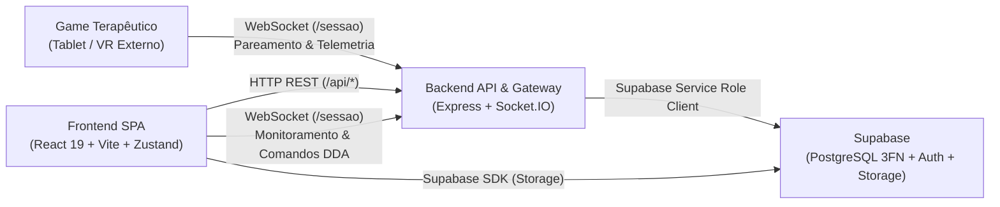
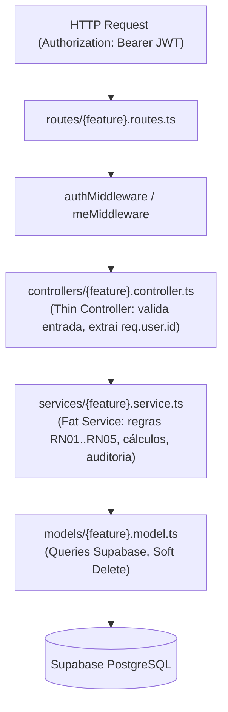
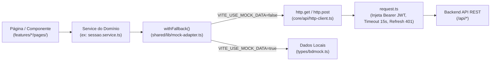
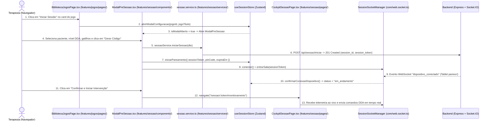
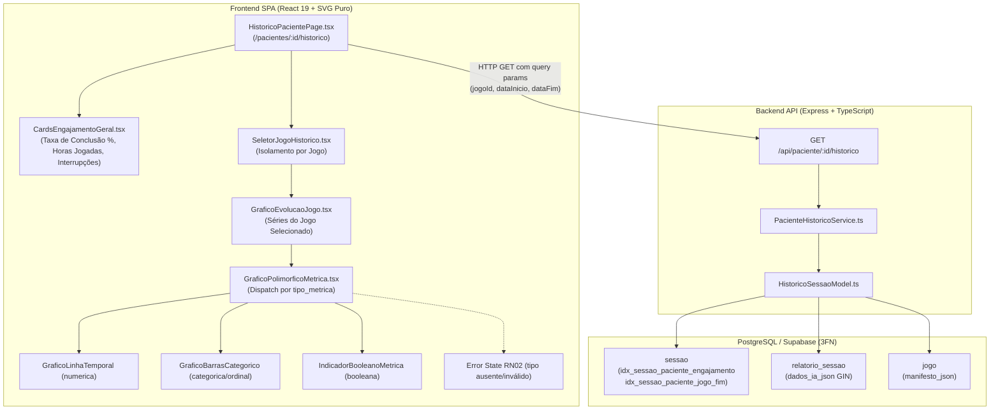

# InTEA — Regras de Arquitetura e Organização Completa do Ecossistema

> **Documento de referência obrigatório para todos os integrantes da equipe e agentes de IA que contribuírem com este projeto.**  
> Toda nova funcionalidade, migração ou refatoração deve seguir rigorosamente as convenções, fluxos e camadas descritas aqui.

---

## Índice

1. [Visão Geral da Arquitetura](#1-visão-geral-da-arquitetura)
2. [Banco de Dados (Database)](#2-banco-de-dados-database)
3. [Back-end (Backend)](#3-back-end-backend)
   - [3.1 Stack Tecnológica](#31-stack-tecnológica)
   - [3.2 Estrutura de Diretórios](#32-estrutura-de-diretórios)
   - [3.3 Padrão de Arquitetura: Clean MVC + Gateway WebSocket](#33-padrão-de-arquitetura-clean-mvc--gateway-websocket)
   - [3.4 Padronização de Payloads REST: Sanitização, Categorização Semântica e Responsabilidade Única (Envelope Pattern)](#34-padronização-de-payloads-rest-sanitização-categorização-semântica-e-responsabilidade-única-envelope-pattern)
4. [Front-end (Frontend) — Arquitetura Completa](#4-front-end-frontend--arquitetura-completa)
   - [4.1 Stack Tecnológica](#41-stack-tecnológica)
   - [4.2 Estrutura de Diretórios (Arquitetura Orientada a Features — `src/features/`)](#42-estrutura-de-diretórios-arquitetura-orientada-a-features--srcfeatures)
   - [4.3 Ciclo de Inicialização, Roteamento e Layouts](#43-ciclo-de-inicialização-roteamento-e-layouts)
   - [4.4 Camada de Services, Cliente HTTP e Chave Mock/API Real](#44-camada-de-services-cliente-http-e-chave-mockapi-real)
   - [4.5 Gerenciamento de Estado Global com Zustand (`store/`)](#45-gerenciamento-de-estado-global-com-zustand-store)
   - [4.6 Hooks Nativos e Custom Hooks (`hooks/`)](#46-hooks-nativos-e-custom-hooks-hooks)
   - [4.7 Comunicação em Tempo Real via WebSocket (`core/web.socket.ts`)](#47-comunicação-em-tempo-real-via-websocket-corewebsocketts)
   - [4.8 Como Tudo se Conecta nas Telas (`Pages` vs `Components`)](#48-como-tudo-se-conecta-nas-telas-pages-vs-components)
   - [4.9 Prontuário Longitudinal, Histórico e Gráficos Dinâmicos (Sprint 11)](#49-prontuário-longitudinal-histórico-e-gráficos-dinâmicos-sprint-11)
5. [Convenções de Nomenclatura](#5-convenções-de-nomenclatura)
6. [Regras de Git e Branches](#6-regras-de-git-e-branches)
7. [Docker, CI/CD e Testes Automatizados](#7-docker-cicd-e-testes-automatizados)
8. [Segurança e Variáveis de Ambiente](#8-segurança-e-variáveis-de-ambiente)

---

## 1. Visão Geral da Arquitetura

O InTEA é uma aplicação **monorepo** estruturada em três camadas independentes que orquestram o ecossistema de Games Terapêuticos e o Motor de Inteligência Contextual (DDA):

```text
InTEA/
├── Backend/                  # API RESTful + Gateway WebSocket — Node.js + Express + Socket.IO + TypeScript
├── Frontend/                 # SPA Clínica — React 19 + Vite + TypeScript + Tailwind v4 + Zustand
├── Database/                 # Schema Mestre (database.sql), Migrações SQL e Seeds — PostgreSQL via Supabase
├── docs/                     # Documentação técnica modular, OpenAPI, roteiros de teste e Sprints
├── AGENTS.md                 # Diretrizes operacionais, Invariantes Clínicos (RN01..RN05) e Quality Gate
├── docker-compose.yml        # Orquestração de contêineres (Produção / Nginx + Node.js)
└── docker-compose.override.yml # Sobrescrita de desenvolvimento com Hot-Reload (Vite + tsx watch)
```



### Regras Fundamentais

- **Sem monólito:** cada camada possui responsabilidade única e pode ser implantada de forma independente.
- **TypeScript estrito em toda a stack:** o uso do tipo `any` é terminantemente proibido (`tsc --noEmit` deve passar com zero erros).
- **Segredos protegidos:** chaves privadas e credenciais jamais devem ser commitadas. Utilize sempre `.env` e `.env.example`.
- **Invariantes Clínicos Invioláveis (RN01 a RN05):**
  - **RN01 (Modo Livre sem Persistência):** partidas em modo livre possuem `paciente_id = NULL`, não gravam telemetria em prontuário e não geram relatório clínico.
  - **RN02 (Tipagem Estrita de Métricas):** toda métrica deve ter `tipo_metrica` explícito no manifesto; métricas sem tipo ou incompatíveis são rejeitadas com `422 Unprocessable Entity`.
  - **RN03 (Contexto DDA Pré-Sessão):** o contexto de estresse inicial e gatilhos a evitar é injetado antes do primeiro evento de telemetria.
  - **RN04 (Visibilidade por Vínculo Institucional):** acesso a prontuários exige vínculo ativo em `terapeuta_paciente` e mesma clínica (`clinica_id`), retornando `403 Forbidden` em acessos indevidos.
  - **RN05 (Inalterabilidade do Histórico Clínico):** proibido `hard delete` em registros clínicos (`paciente`, `anotacao_clinica`, `relatorio_sessao`). Permitido exclusivamente `soft delete` (`status_ativo = false` ou `soft_delete = true`).

---

## 2. Banco de Dados (Database)

### 2.1 Estrutura de Diretórios

```text
Database/
├── database.sql          # ← Schema mestre consolidado (Single Source of Truth para fresh deploy)
├── migrations/           # ← Migrações DDL sequenciais e idempotentes
│   ├── 001_*.sql         # ← Migração 001: Pacientes, responsáveis, dados clínicos e gatilhos
│   ├── 002_*.sql         # ← Migração 002: Terapeutas e áreas de foco
│   ├── 003_*.sql         # ← Migração 003: Jogos, sessões, telemetria e relatórios
│   └── NNN_descricao.sql # ← Migrações subsequentes (3 dígitos obrigatórios)
└── seeds/                # ← Scripts DML de inserção/população de dados iniciais
    ├── 01_seed_jogos.sql # ← Catálogo inicial de jogos terapêuticos e manifestos
    └── NN_seed_*.sql     # ← Novas sementes de dados
```

### 2.2 Regras de Schema e Normalização (3FN)

| Regra | Detalhe |
| :--- | :--- |
| **PKs sempre UUID** | `id UUID PRIMARY KEY DEFAULT gen_random_uuid()` (ou PK/FK compartilhada `sessao_id UUID PRIMARY KEY REFERENCES sessao(id)` em tabelas 1:1 estritas em 3FN, como `relatorio_sessao`). Nunca usar `BIGSERIAL` ou `INT`. |
| **FKs sempre UUID** | Toda chave estrangeira deve referenciar um `UUID`. Proibido criar FKs transitivas redundantes (ex.: proibido `paciente_id` em `telemetria_evento` ou `relatorio_sessao`, pois já é resolvido via `sessao_id -> paciente_id`). |
| **Timestamps padrão** | Toda tabela deve ter `created_at TIMESTAMPTZ DEFAULT TIMEZONE('utc', NOW()) NOT NULL` e `updated_at` quando aplicável. |
| **Soft Delete (RN05)** | Entidades de prontuário humano (`paciente`, `anotacao_clinica`, `relatorio_sessao`) usam `status_ativo = false` ou `soft_delete = true`. Hard DELETE é bloqueado por trigger (`impedir_hard_delete_clinico`). Tabelas de streaming (`telemetria_evento`) são *append-only* e não possuem `soft_delete`. |
| **RLS obrigatório** | `ALTER TABLE ... ENABLE ROW LEVEL SECURITY` deve ser aplicado a **todas** as tabelas. |
| **Sem colunas BLOB** | Arquivos (PDF, DOCX) **nunca** são armazenados no banco; utiliza-se o **Supabase Storage** com bucket privado e Signed URLs temporárias. |

### 2.3 Regras de Migração e Seeds

1. **Diretório Unificado:** todas as migrações residem em `Database/migrations/` com prefixo de 3 dígitos (`001_*.sql`, `002_*.sql`).
2. **Imutabilidade e Idempotência:** nunca edite uma migration já executada na branch principal. Toda migration deve usar `IF NOT EXISTS`, `DROP ... IF EXISTS` e blocos `DO $$ ... END $$`.
3. **Sincronia com `database.sql`:** o arquivo `Database/database.sql` deve ser mantido sincronizado a cada nova migration.
4. **Seeds (`Database/seeds/`):** contêm exclusivamente comandos DML (`INSERT ... ON CONFLICT DO NOTHING`), sem comandos DDL.

### 2.4 Tabelas do Ecossistema

| Tabela | Responsabilidade |
| :--- | :--- |
| `clinica` | Instituição de saúde (isolamento multi-tenant — **RN04**) |
| `terapeuta` | Perfil profissional do terapeuta (espelha `auth.users`) |
| `areas_foco` / `terapeuta_area_foco` | Catálogo e vínculo N:N de especialidades do terapeuta |
| `paciente` | Dados sociodemográficos do paciente (`status_ativo` — **RN05**) |
| `responsavel` / `paciente_responsavel` | Responsáveis legais e vínculo N:N (`principal` ou `extra`) |
| `dados_clinicos` | Perfil sensorial, reforçadores e anamnese 1:1 com paciente |
| `gatilhos` / `paciente_gatilho` | Catálogo de gatilhos sensoriais e severidade por paciente |
| `laudo_clinico` | Metadados de laudos armazenados no Supabase Storage |
| `terapeuta_paciente` | Vínculo institucional N:N terapeuta ↔ paciente (**RN04**) |
| `jogo` | Catálogo de jogos terapêuticos e manifesto JSON (**RN02**) |
| `sessao` | Sessão de intervenção (`sessao_clinica` ou `modo_livre` — **RN01**, **RN03**) |
| `telemetria_evento` | Série temporal *append-only* de eventos de telemetria da sessão |
| `anotacao_clinica` | Anotações estruturadas e observações de prontuário (**RN05**) |
| `relatorio_sessao` | Relatório analítico pós-sessão (1:1 com `sessao` via `sessao_id` PK/FK em 3FN) |
| `auditoria_clinica` | Trilha imutável de auditoria de operações sensíveis (LGPD) |

---

## 3. Back-end (Backend)

### 3.1 Stack Tecnológica

| Tecnologia | Versão | Uso |
| :--- | :--- | :--- |
| Node.js | 20 LTS | Runtime |
| TypeScript | ^5.x / ^7.x | Linguagem em modo estrito (`strict: true`, zero `any`) |
| Express | ^4.x | Servidor HTTP RESTful |
| Socket.IO | ^4.x | Gateway WebSocket bidirecional em tempo real |
| Supabase JS | ^2.x | Cliente de banco de dados e autenticação (`SERVICE_ROLE_KEY`) |
| Vitest | ^4.x / ^5.x | Suíte de testes unitários e de integração (32 suítes / 579 testes) |

### 3.2 Estrutura de Diretórios

```text
Backend/
├── src/
│   └── server.ts                        # Ponto de entrada: Express, HTTP Server, Socket.IO, CORS, Swagger UI
├── api/
│   ├── index.ts                         # apiRouter central (/auth, /paciente, /terapeuta, /jogos, /sessao, /anotacao)
│   ├── auth/                            # Login, refresh token, logout, recuperação de senha e /me
│   ├── paciente/                        # CRUD clínico, prontuário, soft delete, reativação e equipe multidisciplinar
│   ├── terapeuta/                       # Perfil profissional, áreas de foco e vínculos institucionais
│   ├── jogos/                           # Catálogo, validação de manifesto (Contrato 1) e telemetria estrita (RN02)
│   ├── sessao/                          # Pareamento PIN/Token, início DDA, máquina de estados, resultado e exportação LGPD
│   ├── anotacao/                        # Registro e listagem de anotações clínicas estruturadas
│   └── auditoria/                       # Trilha imutável de auditoria clínica
└── core/
    ├── middlewares/
    │   ├── auth.middleware.ts           # Validação do Bearer JWT e injeção de req.user
    │   └── me.middleware.ts             # Enriquecimento de contexto institucional do terapeuta
    ├── supabase/
    │   └── supabase.client.ts           # Instância singleton do Supabase (SERVICE_ROLE_KEY + ANON_KEY)
    └── websocket/
        ├── sessao.gateway.ts            # Gateway Socket.IO (/sessao e /): salas, telemetria, comandos DDA e presença
        ├── sessao.reconnection.ts       # Controle de resiliência e janela de reconexão de 60 segundos
        └── socket.limiter.ts            # Rate limiting contra flooding de pacotes WebSocket
```

### 3.3 Padrão de Arquitetura: Clean MVC + Gateway WebSocket



#### Responsabilidades por Camada

| Camada | O que faz | O que NÃO faz |
| :--- | :--- | :--- |
| **Route (`routes/`)** | Define verbos HTTP, aplica middlewares e documenta `@swagger`. | Não contém regras de negócio. |
| **Controller (`controllers/`)** | Extrai `req.params`, `req.query`, `req.body` e `req.user.id` (nunca confia em `terapeuta_id` vindo do body — **RF21**); devolve status HTTP semântico. | Não executa queries diretas no banco nem cálculos pesados. |
| **Service (`services/`)** | Executa regras de domínio (**RN01 a RN05**), validações cruzadas de clínica (**RN04**), agregações estatísticas e síntese analítica. | Não manipula objetos HTTP (`req`/`res`). |
| **Model (`models/`)** | Executa consultas ao Supabase, garante `status_ativo = true` nas listagens e aplica Soft Delete (**RN05**). | Não conhece regras de transporte HTTP. |
| **WebSocket Gateway (`core/websocket/`)** | Gerencia salas por `session_token`, retransmite telemetria em baixa latência, encaminha comandos clínicos (`pausar`, `retomar`, `ajustar_dda`, `encerrar`) e controla reconexão (60s). | Não bloqueia o event loop com relatórios síncronos a cada pacote. |

### 3.4 Padronização de Payloads REST: Sanitização, Categorização Semântica e Responsabilidade Única (Envelope Pattern)

A API REST do InTEA adota o **Envelope Pattern com Agrupamento Semântico e Sanitização Estrita**. Toda resposta HTTP da API segue regras invioláveis de higiene, encapsulamento e responsabilidade única:

#### 1. Princípio da Responsabilidade Única e Sanitização Estrita ("Nada mais, nada menos")
* **Retorno Estrito ao Escopo da Rota:** Uma rota DEVE retornar **somente e exclusivamente o que o seu contrato indica — nada mais, nada menos**. É terminantemente proibido devolver campos ou entidades periféricas que não foram explicitamente solicitadas.
  - Exemplo 1 (`POST /api/auth/login`): Sua responsabilidade é estritamente autenticar credenciais e emitir tokens criptográficos. O retorno contém **apenas os tokens** (`data.token.access_token`, etc.), sendo **terminantemente proibido anexar dados de perfil do usuário** (dados de perfil pertencem com exclusividade a `GET /api/auth/me`).
  - Exemplo 2 (`POST /api/anotacao`): Retorna unicamente a anotação registrada e seus metadados, nunca prontuários completos de pacientes ou listas de terceiros.
* **Sanitização Ativa e Expurgo de Dados:**
  - **Zero Vazamento de Infraestrutura ou Segurança:** É expressamente proibido vazar chaves de API (`SUPABASE_SERVICE_ROLE_KEY`), hashes de senha de terapeutas, tokens internos de banco ou colunas de auditoria restritas.
  - **Zero Dados Desnecessários ou Redundantes:** Devolver apenas os campos úteis para a tela. Proibido retornar colunas nulas obsoletas, dados técnicos de log ou chaves duplicadas.
* **Proibição de Chaves Redundantes ou Espalhadas na Raiz:** É terminantemente proibido jogar atributos primitivos soltos no primeiro nível de `data` (ex.: colocar `access_token`, `nome`, `telefone` soltos ao lado de outros objetos). Todas as propriedades devem pertencer à chave de sua respectiva categoria/entidade.

#### 2. Organização dos Dados por Categoria / Nome (Envelope Pattern)
O payload de resposta NUNCA deve ser plano (*flat*). Os dados retornados dentro de `data` devem ser estruturados e agrupados por categoria/nome de entidade:

```json
{
  "data": {
    "<entidade_principal>": { ... },
    "<entidade_secundaria>": [ ... ],
    "meta": { ... }
  },
  "message": "Mensagem informativa amigável."
}
```

#### 3. Exemplos Canônicos de Referência

* **Prontuário / Detalhes do Paciente (`GET /api/paciente/:id`):**
  ```json
  {
    "data": {
      "paciente": {
        "id": "a9849163-613f-4492-90cf-89985902d16e",
        "nome": "Enzo Gabriel da Silva",
        "data_nascimento": "2018-05-14",
        "clinica_id": "f28b49b7-7f91-4e78-8384-25010629ec0b",
        "status_ativo": true
      },
      "responsaveis": [
        {
          "id": "0e16bed1-a27a-41d3-bf0d-4e43ac5139ff",
          "nome": "Mariana da Silva",
          "parentesco": "Mãe",
          "telefone": "+55 (11) 98765-4321",
          "is_principal": true
        }
      ],
      "dados_clinicos": {
        "perfil_sensorial": "Hipersensibilidade auditiva e busca proprioceptiva",
        "reforcadores": "Músicas calmas, estímulos táteis suaves",
        "gatilhos": ["sons_altos", "luzes_estroboscopicas"]
      },
      "meta": {
        "total_responsaveis": 1,
        "ultima_atualizacao": "2026-10-21T14:30:00Z"
      }
    },
    "message": "Paciente recuperado com sucesso."
  }
  ```

* **Autenticação (`POST /api/auth/login`):**
  ```json
  {
    "data": {
      "token": {
        "access_token": "eyJhbGciOi...",
        "refresh_token": "mx4zrs...",
        "token_type": "Bearer",
        "expires_in": 3600
      }
    },
    "message": "Login realizado com sucesso."
  }
  ```

* **Histórico Longitudinal e Séries de Engajamento (`GET /api/paciente/:id/historico`):**
  ```json
  {
    "data": {
      "engajamento_geral": {
        "total_sessoes": 12,
        "tempo_total_segundos": 14400,
        "score_medio_engajamento": 84.5
      },
      "jogos_disponiveis": [
        { "id": "uuid-jogo-1", "titulo": "Aventura Espacial" }
      ],
      "serie_jogo": {
        "jogo_id": "uuid-jogo-1",
        "metricas": [ ... ]
      },
      "meta": {
        "filtro_data_inicio": "2026-09-01",
        "filtro_data_fim": "2026-10-21",
        "pagina": 1,
        "limite": 10
      }
    },
    "message": "Histórico do paciente carregado com sucesso."
  }
  ```

#### 4. Anti-padrões Vetados no Quality Gate
1. **Payload Flat com Mistura de Domínios:** Colocar propriedades de entidades distintas misturadas diretamente na raiz de `data` (ex.: `{ data: { id, nome, email, token, parentesco } }`).
2. **Duplicação de Campos (Redundância Desnecessária):** Retornar o mesmo token ou campo solto na raiz e aninhado em um objeto (`data.access_token` e `data.token.access_token`).
3. **Over-fetching por Preguiça de Endpoint:** Fazer uma rota de comando ou mutação simples devolver árvores inteiras de entidades alheias ao propósito da rota.
4. **Vazamento de Identidade ou Perfil em Rotas de Credenciais:** Retornar dados de perfil em rotas cujo único propósito é emitir tokens criptográficos.

---

## 4. Front-end (Frontend) — Arquitetura Completa

Esta seção explica em profundidade os fundamentos e a mecânica real do Frontend para que qualquer desenvolvedor da equipe (mesmo quem atuou exclusivamente no Backend/BD) compreenda exatamente como as telas, modais, services, hooks e stores funcionam.

### 4.1 Stack Tecnológica

| Tecnologia | Versão | Finalidade |
| :--- | :--- | :--- |
| React | ^19.x | Biblioteca SPA baseada em componentes declarativos e hooks |
| TypeScript | ~5.9.x | Tipagem estrita (`strict: true`, zero `any`) |
| Vite | ^7.x | Bundler, injeção de variáveis `VITE_*` e servidor de desenvolvimento com proxy |
| Tailwind CSS | ^4.x | Estilização utilitária responsiva com `@theme inline` |
| React Router DOM | ^7.x | Roteamento declarativo SPA (`BrowserRouter`, `Routes`, `Outlet`) |
| Zustand | ^5.x | Gerenciamento de estado global em memória com persistência (`persist`) |
| Socket.IO Client | ^4.x | Comunicação bidirecional em tempo real no Cockpit da Sessão |
| Radix UI + shadcn | ^1.x | Primitivos visuais acessíveis (`Dialog`, `Select`, `Table`, `Sidebar`, etc.) |
| Vitest + Testing Library | ^4.x | Suíte de testes automatizados (34 suítes / 285 testes) |

---

### 4.2 Estrutura de Diretórios (Arquitetura Orientada a Features — `src/features/`)

O Frontend adota o padrão **Feature-Driven Clean Architecture**, onde cada domínio clínico (`autenticacao`, `terapeuta`, `paciente`, `jogos`, `sessao`, `anotacao`, `painel`, `configuracoes`) é um módulo vertical autossuficiente que agrupa suas próprias `pages/`, `components/`, `services/`, `store/`, `hooks/` e `types/`:

```text
Frontend/src/
├── main.tsx                              # Ponto de entrada: monta <App /> na <div id="root">
├── App.tsx                               # Configura ThemeProvider, BrowserRouter, AppRoutes e Toaster
├── routes/
│   └── index.tsx                         # Definição de rotas públicas/privadas, ProtectedRoute e Layouts
├── layout/
│   ├── SidebarLayout.tsx                 # Casca administrativa com menu lateral (Painel, Pacientes, Jogos)
│   ├── FocusLayout.tsx                   # Casca imersiva em tela cheia sem distrações (Cockpit e Resultado — RNF07)
│   └── components/                       # app-sidebar.tsx, nav-header.tsx, nav-main.tsx, nav-user.tsx
├── core/                                 # Infraestrutura de comunicação com o Backend
│   ├── api/
│   │   ├── endpoints.ts                  # Mapa tipado de todas as URLs da API REST (/auth, /paciente, /sessao, etc.)
│   │   └── http-client.ts                # Instância do HttpClient com injeção automática de JWT e fila de refresh 401
│   └── web.socket.ts                     # Singleton SessionSocketManager (Socket.IO Client) e hooks reativos
├── features/                             # MÓDULOS VERTICAIS POR DOMÍNIO DE NEGÓCIO
│   ├── autenticacao/                     # Autenticação, registro e sessão do terapeuta
│   │   ├── pages/                        # LoginPage.tsx
│   │   ├── hooks/                        # useAuth.ts
│   │   ├── services/                     # auth.service.ts
│   │   ├── store/                        # authStore.ts
│   │   └── types/                        # auth.types.ts e bdmock.ts
│   ├── terapeuta/                        # Gestão do perfil profissional e equipe multidisciplinar
│   │   ├── services/                     # terapeuta.service.ts
│   │   └── types/                        # terapeuta.types.ts e bdmock.ts
│   ├── paciente/                         # Gestão cadastral, prontuários clínicos e histórico longitudinal (RF15)
│   │   ├── pages/                        # PacientesPage.tsx, HistoricoPacientePage.tsx
│   │   ├── components/                   # ListaPacientes.tsx, CardPacienteGrid.tsx, DialogFormularioPaciente.tsx, DialogDetalhesPaciente.tsx, CardsEngajamentoGeral.tsx, GraficoEvolucaoJogo.tsx, GraficoPolimorficoMetrica.tsx, LinhaDoTempoSessoes.tsx, SeletorJogoHistorico.tsx
│   │   ├── services/                     # paciente.service.ts
│   │   ├── store/                        # paciente.store.ts
│   │   └── types/                        # paciente.types.ts, historico.types.ts e bdmock.ts
│   ├── jogos/                            # Catálogo e biblioteca de jogos terapêuticos
│   │   ├── pages/                        # BibliotecaJogosPage.tsx
│   │   ├── components/                   # JogoCard.tsx, JogosFiltros.tsx
│   │   ├── services/                     # jogos.service.ts
│   │   └── types/                        # jogos.types.ts e bdmock.ts
│   ├── sessao/                           # Orquestração de sessão, pareamento remoto, cockpit e resultados
│   │   ├── pages/                        # CockpitSessaoPage.tsx, ResultadoSessaoPage.tsx
│   │   ├── components/                   # ModalPreSessao.tsx, ModalFinalizarSessao.tsx, ControlesClinicos.tsx, telemetria/, resultado/
│   │   ├── hooks/                        # useLiveTelemetry.ts, useSessionPersistence.ts, useClinicalTimer.ts, useSessionSync.ts
│   │   ├── services/                     # sessao.service.ts
│   │   ├── store/                        # sessionStore.ts
│   │   └── types/                        # sessao.types.ts e bdmock.ts
│   ├── anotacao/                         # Registro e histórico de anotações clínicas
│   │   ├── services/                     # anotacao.service.ts
│   │   └── types/                        # anotacao.types.ts e bdmock.ts
│   ├── painel/                           # Dashboard clínico, indicadores e alertas de IA
│   │   ├── pages/                        # PainelPage.tsx
│   │   ├── services/                     # dashboard.service.ts
│   │   └── types/                        # dashboard.types.ts e bdmock.ts
│   └── configuracoes/                    # Preferências visuais, tema e privacidade do terapeuta
│       ├── pages/                        # settingsPage.tsx
│       ├── sections/                     # appearanceSetting.tsx
│       ├── services/                     # settings.service.ts
│       ├── store/                        # settingsStore.ts
│       └── types/                        # settings.types.ts e bdmock.ts
└── shared/                               # Recursos transversais reutilizáveis
    ├── components/ui/                    # 17 componentes primitivos Radix UI / shadcn (button, dialog, card, etc.)
    ├── hooks/                            # use-mobile.ts
    ├── lib/                              # utils.ts (função cn()), mock-adapter.ts (withFallback / shouldUseMock)
    ├── providers/                        # theme-provider.tsx
    ├── types/                            # api.types.ts e bdmock.ts global
    └── utils/                            # request.ts (motor base do HttpClient com timeout, retry e fila 401)
```

---

### 4.3 Ciclo de Inicialização, Roteamento e Layouts

Quando o navegador carrega a aplicação, a execução segue exatamente este fluxo:

1. **`Frontend/index.html` $\rightarrow$ `Frontend/src/main.tsx`:** localiza a `<div id="root">` e monta `<App />`.
2. **`Frontend/src/App.tsx`:** envolve a aplicação em três camadas globais:
   - `<ThemeProvider>`: aplica o tema visual (`light`, `dark` ou `system`).
   - `<BrowserRouter>`: habilita navegação SPA sem recarregar a página inteira.
   - `<AppRoutes />` + `<Toaster />`: renderiza a página correspondente à URL atual e exibe notificações flutuantes (*toasts*).
3. **`Frontend/src/routes/index.tsx`:** atua como o **`apiRouter` + `authMiddleware` do Frontend**:
   - **`ProtectedRoute`:** lê `const isAuthenticated = useAuthStore((s) => s.isAuthenticated)`. Se for `false`, redireciona imediatamente para `/login`. Se for `true`, renderiza a rota solicitada via `<Outlet />`.
   - **Divisão em 2 Layouts Clínicos:**
     - **`SidebarLayout` (`/painel`, `/pacientes`, `/jogos`):** exibe a barra lateral de navegação (`AppSidebar`) e o cabeçalho superior.
     - **`FocusLayout` (`/sessao/:id/monitoramento` e `/sessao/:id/resultado`):** tela cheia imersiva sem menu lateral para eliminar distrações cognitivas durante o atendimento (**RNF07**).

---

### 4.4 Camada de Services, Cliente HTTP e Chave Mock/API Real

No Backend, um `Model` consulta o PostgreSQL. Como o Frontend roda no navegador do usuário e não acessa o banco diretamente, **a fonte de dados do Frontend é a API REST do Backend**.
Um **Service** no Frontend (`features/*/services/*.service.ts`) é um objeto que agrupa todas as chamadas HTTP daquele domínio.

#### Mecânica de uma Requisição HTTP no Frontend:



1. **Dicionário de Rotas (`core/api/endpoints.ts`):** centraliza todos os caminhos REST (`ENDPOINTS.SESSAO.INICIAR`, `ENDPOINTS.PACIENTE.POR_ID(id)`), evitando strings soltas nas telas.
2. **Cliente HTTP (`core/api/http-client.ts` + `shared/utils/request.ts`):**
   - **Injeção Automática de JWT:** antes de enviar qualquer requisição, lê `localStorage.getItem("access_token")` e injeta o header `Authorization: Bearer <token>`.
   - **Fila Inteligente de Renovação (`401 Unauthorized`):** se o token expirar durante o uso, o interceptor chama `POST /api/auth/refresh` automaticamente com o `refresh_token`, salva o novo `access_token` e repete a requisição original de forma transparente. Se o refresh falhar, limpa a sessão (`onAuthFailure`) e redireciona para `/login`.
   - **Normalização na Fronteira:** quando o contrato do Backend retorna campos em `snake_case` (como `session_id` em `POST /api/sessao/iniciar` ou `nome`/`descricao` em `GET /api/jogos`), o próprio Service do Frontend normaliza os dados para a interface TypeScript consumida pelas telas, mantendo o Backend enxuto e sem chaves duplicadas.
3. **Alternância Mock vs. API Real (`shared/lib/mock-adapter.ts`):**
   - A função `withFallback(apiCall, mockFallback)` verifica a variável `VITE_USE_MOCK_DATA`:
     - Se `VITE_USE_MOCK_DATA === "true"`, retorna imediatamente os dados simulados de `bdmock.ts` (usado nos testes unitários offline).
     - Se `VITE_USE_MOCK_DATA === "false"`, executa a chamada real `apiCall()` contra o Backend.

---

### 4.5 Gerenciamento de Estado Global com Zustand (`store/`)

#### Qual problema o Zustand resolve?
No React, variáveis criadas com `useState` dentro de uma página são **locais e efêmeras**: quando o terapeuta navega de `/jogos` (onde abriu o `ModalPreSessao`) para `/sessao/:id/monitoramento` (`CockpitSessaoPage`), o componente anterior é desmontado da memória.
O **Zustand** cria **Stores globais em memória RAM no navegador** (fora da árvore de componentes) que permanecem vivas durante toda a navegação e podem opcionalmente sincronizar com o `localStorage` via middleware `persist`.

#### As 4 Stores Globais do InTEA:

| Store | Arquivo | O que armazena | Persistência |
| :--- | :--- | :--- | :--- |
| **`useAuthStore`** | `features/autenticacao/store/authStore.ts` | `user` (terapeuta logado), `tokens` (`access_token`, `refresh_token`), `isAuthenticated` e actions `login()`, `logout()`. | `localStorage` (`intea:auth-store`) |
| **`useSessionStore`** | `features/sessao/store/sessionStore.ts` | Máquina de estados da sessão (`status`: `ocioso` $\rightarrow$ `configurando` $\rightarrow$ `aguardando_dispositivo` $\rightarrow$ `em_andamento` $\rightarrow$ `pausada` $\rightarrow$ `finalizada`), `config` DDA, `pareamento` (`sessionToken`, `pinCode`), `dispositivo`, `nivelDdaAtual` e `eventosTelemetria`. | Memória + hidratação via `useSessionPersistence` (`sessionStorage`) |
| **`usePacienteStore`** | `features/paciente/store/paciente.store.ts` | Dicionário e lista de pacientes da clínica (`patients`), `isLoading`, `fetchPatients()` (integração com `pacienteService.listar()`), `savePatient()` e `toggleStatus()`. | Memória + sincronização REST |
| **`useSettingStore`** | `features/configuracoes/store/settingsStore.ts` | Preferências visuais do terapeuta (`theme`, `language`, `autoDelete`). | `localStorage` (`app:preferences`) |

#### Regra de Performance (Seletores Estritos):
Ao consumir uma store Zustand em uma página ou componente, selecione apenas a fatia necessária do estado:
```typescript
// CORRETO: o componente só re-renderiza quando nivelDdaAtual mudar
const nivelDdaAtual = useSessionStore((s) => s.nivelDdaAtual);
```

---

### 4.6 Hooks Nativos e Custom Hooks (`hooks/`)

Um **Custom Hook** (`useNome`) é uma função reutilizável que encapsula lógica reativa do React (`useState`, `useEffect`, `useCallback`, `useRef`), tirando a complexidade de timers, WebSockets e cache de dentro dos arquivos visuais `.tsx`.

| Custom Hook | Arquivo | Mecânica e Responsabilidade |
| :--- | :--- | :--- |
| **`useSessionPersistence`** | `features/sessao/hooks/useSessionPersistence.ts` | **Proteção contra F5 no Cockpit:** salva um snapshot da sessão ativa no `sessionStorage` (`intea_active_session_v1`), restaura o estado caso o terapeuta recarregue a página acidentalmente e registra o alerta nativo `beforeunload`. |
| **`useLiveTelemetry`** | `features/sessao/hooks/useLiveTelemetry.ts` | **Streaming de Telemetria:** escuta eventos em tempo real do WebSocket (ou gera simulação em modo demonstração) e calcula estatísticas instantâneas (`totalEventos`, `taxaAcertoPercentual`, `tempoReacaoMedioMs`, `ultimoEvento`). |
| **`useClinicalTimer`** | `features/sessao/hooks/useClinicalTimer.ts` | **Cronômetro Clínico:** controla a contagem de segundos da intervenção (`tempoFormatado`), respeitando automaticamente os estados de pausa e retomada da sessão. |
| **`useSessionSync`** | `features/sessao/hooks/useSessionSync.ts` | **Sincronização de Presença:** conecta os eventos do Socket.IO (`dispositivo_conectado`, `dispositivo_desconectado`) às transições de estado da `useSessionStore`. |
| **`useAuth`** | `features/autenticacao/hooks/useAuth.ts` | **Atalho de Autenticação:** expõe os dados do terapeuta autenticado e métodos de sessão para componentes de layout e páginas. |

---

### 4.7 Comunicação em Tempo Real via WebSocket (`core/web.socket.ts`)

O arquivo `Frontend/src/core/web.socket.ts` implementa a classe Singleton **`SessionSocketManager`**:
- Garante que exista **apenas uma conexão Socket.IO ativa** no navegador.
- Conecta com autenticação JWT (`auth: { token }`) e entra na sala da sessão emitindo `entrar_sala` com `{ sessionToken }`.
- Escuta os eventos vindos do `sessao.gateway.ts` do Backend (`dispositivo_conectado`, `dispositivo_desconectado`, `telemetria_amostra`, `sessao_atualizada`), normalizando o payload `snake_case` do servidor para a interface TypeScript `camelCase` do Frontend.
- Emite comandos clínicos em tempo real (`sessao:comando` com `pausar`, `retomar`, `ajustar_dda`, `encerrar` e `finalizar_sessao`).

---

### 4.8 Como Tudo se Conecta nas Telas (`Pages` vs `Components`)

Dentro de cada feature (`src/features/{dominio}/`), a interface visual é dividida em duas camadas com responsabilidades claras para evitar acoplamento e conflitos de merge:

1. **Páginas Mestre (`src/features/*/pages/*.tsx`):**
   - Orquestram a rota inteira: leem parâmetros da URL (`useParams`), acionam Custom Hooks, leem as Stores do Zustand, chamam os Services e distribuem os dados prontos via *props* para os componentes filhos.
2. **Componentes e Modais da Feature (`src/features/*/components/*.tsx`):**
   - Blocos visuais e modais especializados de cada domínio (`ModalPreSessao.tsx`, `ModalFinalizarSessao.tsx`, `DialogFormularioPaciente.tsx`, `DialogDetalhesPaciente.tsx`, `TelemetriaCards.tsx`, `TelemetriaChart.tsx`, `ControlesClinicos.tsx`, `JogoCard.tsx`, `ListaPacientes.tsx`). Recebem dados via *props* ou interagem com o contexto da feature e notificam eventos via *callbacks* (`onPausar`, `onAjustarDda`).



---

### 4.9 Prontuário Longitudinal, Histórico e Gráficos Dinâmicos (Sprint 11)

A evolução clínica do paciente com TEA exige análise longitudinal fundamentada em evidências, superando a heterogeneidade das mecânicas de jogos através de um **modelo arquitetural em dois níveis**:



1. **Nível 1 — Panorama Universal de Engajamento e Adesão:**
   - Métricas de ciclo de vida que se aplicam de forma idêntica a todos os jogos: Taxa de Conclusão de Sessões ($\frac{\text{Sessões Finalizadas}}{\text{Sessões Iniciadas}} \times 100$), Tempo Acumulado de Permanência Ativa e Frequência de Interrupções por recusa/desregulação sensorial.
   - Renderizados no topo da tela através de `CardsEngajamentoGeral.tsx` e refletidos em mini-gráficos `SparklineTendencia.tsx` na listagem de pacientes.

2. **Nível 2 — Séries Temporais Especializadas por Jogo:**
   - Métricas clínicas finas (ex: tempo de reação em ms, acurácia, tônus, frustração) consultadas exclusivamente mediante seleção de um `jogo_id`.
   - O backend cruza os relatórios anteriores com o `manifesto_json` do jogo correspondente. Caso alguma métrica não possua `tipo_metrica` válido, a requisição é rejeitada com código **`422 Unprocessable Entity`** (**RN02**).
   - O frontend renderiza visualizações puras em SVG escalável através de `GraficoPolimorficoMetrica`, sem dependência de bibliotecas pesadas de terceiros (zero Chart.js / zero Recharts), garantindo alvos de toque de 44x44px (**RNF07**) e aderência a temas claro e escuro via Tailwind CSS.

---

## 5. Convenções de Nomenclatura

| Elemento | Convenção Obrigatória | Exemplo Correto | Exemplo Proibido |
| :--- | :--- | :--- | :--- |
| **Métodos em Controllers, Models e Services** | **`camelCase`** | `deletarHard()`, `buscarPorId()`, `iniciarSessao()` | `deletar_hard()`, `buscar_por_id()` |
| **Componentes, Páginas e Modais React** | **`PascalCase`** | `CockpitSessaoPage.tsx`, `ModalPreSessao.tsx` | `cockpit_sessao.tsx` |
| **Arquivos de Service, Model, Route, DTO** | **`kebab-case` / `.layer.ts`** | `paciente.model.ts`, `sessao.service.ts` | `PacienteModel.ts`, `sessao_service.ts` |
| **Interfaces e Types TypeScript** | **`PascalCase`** | `CriarPacienteDTO`, `Sessao` | `criarPacienteDTO`, `sessao_type` |
| **Variáveis e Funções** | **`camelCase`** | `nivelDdaAtual`, `isModalAberto` | `nivel_dda_atual` |
| **Constantes Globais** | **`UPPER_SNAKE_CASE`** | `ENDPOINTS`, `STORAGE_KEY` | `endpoints` |
| **Tabelas e Colunas SQL / Payloads REST** | **`snake_case`** | `terapeuta_paciente`, `data_nascimento`, `session_id` | `TerapeutaPaciente`, `dataNascimento` |
| **Endpoints REST (Recursos Base)** | **Singular** | `/api/paciente`, `/api/terapeuta`, `/api/sessao`, `/api/jogos` | `/api/pacientes`, `/api/sessoes` |
| **Sub-rotas de Ação REST** | **Ação semântica no final** | `PATCH /api/sessao/:id/finalizar`, `PATCH /api/paciente/:id/reativar` | `/api/sessao/finalizar/:id` |
| **Payload de Retorno REST (Envelope)** | **Categorizado por Entidade** | `{ data: { paciente, responsaveis, meta }, message }` | Chaves soltas ou redundantes na raiz de `data` |

---

## 6. Regras de Git e Branches

### Branches

| Branch | Finalidade |
| :--- | :--- |
| `main` | Produção. Código homologado, testado e aprovado via Pull Request. |
| `develop` | Branch de integração contínua das entregas da sprint. |
| `{nome}-dev` | Branch individual de desenvolvimento (ex.: `marcos-dev`). |

### Convenção de Commit (Conventional Commits)

```text
<tipo>(<escopo>): <descrição curta e clara em português>
```

- **Tipos permitidos:** `feat`, `fix`, `refactor`, `docs`, `test`, `chore`, `db`.
- **Regras de Pull Request:** aprovação mínima de 1 revisor, 100% dos testes e `typecheck` passando no Backend e no Frontend, e referência à task correspondente do GitHub Projects.

---

## 7. Docker, CI/CD e Testes Automatizados

### 7.1 Arquitetura Docker (Produção vs. Desenvolvimento)

- **Produção (`docker-compose.yml` + `Frontend/Dockerfile` estágio `production`):**
  - Compila o bundle estático do React via `npm run build` injetando os `ARG VITE_*` em tempo de build.
  - Serve a aplicação via **Nginx (`Frontend/nginx.conf`)** na porta `80`, atuando também como **Proxy Reverso** para:
    - `location /api/` $\rightarrow$ `http://backend:3000/api/`
    - `location /socket.io/` $\rightarrow$ `http://backend:3000/socket.io/` (com cabeçalhos `Upgrade` e `Connection "upgrade"` para WebSockets).
- **Desenvolvimento (`docker-compose.override.yml` + `Frontend/vite.config.ts`):**
  - Executa o Backend com `tsx watch` na porta `3000` e o Frontend com Vite Dev Server na porta `5173`.
  - O `Frontend/vite.config.ts` possui `server.proxy` configurado para redirecionar `/api` e `/socket.io` ao Backend caso URLs relativas sejam utilizadas.

### 7.2 Comandos de Qualidade e Testes (Vitest)

| Ação | Backend (`Backend/`) | Frontend (`Frontend/`) |
| :--- | :--- | :--- |
| Instalar dependências | `npm ci` | `npm ci` |
| Verificação de Tipos | `npm run typecheck` (`0 erros`) | `npm run typecheck` (`0 erros`) |
| Suíte de Testes (Vitest) | `npm test` (**32 suítes / 579 testes**) | `npm test` (**34 suítes / 285 testes**) |
| Build de Produção | `npm run build` | `npm run build` |
| Servidor de Desenvolvimento | `npm run dev` | `npm run dev` |

> [!IMPORTANT]
> **Regra de Ouro:** Nunca submeta ou aprove código sem validar `npm run typecheck` e `npm test` com 100% de aprovação tanto em `Backend/` quanto em `Frontend/`.

---

## 8. Segurança e Variáveis de Ambiente

### 8.1 Back-end (`Backend/.env`)

```env
PORT=3000
NODE_ENV=development
SUPABASE_URL=https://xxxx.supabase.co
SUPABASE_ANON_KEY=eyJ...
SUPABASE_SERVICE_ROLE_KEY=eyJ...  # Exclusiva do Backend — NUNCA expor ao Frontend
CORS_ORIGIN=http://localhost:5173
```

### 8.2 Front-end (`Frontend/.env`)

```env
VITE_API_URL=http://localhost:3000/api
VITE_WS_URL=http://localhost:3000
VITE_USE_MOCK_DATA=false
VITE_SUPABASE_URL=https://xxxx.supabase.co
VITE_SUPABASE_ANON_KEY=eyJ...
```

### 8.3 Isolamento de Chaves e Proteção de Dados Clínicos (LGPD)

| Camada | Chave Utilizada | Responsabilidade de Segurança |
| :--- | :--- | :--- |
| **Back-end (Node.js)** | `SUPABASE_SERVICE_ROLE_KEY` | Autoridade central de negócio: valida o token JWT no `authMiddleware`, verifica vínculo institucional (`terapeuta_paciente` e `clinica_id` — **RN04**), aplica Soft Delete (**RN05**) e registra trilha de auditoria antes de persistir no Supabase. |
| **Front-end (React)** | `VITE_SUPABASE_ANON_KEY` | Chave pública de cliente. Nunca armazena segredos de infraestrutura. Em caso de expiração de sessão (`401`), limpa `access_token`, `refresh_token` e o cache `intea:auth-store` do `localStorage`. |

### 8.4 Supabase Storage (Laudos Clínicos)

- O bucket `'laudos'` é estritamente **privado** (`public = false`).
- O acesso aos arquivos é realizado via **Signed URLs temporárias** com expiração de 60 segundos.
- Tipos MIME aceitos: `application/pdf`, `application/msword`, `application/vnd.openxmlformats-officedocument.wordprocessingml.document` (limite máximo de **15 MB** por arquivo).
